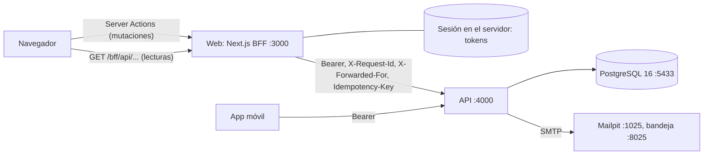

# TreoWallet

Billetera digital en pesos mexicanos (MXN): registro con verificación de correo, cuentas con CLABE, beneficiarios, transferencias con OTP y límite diario, historial de movimientos, estado de cuenta en PDF y transferencias programadas. Tiene una API, un panel web y una app móvil. Es la prueba técnica de Treo para el rol fullstack con enfoque en backend.

[](https://github.com/DevChrisVaz/Treo_Wallet-Coding-Assignment/actions/workflows/api.yml)
[](https://github.com/DevChrisVaz/Treo_Wallet-Coding-Assignment/actions/workflows/web.yml)
[](https://github.com/DevChrisVaz/Treo_Wallet-Coding-Assignment/actions/workflows/mobile.yml)
[](https://github.com/DevChrisVaz/Treo_Wallet-Coding-Assignment/actions/workflows/contract.yml)
[](https://github.com/DevChrisVaz/Treo_Wallet-Coding-Assignment/actions/workflows/design-tokens.yml)
[](https://github.com/DevChrisVaz/Treo_Wallet-Coding-Assignment/actions/workflows/infrastructure.yml)

Este README reúne la información de los cinco proyectos. Cada proyecto conserva su propio `README.md` porque se separará en un repositorio propio.

**Alcance.** Se aceptó a propósito exceder las 10 a 14 horas que estima el enunciado, para conservar el alcance completo: verificación de correo, límite diario restante, BFF, validación de CURP, RFC y teléfono, y tres bonus. La decisión y su razón están en la bitácora de AI ([`docs/ai-log.md`](docs/ai-log.md)).

## Contenido

1. [Qué incluye](#qué-incluye)
2. [Estructura del repositorio](#estructura-del-repositorio)
3. [Arquitectura](#arquitectura)
4. [Requisitos](#requisitos)
5. [Instalación](#instalación)
6. [Configuración](#configuración)
7. [Ejecución en local](#ejecución-en-local)
8. [Pruebas](#pruebas)
9. [Scripts](#scripts)
10. [Cómo funciona](#cómo-funciona)
11. [Verificaciones manuales](#verificaciones-manuales)
12. [Especificación y bitácora de AI](#especificación-y-bitácora-de-ai)
13. [Entregables del enunciado](#entregables-del-enunciado)
14. [Avisos conocidos](#avisos-conocidos)
15. [¿Qué haría con más tiempo?](#qué-haría-con-más-tiempo)

## Qué incluye

**Del enunciado:**

- Registro con CURP, RFC y teléfono (nombre de al menos dos palabras, contraseña de 12 caracteres con letra y dígito, mayoría de edad por la CURP y RFC que coincide con ella), verificación del correo con un código de 6 dígitos e inicio de sesión con refresh token rotativo.
- Dos cuentas por usuario ("Principal" y "Ahorro") con CLABE, saldo y el límite diario que queda.
- Beneficiarios dados de alta por CLABE de la plataforma.
- Transferencias a una cuenta propia o a un beneficiario:
  - idempotentes, con una llave por intento;
  - con OTP por correo arriba de $10,000.00;
  - con límite diario de $50,000.00 a terceros, por día de la Ciudad de México;
  - sobre un ledger de partida doble.
- Historial de movimientos con filtros por fecha y tipo y paginación por cursor, sobre más de 100,000 asientos de datos de desarrollo.
- Bitácora de auditoría inmutable.
- Web con todo lo anterior. App móvil con inicio de sesión, saldos, últimos 20 movimientos y transferencias a beneficiarios.

**Bonus:**

- **Estado de cuenta mensual en PDF**, conciliado con el ledger y descargable desde la web, desde el mes en que se abrió la cuenta.
- **Transferencias programadas** con fecha y hora futuras: cancelación, tope de 20 por usuario y un ejecutor dentro de la API que ejecuta cada una exactamente una vez.
- **Desbloqueo biométrico** en la app móvil, con huella en Android en Expo Go.

## Estructura del repositorio

Son cinco proyectos independientes en un solo repositorio. **No es un monorepo:** no hay workspaces, cada proyecto tiene su propio lockfile y su propio CI, y ninguno importa código de otro salvo los dos paquetes compartidos, que se instalan como copia.

| Carpeta                            | Proyecto                            | Qué es                                                                                                                                                                                  |
| ---------------------------------- | ----------------------------------- | --------------------------------------------------------------------------------------------------------------------------------------------------------------------------------------- |
| [`contract/`](contract/)           | `@devchrisvaz/wallet-contract`      | Contrato OpenAPI 3.1 (`openapi.yaml`, fuente de verdad, contrato primero), tipos generados, cliente HTTP tipado, validadores Zod, formato de montos y calendario de la Ciudad de México |
| [`design-tokens/`](design-tokens/) | `@devchrisvaz/wallet-design-tokens` | Sistema de diseño de TreoWallet: tokens, salidas para Tailwind v4 y React Native, estados, movimientos y textos de la interfaz                                                          |
| [`api/`](api/)                     | API                                 | Express 5, TypeScript estricto, PostgreSQL 16 con TypeORM y migraciones con SQL explícito                                                                                               |
| [`web/`](web/)                     | Web                                 | Next.js (App Router) como BFF de la API, con TanStack Query y Server Actions                                                                                                            |
| [`mobile/`](mobile/)               | App móvil                           | Expo SDK 57, React Native y Expo Router                                                                                                                                                 |
| [`infrastructure/`](infrastructure/README.md) | Infraestructura en AWS | Terraform de la propuesta de [`docs/aws-deploy.md`](docs/aws-deploy.md): un módulo raíz para dev, staging y prod, con pruebas que corren sin credenciales. No se ha aplicado en una cuenta real |
| [`openspec/`](openspec/)           | Especificación                      | Changes de OpenSpec: propuesta, requisitos, diseño y tareas de cada parte                                                                                                               |
| [`docs/`](docs/)                   | Documentación                       | Bitácora de AI, [propuesta de AWS](docs/aws-deploy.md), [matriz de trazabilidad](docs/traceability.md) |
| [`scripts/`](scripts/)             | Herramientas del repositorio        | `trace.sh`, que genera la matriz de trazabilidad (`scripts/trace.sh --check` falla si hay huecos) |

**Desviaciones del enunciado:**

- **Sin carpeta `/specs`:** la especificación vive en `openspec/` con su estructura nativa. Ver [Especificación y bitácora de AI](#especificación-y-bitácora-de-ai).
- **Sin monorepo:** cada proyecto se puede construir, probar y desplegar por su cuenta, y se separará en su propio repositorio.
- **La web no es un sitio estático:** es un BFF que guarda la sesión en el servidor, ejecuta Server Actions y llama a la API con el access token. Por eso en AWS no aplica S3 + CloudFront, que sugiere el enunciado. Se planea Next.js en ECS Fargate detrás de CloudFront (`openspec/changes/delivery/design.md`, D3).

## Arquitectura



- **Web:** el navegador nunca recibe los tokens. La sesión vive en el servidor de la web y el navegador solo guarda una cookie con un id opaco.
- **App móvil:** habla directamente con la API, con el refresh token en el almacenamiento seguro del sistema y el access token solo en memoria.
- **Contrato:** la API, la web y la app comparten `openapi.yaml` por medio del paquete del contrato.

## Requisitos

- **Node.js 24** para las herramientas de todos los proyectos; el CI usa Node 24.
  - La API compilada corre en Node ≥ 20.
  - El servidor de la web, desde Node 20.9.
  - Los paquetes compartidos, desde Node 20; su CI lo comprueba en 20, 22 y 24.
- **Docker** con Compose, para PostgreSQL 16 y Mailpit (`/api`) y para Redis 7, el de las sesiones de la web (`/web`).
- `psql` es opcional: si no está instalado, `db:bootstrap` usa el de la imagen de PostgreSQL.
- **Para la app móvil**, una de estas opciones:
  - **Expo Go** compatible con el SDK 57, en un teléfono en la **misma red Wi-Fi** que la computadora;
  - un emulador de Android;
  - el simulador de iOS (solo macOS).
- `jq` y `uuidgen`, solo para los ejemplos con `curl`.

## Instalación

Desde la raíz del repositorio, en este orden. Los paquetes compartidos se compilan primero, porque los demás los instalan como copia de su `dist`.

```bash
# 1. Paquetes compartidos
(cd contract && npm ci && npm run build)
(cd design-tokens && npm ci && npm run build)

# 2. API
(cd api && npm ci && cp .env.example .env)          # valores SOLO de desarrollo

# 3. Web
(cd web && npm ci && cp .env.example .env.local)

# 4. App móvil
(cd mobile && npm ci && cp .env.example .env)       # después ajusta EXPO_PUBLIC_API_URL
```

### Paquetes locales como copia (`install-links`)

La API, la web y la app declaran `"@devchrisvaz/wallet-contract": "file:../contract"` y `"@devchrisvaz/wallet-design-tokens": "file:../design-tokens"`, y su `.npmrc` fija `install-links=true`. Con eso, npm instala cada paquete como una copia de lo que publica (su `dist`) y con sus dependencias, igual que si viniera de un registro. Sin `install-links`, npm crearía un enlace simbólico y no instalaría las dependencias del paquete, porque la carpeta queda fuera del proyecto. No hace falta token ni registro.

Consecuencias:

- **Un cambio no llega solo.** Al cambiar el contrato o los tokens, hay que volver a compilar el paquete y correr `npm install` en cada consumidor. Para que el lockfile registre la versión nueva, se nombra el paquete: `npm install @devchrisvaz/wallet-contract@file:../contract`.
- **`npm ci` copia lo que haya en la carpeta**, sin importar la versión que diga el lockfile. Un cambio del contrato que agrega campos obligatorios a una respuesta, o valores a un enum que los clientes recorren de forma exhaustiva, llega a todos los consumidores a la vez. Por eso se integra en la rama principal junto con la adaptación de todos ellos.
- **`zod` es `peerDependency` del contrato:** una sola versión mayor de Zod en todo el proyecto.

Al separar los repositorios, el contrato y los tokens se publicarán en GitHub Packages ([Publicación al separar los repositorios](#publicación-al-separar-los-repositorios)).

## Configuración

### API (`api/.env`)

`.env.example` trae valores solo de desarrollo; en AWS vendrían de Secrets Manager y de las variables de la tarea. La API valida la configuración al arrancar y se niega a correr si `DATABASE_URL` usa el dueño del esquema o un superusuario.

| Variables                                                                                         | Para qué                                                                                                                         |
| ------------------------------------------------------------------------------------------------- | -------------------------------------------------------------------------------------------------------------------------------- |
| `HOST`, `PORT`                                                                                    | `0.0.0.0:4000`, para que la app móvil alcance la API por la red local                                                            |
| `DATABASE_URL`                                                                                    | Rol de ejecución `wallet_app`, con privilegio mínimo                                                                             |
| `MIGRATION_DATABASE_URL`                                                                          | Rol dueño `wallet_migrator`: migraciones y seed                                                                                  |
| `BOOTSTRAP_DATABASE_URL`, `WALLET_MIGRATOR_PASSWORD`, `WALLET_APP_PASSWORD`                       | Superusuario y contraseñas de los roles, solo para `db:bootstrap`                                                                |
| `TEST_DATABASE_URL`, `TEST_MIGRATION_DATABASE_URL`                                                | Base `wallet_test` de las pruebas de integración                                                                                 |
| `JWT_SECRET`, `JWT_ISSUER`, `JWT_AUDIENCE`, `OTP_HMAC_SECRET`, `CURSOR_SIGNING_SECRET`            | Secretos en base64 de 32 bytes o más (`openssl rand -base64 32`)                                                                 |
| `CLABE_BANK_CODE`, `CLABE_PLAZA_CODE`                                                             | CLABE de las cuentas: banco `999` (ninguna institución del catálogo del SPEI de Banxico, verificado el 2026-10-13) y plaza `180` |
| `SMTP_HOST`, `SMTP_PORT`, `SMTP_FROM`                                                             | Mailpit en local. `SMTP_USER` y `SMTP_PASSWORD` solo hacen falta con un servidor que pida autenticación, como Amazon SES         |
| `TRUSTED_PROXIES`                                                                                 | Proxies cuyo `X-Forwarded-For` se respeta (`loopback` en local, donde el BFF corre en la misma máquina)                          |
| `DAILY_TRANSFER_LIMIT`, `OTP_THRESHOLD`, `OTP_TTL_SECONDS`, `OTP_MAX_ATTEMPTS`, `OTP_MAX_RESENDS` | 50,000.00, 10,000.00, 300 s, 3 intentos y 3 reenvíos                                                                             |
| `SCHEDULER_ENABLED`, `SCHEDULER_INTERVAL_MS`, `SCHEDULER_BATCH_SIZE`                              | Ejecutor de transferencias programadas ([El ejecutor](#el-ejecutor))                                                             |

### Web (`web/.env.local`)

Todas las variables son del servidor (ninguna lleva `NEXT_PUBLIC_`) y se validan con Zod al arrancar: una inválida detiene `next dev` o `next start` con un error que la nombra.

| Variable                | Por defecto                                                            | Uso                                                                                                                                                                           |
| ----------------------- | ---------------------------------------------------------------------- | ----------------------------------------------------------------------------------------------------------------------------------------------------------------------------- |
| `API_BASE_URL`          | `http://localhost:4000` en desarrollo; **obligatoria** en `next start` | Origen de la API, sin ruta. Es el destino de todas las llamadas y nunca se toma de la petición. El build (`next build`) no la necesita: el servidor la lee en cada petición   |
| `ALLOWED_ORIGINS`       | Vacío (solo el propio origen)                                          | Orígenes adicionales, separados por comas, desde los que se aceptan Server Actions (la web detrás de un proxy con otro dominio). Se aplica al arrancar                        |
| `SESSION_COOKIE_SECURE` | `true` en producción, `false` en desarrollo                            | Con `true` (detrás de HTTPS), la cookie se llama `__Host-sid` y lleva `Secure`. Safari rechaza cookies `Secure` en `http://localhost`, por eso en local es `sid` sin `Secure` |
| `SESSION_IDLE_MINUTES`  | `15`                                                                   | Minutos de inactividad tras los que expira la sesión                                                                                                                          |
| `REDIS_URL`             | Vacía (sesiones en memoria)                                            | `redis://` o `rediss://` (TLS) del Redis de sesiones; en local, `redis://localhost:6379`. Con ella las sesiones sobreviven al reinicio del servidor                           |

### App móvil (`mobile/.env`)

La app lee la URL base de `EXPO_PUBLIC_API_URL`, que Expo incorpora al bundle, sin cambios de código:

| Dónde corre la app     | `EXPO_PUBLIC_API_URL`                                                      |
| ---------------------- | -------------------------------------------------------------------------- |
| Expo Go en un teléfono | `http://<IP de tu red local>:4000`, por ejemplo `http://192.168.1.50:4000` |
| Emulador de Android    | `http://10.0.2.2:4000`                                                     |
| Simulador de iOS       | `http://localhost:4000`                                                    |

Para conocer la IP de tu red local: `ipconfig getifaddr en0` (macOS), `hostname -I` (Linux) o `ipconfig` (Windows). Si la variable falta o no es una URL `http(s)`, la app muestra una pantalla de configuración que lo explica en lugar de fallar en silencio. Después de cambiar `.env`, reinicia Expo con `npx expo start --clear`.

> En local la app usa HTTP sin TLS hacia la IP de tu equipo; es solo para desarrollo. En producción la URL es HTTPS.

## Ejecución en local

### 1. Base de datos, correo y API

```bash
cd api

# PostgreSQL (puerto 5433 del host) y Mailpit (SMTP 1025, bandeja 8025, guardada en el volumen `mailpit-data`)
docker compose up -d --wait

# Roles, bases y esquema (superusuario, idempotente)
npm run db:bootstrap

# Esquema y datos de desarrollo (~120k asientos; unos 11 s en local)
npm run db:migrate
npm run db:seed

# API en http://localhost:4000 (escucha en 0.0.0.0 para la app móvil)
npm run dev
```

| URL                                | Qué es                                                                      |
| ---------------------------------- | --------------------------------------------------------------------------- |
| http://localhost:4000/health       | Salud del servicio                                                          |
| http://localhost:4000/docs         | Swagger UI del contrato (fuera de producción)                               |
| http://localhost:4000/openapi.yaml | El contrato tal cual (fuera de producción)                                  |
| http://localhost:8025              | Bandeja de Mailpit: códigos de verificación, OTP de transferencias y avisos |

Una base creada antes de los bonus y de `ux-fixes` necesita `npm run db:migrate` para recibir sus migraciones (estado de cuenta, transferencias programadas, referencia opcional y programadas con hora).

La bandeja de Mailpit se guarda en un volumen de Docker (`mailpit-data`): los correos sobreviven a `docker compose down` y a recrear el contenedor. Para vaciarla, `docker compose down -v` (borra también la base de PostgreSQL, así que hay que repetir `db:bootstrap`, `db:migrate` y `db:seed`).

### 2. Web

```bash
cd web

# Redis para las sesiones (127.0.0.1:6379); con REDIS_URL en .env.local sobreviven al reinicio
docker compose up -d --wait

npm run dev        # http://localhost:3000; si el puerto está ocupado: npm run dev -- -p 3100
```

1. Regístrate en `/register`; el código de verificación llega a Mailpit. Al verificar el correo se abren las cuentas Principal y Ahorro en $0.00; para tener saldo, usa el fondeo (`db:fund`). También puedes entrar con un usuario del seed.
2. Las transferencias de más de $10,000.00 piden un código que también llega a Mailpit.
3. Para programar una transferencia, elige "Programar" en "Cuándo", en el paso del monto, y una fecha y una hora (de la Ciudad de México, con al menos 10 minutos de anticipación y hasta 90 días). Aparece en "Programadas" (en la navegación lateral desde 1024 px; en teléfono, "Transferencias programadas" al pie del primer paso de Transferir) hasta que se ejecuta o la cancelas. Para verla ejecutarse sin esperar a su hora, sigue [Verlas ejecutarse en local](#verlas-ejecutarse-en-local). Al ejecutarse, sale de "Programadas" y aparece en el historial; si falla, el aviso llega a Mailpit.
4. El estado de cuenta se descarga desde la tarjeta "Estado de cuenta" de Movimientos, después del historial de cada cuenta, y ofrece los meses desde que se abrió la cuenta hasta el mes en curso.
5. "Recibir", en Inicio, muestra los datos para que te transfieran (Titular, Banco, Cuenta y la CLABE completa, con "Copiar CLABE"); las tarjetas de cuenta solo muestran los últimos 4 dígitos.
6. Con la ventana a menos de 1024 px de ancho (o en el teléfono), la web toma la forma de la app móvil, con la barra de pestañas abajo; desde 1024 px es el dashboard con la navegación lateral.

**Build de producción por `http` en local:** `npm run build` y luego `API_BASE_URL=http://localhost:4000 SESSION_COOKIE_SECURE=false REDIS_URL=redis://localhost:6379 npm start`.

**Dónde vive la sesión:** con `REDIS_URL`, en Redis, y sobrevive al reinicio del servidor (un `next build` + `next start`, un cambio de `.env.local`). Sin `REDIS_URL`, en la memoria del proceso, y reiniciar el servidor cierra todas las sesiones. Si Redis no está levantado, las páginas con sesión responden con error sin cerrar la sesión: levántalo o quita `REDIS_URL`.

### 3. App móvil

```bash
cd mobile
npx expo start          # escanea el QR con Expo Go (Android) o con la cámara (iOS)
npm run android         # emulador de Android
npm run ios             # simulador de iOS (macOS)
```

En Linux, si Expo anuncia una IP que el teléfono no alcanza, fíjala con `REACT_NATIVE_PACKAGER_HOSTNAME=<IP de tu red local> npx expo start`. El registro, la verificación del correo y el alta de beneficiarios se hacen en la web. Después de un `npm install` que cambie el paquete de diseño o el contrato, reinicia Expo con `npx expo start --clear`, para que Metro no sirva la copia anterior.

### Usuarios de prueba

| Usuario               | Email                                             | Contraseña           |
| --------------------- | ------------------------------------------------- | -------------------- |
| Ana Gómez Cruz        | `ana@example.com`                                 | `Ana-demo-2026!`     |
| Luis Pérez López      | `luis@example.com`                                | `Luis-demo-2026!`    |
| 50 usuarios generados | `usuario01@example.com` … `usuario50@example.com` | `Demo-usuario-2026!` |

Todos están verificados y tienen sus cuentas "Principal" y "Ahorro". Sus CURP, RFC y teléfonos son sintéticos: válidos en estructura y dígito verificador, pero no corresponden a personas reales. Ana ya tiene a Luis (alias "Luis") y a otros nueve usuarios como beneficiarios, y su "Principal" tiene unos 60,000 movimientos de los últimos 12 meses. El inicio de sesión admite 5 intentos por correo e IP (y 20 por IP) cada 15 minutos; después responde `429` con `Retry-After`, sin bloquear la cuenta.

### Códigos por correo

- **Registro:** `POST /auth/register` responde 202 exista o no el correo; si la CURP, el RFC o el teléfono ya son de otro usuario, responde 422 en ese campo y no envía correo. El código de 6 dígitos llega a Mailpit y se confirma con `POST /auth/verify-email`, que devuelve la sesión y abre las dos cuentas.
- **OTP de transferencias** (mayores a $10,000.00): llega a Mailpit, vence en 5 minutos y se puede reenviar hasta 3 veces desde la web o la app.

### Fondear una cuenta

```bash
cd api
npm run db:fund -- --account <id o CLABE> --amount 1000.00
```

Es la única forma de meter dinero: no hay endpoint que lo cree. Valida el monto con las mismas reglas que la API antes de conectarse, usa el rol de la aplicación y registra `FUNDING_POSTED` con actor `SYSTEM`.

## Pruebas

| Proyecto        | Comando                    | Qué cubre                                                                            |
| --------------- | -------------------------- | ------------------------------------------------------------------------------------ |
| `contract`      | `npm test`                 | Pruebas unitarias, de vectores y de paridad con el contrato                          |
| `design-tokens` | `npm test`                 | Tokens, contraste WCAG, escala, convenciones, textos, CSS y referencia visual al día |
| `api`           | `npm test`                 | Unitarias e integración contra PostgreSQL real y Mailpit                             |
| `api`           | `npm run test:unit`        | Solo unitarias, sin base de datos                                                    |
| `api`           | `npm run test:integration` | Solo integración (`wallet_test`)                                                     |
| `web`           | `npm test`                 | Vitest: BFF, configuración y lógica en Node, y pantallas en jsdom                    |
| `web`           | `npm run test:e2e`         | Playwright en Chromium contra una API simulada: layout, teclado, hojas y axe         |
| `mobile`        | `npm test`                 | jest-expo y Testing Library                                                          |

En todos los proyectos, el título de cada prueba empieza con el ID del requisito que verifica, por ejemplo `TRF-03 …`, `WEB-17 …` o `MOB-25 …`.

### API

- **Requisitos:** las pruebas de integración necesitan `docker compose up -d` y `npm run db:bootstrap`. El global setup aplica las migraciones en `wallet_test` con el rol dueño.
- **Conexiones:** el código bajo prueba usa `wallet_app`, y el arnés reinicia los datos antes de cada prueba con la conexión del dueño. Los archivos de integración corren uno a la vez, porque comparten la base.
- **Contrato:** cada respuesta HTTP se valida contra `openapi.yaml` con Ajv (`expectToMatchContract`).
- **Concurrencia** (`test/integration/concurrency/`):
  - 10 peticiones simultáneas con la misma llave de idempotencia;
  - 100 transferencias simultáneas desde una cuenta;
  - transferencias cruzadas sin deadlocks;
  - el límite diario desde dos cuentas a la vez;
  - dos ejecutores de programadas sobre 50 vencidas;
  - el ejecutor contra transferencias manuales;
  - las carreras entre cancelación y ejecución;
  - el tope de programadas con peticiones simultáneas.
- **Estado de cuenta:** las pruebas leen el texto del PDF generado (con `unpdf`) y hay una prueba de rendimiento con 5,000 movimientos.

### Web

- **Sin la API:** ninguna prueba la necesita. El BFF se prueba con `fetch` simulado (`test/support/fake-api.ts`) y sustitutos de `next/headers`, y las pantallas con el módulo de acciones y las lecturas simulados.
- **Dos proyectos de Vitest:**
  - `*.test.ts` corre en Node (BFF, configuración y lógica);
  - `*.test.tsx` corre en jsdom, con Testing Library y `vitest-axe`.
- **Sesiones en Redis:** `lib/server/redis-session-store.test.ts` y `app/(app)/layout.redis.test.ts` corren contra un Redis real con `TEST_REDIS_URL=redis://localhost:6379/15 npm test` (después de `docker compose up -d --wait` en `/web`).
  - Sin la variable se saltan, salvo en CI, donde es obligatoria y la da un servicio Redis del job. No puede ser la base 0, la de las sesiones de desarrollo.
  - La implementación en memoria y la de Redis pasan la misma suite de WEB-03 (`test/support/session-store-contract.ts`); en Redis, con tiempo real y un plazo de 1 s.
  - Las demás pruebas usan el almacén en memoria aunque el entorno traiga `REDIS_URL`.
- **Contraste:** no se puede medir en jsdom; se verificó con Lighthouse ([Verificaciones manuales](#verificaciones-manuales)) y, desde el rediseño, lo mide axe en las pruebas en navegador.
- **Programadas:** sus pruebas usan un reloj fijo, el 14 de octubre de 2026 a mediodía de la Ciudad de México, con `vi.useFakeTimers({ toFake: ['Date'] })`. Solo se falsea `Date`, así que user-event sigue funcionando. La fecha en palabras se prueba también con `TZ` al oeste y al este de UTC.
- **Doble clic:** `user.dblClick` no basta para probar el candado del envío, porque user-event envuelve cada evento en `act` y React deshabilita el botón entre los dos clics. Por eso las pruebas del candado hacen los dos clics dentro de un mismo `act`.
- **Diálogo de cancelación:** no usa `<dialog>` nativo porque jsdom no implementa `showModal()`. Sigue el patrón modal de WAI-ARIA (`role="dialog"`, `aria-modal`, foco atrapado y Escape), que sí se puede probar con el teclado en jsdom.
- **Pruebas en navegador** (`npm run test:e2e`, Playwright 1.61.1, `web/e2e/`): lo que jsdom no puede medir. La configuración levanta `e2e/fake-api.mjs` en `127.0.0.1:4999`, una API simulada con los datos canónicos de las historias del rediseño, y `next dev` en `127.0.0.1:3101` apuntando a ella; no usa la API real ni los puertos 3000 y 4000. La primera vez, si falta el navegador, `npx playwright install chromium`; si Turbopack se detiene con "OS file watch limit reached", libera observadores de archivos (inotify) o sube `fs.inotify.max_user_watches`. El CI de la web las corre después del build (`npx playwright install --with-deps chromium` y `npm run test:e2e`).
  - **Layout:** sin desplazamiento horizontal de 320 a 1920 px (también con barras de desplazamiento clásicas), un solo `h1` visible por pantalla, las dos formas y el texto al 200 %.
  - **Teclado:** la transferencia hasta el comprobante solo con el teclado, a 390 y a 1280 px.
  - **Hojas y diálogos:** foco atrapado, Escape y foco de regreso.
  - **Accesibilidad:** axe con el CSS real, incluido el contraste, en cada pantalla y con las hojas abiertas.

### App móvil

- **Sin API real:** las pruebas simulan `fetch`, `expo-secure-store`, NetInfo, `expo-local-authentication` y `AppState`.
- **Jest:** mapea el contrato a su salida ESM, la misma que usa Metro.
- **Bundle sin dispositivo:** `npx expo export --platform android` corre Metro y compila el bundle a Hermes; así se comprueba que Metro resuelve los paquetes locales.

### Contrato y sistema de diseño

- **Vectores del contrato:** `test/vectors/` es la especificación ejecutable de los validadores. Los dígitos verificadores se calcularon a mano, y las CURP y RFC son sintéticas.
- **Paridad:** la prueba pasa cada vector por el esquema del yaml (Ajv) y por el validador del paquete.
- **Verificaciones extra de ambos paquetes:**
  - las rutas del paquete existen después del build;
  - el build no importa módulos de Node, así que funciona en Hermes;
  - prueba de humo con `import` y `require`;
  - un consumidor nuevo lo instala como copia.

### Integración continua

Hay un workflow por proyecto en `.github/workflows/`: `api`, `web`, `mobile`, `contract`, `design-tokens` e `infrastructure`. Cada uno corre en los pushes a `release`, la rama principal, y en los pull requests que tocan su carpeta.

- **Paquetes compartidos:** los workflows de la API, la web y la app también corren cuando cambian `contract/**` o `design-tokens/**`, porque instalan esos paquetes como copia.
- **Pasos:** lint, typecheck, formato y pruebas.
- **API:** además levanta PostgreSQL y Mailpit como servicios del CI.
- **Paquetes:** además verifican los tipos o las salidas generadas, las rutas, la compatibilidad con Hermes, la instalación como copia y una prueba de humo en Node 20, 22 y 24.
- **Infraestructura:** `terraform fmt`, `validate` y `terraform test` con proveedores simulados para cada ambiente, sin credenciales de AWS ([detalle](infrastructure/README.md#verificar-sin-una-cuenta-de-aws)).

## Scripts

### API

| Script                                  | Qué hace                                                                                                                                                                                                                      |
| --------------------------------------- | ----------------------------------------------------------------------------------------------------------------------------------------------------------------------------------------------------------------------------- |
| `dev`                                   | API con recarga (tsx) leyendo `.env`                                                                                                                                                                                          |
| `build` / `start`                       | Compila a `dist/` y lo ejecuta con Node                                                                                                                                                                                       |
| `db:bootstrap`                          | `db/bootstrap.sql` con psql como superusuario (`BOOTSTRAP_DATABASE_URL`): roles `wallet_migrator` y `wallet_app`, bases `wallet` y `wallet_test`, esquema `app`. Las contraseñas de los roles llegan por variables de entorno |
| `db:migrate`                            | Aplica migraciones pendientes con el rol dueño (`MIGRATION_DATABASE_URL`)                                                                                                                                                     |
| `db:revert`                             | Revierte la última migración; `npm run db:revert -- --all` revierte todas                                                                                                                                                     |
| `db:seed`                               | Datos de desarrollo con volumen. Es idempotente y termina verificando las invariantes del ledger                                                                                                                              |
| `db:fund`                               | Fondea una cuenta desde la Tesorería                                                                                                                                                                                          |
| `lint`, `typecheck`, `format:check`     | ESLint (incluye la regla de capas), TypeScript y Prettier                                                                                                                                                                     |
| `test`, `test:unit`, `test:integration` | Vitest                                                                                                                                                                                                                        |

### Web

| Script                    | Qué hace                                                                                      |
| ------------------------- | --------------------------------------------------------------------------------------------- |
| `dev`                     | Servidor de desarrollo                                                                        |
| `build` / `start`         | Build de producción y servidor                                                                |
| `test`                    | Vitest (`test:watch` en modo observación)                                                     |
| `test:e2e`                | Playwright en Chromium contra la API simulada de `e2e/fake-api.mjs`                           |
| `typecheck`               | `next typegen` y `tsc --noEmit`                                                               |
| `lint`                    | ESLint sin advertencias permitidas; incluye la regla que prohíbe `parseFloat` y `Number(...)` |
| `format` / `format:check` | Prettier                                                                                      |

### App móvil

| Script         | Qué hace                                                                            |
| -------------- | ----------------------------------------------------------------------------------- |
| `start`        | Servidor de desarrollo de Expo (`android` e `ios` abren el emulador o el simulador) |
| `test`         | jest-expo y Testing Library                                                         |
| `typecheck`    | `tsc --noEmit`                                                                      |
| `lint`         | ESLint (`eslint-config-expo`), incluida la regla que prohíbe AsyncStorage           |
| `format:check` | Prettier                                                                            |

### Contrato

| Script                              | Qué verifica                                                                                 |
| ----------------------------------- | -------------------------------------------------------------------------------------------- |
| `build`                             | `dist/`: ESM, CommonJS y declaraciones                                                       |
| `lint:contract`                     | Lint de `openapi.yaml` con Redocly (excepciones justificadas en `.redocly.lint-ignore.yaml`) |
| `generate`                          | Regenera `src/generated/api.d.ts`; el CI falla si el resultado difiere del versionado        |
| `typecheck`, `lint`, `format:check` | TypeScript estricto, ESLint y Prettier                                                       |
| `check:version`                     | `version` del paquete igual a `info.version` del contrato                                    |
| `check:exports`                     | Cada ruta de `main`, `module`, `types` y `exports` existe después del build                  |
| `check:no-node-imports`             | El build no importa módulos internos de Node (debe funcionar en Hermes)                      |
| `smoke`                             | El paquete construido funciona con `import` y con `require`                                  |
| `verify:install`                    | Un consumidor nuevo lo instala como copia, sin credenciales y con sus dependencias           |

**Ciclo al cambiar el contrato:** editar `openapi.yaml` → `npm run generate` → ajustar validadores y vectores → `npm test` → `npm run build` → en cada consumidor, `npm install` para recibir la copia nueva.

### Sistema de diseño

| Script                                                              | Qué hace                                                                                                                               |
| ------------------------------------------------------------------- | -------------------------------------------------------------------------------------------------------------------------------------- |
| `test`                                                              | Tokens, contraste WCAG, escala, convenciones, textos, CSS y referencia visual al día                                                   |
| `generate`                                                          | Construye y regenera `generated/tokens.css`, `generated/tailwind.css` y `preview/index.html`; el CI falla si difieren de lo versionado |
| `build`                                                             | `dist/`: ESM, CommonJS y tipos para `.` y `./native`                                                                                   |
| `check:exports`, `check:no-node-imports`, `smoke`, `verify:install` | Rutas del paquete, compatibilidad con Hermes, `import`/`require` e instalación como copia                                              |

## Cómo funciona

### API

Backend de la billetera:

- **Identidad:** registro con verificación por correo y sesiones con refresh token rotativo.
- **Cuentas y beneficiarios:** cuentas con CLABE y beneficiarios dados de alta por CLABE.
- **Transferencias:** ledger de partida doble con idempotencia, límite diario y OTP por correo; también programadas con fecha y hora futuras.
- **Consultas:** historial con paginación por cursor y estado de cuenta mensual en PDF.
- **Auditoría:** bitácora inmutable.

El stack es Express 5 con TypeScript estricto y PostgreSQL 16 con TypeORM: sin `synchronize`, con migraciones de SQL explícito.

#### Estructura por capas

```
src/
  modules/
    identity/      domain (CURP, RFC, teléfono) · application (casos de uso y puertos) · infrastructure (PostgreSQL, argon2, JWT, rutas)
    accounts/      domain (CLABE) · application (apertura de cuentas) · infrastructure
    audit/         domain (catálogo de eventos) · application (puerto) · infrastructure (escritor en PostgreSQL)
    beneficiaries/ alta por CLABE de la plataforma y listado
    transfers/     domain (ledger, máquina de estados, huella, rango programable, regla de saldo y límite) · application (creación, OTP, confirmación, programadas: ejecutor, cancelación y lista; fondeo) · infrastructure
    movements/     historial: filtros, cursor firmado y consulta keyset
    statements/    estado de cuenta: periodo y resumen (dominio), caso de uso, lector con instantánea y PDF
  platform/        config, contexto de petición, http (app, errores RFC 9457, validación, auth, rate limit, docs), logging, mail, persistencia, trabajo periódico y apagado ordenado
  shared/          núcleo sin dependencias: errores de dominio, Clock, transacción opaca, enmascarado
  seed/            datos de desarrollo (usuarios, beneficiarios, fondeo y volumen)
  composition.ts   raíz de composición con inyección manual
  main.ts          arranque del proceso, ejecutor de programadas y apagado ordenado
migrations/        migraciones TypeORM con SQL explícito (constraints, funciones, triggers y GRANTs)
db/                bootstrap.sql
test/              unit/, integration/, helpers/ (arnés, contrato, reloj falso, correo en memoria), vectors/
```

ESLint hace cumplir las reglas de capas:

- el dominio no importa Express, TypeORM ni adaptadores;
- la aplicación depende de puertos, no de infraestructura;
- los handlers HTTP solo validan, llaman al caso de uso y traducen el resultado.

**Errores:** siguen RFC 9457 (`application/problem+json`) con las extensiones `code` y `requestId`. Los clientes deciden por `code`.

#### Base de datos y privilegios

- **`wallet_migrator`** es dueño de las bases y del esquema `app`: ejecuta migraciones y seed.
- **`wallet_app`** es el rol de la API. No es dueño de nada, y cada migración le otorga solo lo necesario, tabla por tabla:
  - ninguna tabla le otorga `DELETE` ni `TRUNCATE`;
  - en `audit_log` solo tiene `INSERT`.
- **Nombres con prefijo:** toda constraint, índice y trigger tiene nombre con prefijo (`pk_`, `fk_`, `uq_`, `ck_`, `ix_`, `tg_`), y los errores de PostgreSQL se traducen por ese nombre.

#### Datos de desarrollo (`db:seed`)

`npm run db:seed` usa el rol dueño y es idempotente: correrlo otra vez no duplica nada. Crea:

1. Ana, Luis y 50 usuarios generados, verificados, con sus dos cuentas.
2. Beneficiarios: Luis y otros nueve para Ana; "Ana" para cada uno de los demás.
3. El fondeo inicial de cada "Principal" desde la Tesorería, con el mismo servicio que `db:fund` (evento `FUNDING_POSTED`): 10,000.00 para Ana y 600,000.00 para los demás.
4. 60,000 transferencias completadas (120,000 asientos), todas con un lado en la "Principal" de Ana, más 12 depósitos de nómina de la Tesorería.
   - **Fechas:** repartidas en los 12 meses que terminan **ayer a las 23:59 de la Ciudad de México**. Nada cae en el día actual, así que el límite diario de hoy está libre.
   - **Generación:** por tandas de 5,000 con `generate_series`, y el `balance_after` se calcula en staging con una función de ventana.
5. El ajuste de cada saldo al `balance_after` de su último asiento, `ANALYZE` y la verificación de invariantes:
   - al menos 100,000 asientos;
   - suma global cero;
   - ningún `balance_after` negativo en cuentas USER;
   - cadena de `balance_after` correcta;
   - saldos iguales al último asiento;
   - Tesorería igual al negativo de las cuentas USER;
   - ningún movimiento de hoy.

   Si algo falla, el comando termina con código 1.

**Tiempo medido en local** (PostgreSQL 16 en Docker, 2026-10-13): **10.7 s** la primera vez (120,128 asientos, 60,013 en la "Principal" de Ana) y 0.5 s las siguientes. Los planes `EXPLAIN ANALYZE` de las consultas del historial con este volumen están en `openspec/changes/archive/2026-10-14-api-ledger/design.md`.

#### Conciliación del ledger

Son las mismas consultas que usan las pruebas (`test/helpers/reconciliation.ts`) y la verificación del seed. Se corren con `psql` como `wallet_migrator`, sobre el esquema `app`:

```sql
-- 1. Saldo = suma de asientos, por cuenta (debe devolver 0 filas)
SELECT a.id FROM accounts a
LEFT JOIN ledger_entries e ON e.account_id = a.id
GROUP BY a.id, a.balance_cents
HAVING a.balance_cents <> COALESCE(SUM(e.amount_cents), 0);

-- 2. Suma global de asientos (debe ser 0)
SELECT COALESCE(SUM(amount_cents), 0) FROM ledger_entries;

-- 3. Cadena de balance_after (debe devolver 0 filas)
SELECT * FROM (
  SELECT id, account_id, balance_after_cents,
         SUM(amount_cents) OVER (PARTITION BY account_id ORDER BY created_at, id) AS running
    FROM ledger_entries) t
WHERE balance_after_cents <> running;

-- 4. Tesorería = negativo de la suma de las cuentas USER (debe ser 0)
SELECT (SELECT balance_cents FROM accounts WHERE type = 'SYSTEM')
     + (SELECT COALESCE(SUM(balance_cents), 0) FROM accounts WHERE type = 'USER');
```

La base también lo protege por su cuenta:

- **Suma cero:** un trigger diferido rechaza al hacer `COMMIT` cualquier transferencia cuyos asientos no sean exactamente dos que sumen cero.
- **Inmutabilidad:** los asientos no se pueden modificar ni borrar. `wallet_app` no tiene `UPDATE`, `DELETE` ni `TRUNCATE`, y un trigger lo impide incluso al dueño del esquema.

#### Estado de cuenta (bonus)

`GET /accounts/{accountId}/statements/{period}` (`getAccountStatement`) devuelve el PDF del mes `period` (`AAAA-MM`, mes calendario de la Ciudad de México) de una cuenta del usuario.

- **Respuesta:** `Content-Type: application/pdf`, `Content-Length`, `Cache-Control: no-store` y `Content-Disposition: attachment; filename="estado-de-cuenta-2026-09-0015.pdf"`, con el periodo y los últimos 4 dígitos de la CLABE.
- **Periodo:** de la medianoche de la Ciudad de México del día 1 a la del día 1 del mes siguiente. La conversión a UTC usa la base IANA, así que los meses con horario de verano (antes de 2023) quedan bien.
  - El mes en curso se entrega como parcial, hasta el momento de la generación.
  - Un mes futuro, un mes anterior al de apertura de la cuenta (`Account.createdAt`, en la Ciudad de México) o un periodo mal formado responde `422 VALIDATION_FAILED` en `/period`; los dos primeros con `DATE_OUT_OF_RANGE`. El mes de apertura sí se permite.
  - Una cuenta ajena o inexistente responde `404 NOT_FOUND`.
  - Un HEAD responde `405` sin generar nada.
- **Límite:** 10 por minuto por usuario (`429 RATE_LIMITED` con `Retry-After`).
- **Auditoría:** cada descarga registra `STATEMENT_EXPORTED` con el usuario, la cuenta y el periodo, sin CLABE, nombre ni montos.
  - Es la única lectura que se audita.
  - Si el evento no se puede escribir, la respuesta es 500 y el documento no sale.
  - Los rechazos no dejan evento.

Cómo se arma (`src/modules/statements/`):

1. **Instantánea:** el lector abre `BEGIN ISOLATION LEVEL REPEATABLE READ READ ONLY`. La cuenta, el titular, el saldo inicial y los movimientos salen de la misma instantánea, así que una transferencia que se completa mientras se genera el documento no aparece y el resumen cuadra.
2. **Lectura:**
   - el saldo inicial es el `balance_after` del último asiento anterior al periodo, o 0 si no hay;
   - los movimientos se leen en tandas ascendentes de 1,000 por keyset, con la misma proyección que el historial (contraparte, concepto, referencia).
3. **Conciliación:** mientras pasan las tandas se acumulan abonos y cargos en centavos con `BigInt`. Al final se verifica que saldo inicial + abonos − cargos sea igual al `balance_after` del último movimiento. Si no cuadra, la API responde 500 con un log ERROR de alerta y el documento no sale.
4. **PDF:** se genera en memoria con PDFKit, en tamaño carta y con Work Sans incrustada.
   - **Encabezado:** la marca, el titular, la cuenta, la CLABE completa, el periodo y la hora de generación.
   - **Resumen:** un recuadro con saldo inicial, abonos, cargos y saldo final.
   - **Tabla:** fecha y hora de la Ciudad de México, tipo (con las etiquetas del sistema de diseño), concepto, contraparte y referencia (solo si la hay, nunca "null"), cargo y abono en columnas separadas, y saldo.
   - **Páginas:** los encabezados de la tabla se repiten en cada una, con "Página X de Y" y la leyenda "Documento informativo; no es un comprobante fiscal.".
   - **Montos:** se escriben con `formatMXN` del contrato.

**Tipografía.** Work Sans Regular y SemiBold vienen del paquete `@fontsource/work-sans`, con licencia SIL Open Font License 1.1. Se usa el WOFF del subconjunto latino, que el renderizador convierte una vez a TrueType al arrancar. Así se evitan dos problemas: fontkit no recorta bien el WOFF2 de ese paquete, y con WOFF descomprimía las tablas en cada consulta (5,000 renglones tardaban 4.3 s solo en el PDF).

**Rendimiento medido en local** (Node 24, PostgreSQL 16 en Docker, 2026-10-14):

| Caso                                                                          | Movimientos | Tiempo                              | Tamaño              |
| ----------------------------------------------------------------------------- | ----------- | ----------------------------------- | ------------------- |
| Prueba automatizada (`statement-performance.test.ts`, petición HTTP completa) | 5,000       | 0.59 a 0.64 s                       | 409 KB, 162 páginas |
| Seed: septiembre de 2026 de la "Principal" de Ana (lector, resumen y PDF)     | 4,933       | 0.84 a 1.0 s (1.5 s la primera vez) | 620 KB              |

Para comprobar un estado de cuenta contra la base (con `psql` como `wallet_migrator`, esquema `app`), estas cifras en centavos deben coincidir con el resumen del documento:

```sql
-- La cuenta: "Principal" de Ana
SELECT a.id FROM accounts a JOIN users u ON u.id = a.user_id
 WHERE u.email = 'ana@example.com' AND a.name = 'Principal';

-- Resumen de septiembre de 2026 (mes de CDMX); :cuenta es el id anterior
WITH periodo AS (
  SELECT timestamp '2026-09-01 00:00' AT TIME ZONE 'America/Mexico_City' AS inicio,
         timestamp '2026-10-01 00:00' AT TIME ZONE 'America/Mexico_City' AS fin
), mes AS (
  SELECT e.* FROM ledger_entries e, periodo p
   WHERE e.account_id = :'cuenta' AND e.created_at >= p.inicio AND e.created_at < p.fin
)
SELECT
  COALESCE((SELECT e.balance_after_cents FROM ledger_entries e, periodo p
             WHERE e.account_id = :'cuenta' AND e.created_at < p.inicio
             ORDER BY e.created_at DESC, e.id DESC LIMIT 1), 0)              AS saldo_inicial,
  (SELECT COALESCE(SUM(amount_cents), 0) FROM mes WHERE amount_cents > 0)    AS abonos,
  (SELECT COALESCE(-SUM(amount_cents), 0) FROM mes WHERE amount_cents < 0)   AS cargos,
  (SELECT balance_after_cents FROM mes ORDER BY created_at DESC, id DESC LIMIT 1) AS saldo_final,
  (SELECT count(*) FROM mes)                                                  AS movimientos;
```

Para el mes en curso, `fin` es el momento de la generación. Sin movimientos en el mes, `saldo_final` sale nulo y el documento muestra el saldo inicial.

#### Transferencias programadas (bonus)

`POST /transfers` con `scheduledFor` programa la transferencia en lugar de ejecutarla. `scheduledFor` es un instante RFC 3339 con desfase (por ejemplo `2026-10-20T14:30:00-06:00` o `...Z`), con minutos exactos (segundos y fracción en cero), de 10 minutos a 90 días después del momento de la petición. La fecha y la hora se eligen en la web en hora de la Ciudad de México.

- **Hasta 10,000.00:** responde `201` con estado `SCHEDULED`, sin asientos y sin tocar saldo ni límite.
- **Arriba de 10,000.00:** responde `201` en `PENDING_OTP`, y el correo del código incluye la fecha y la hora ("Programada para el 20 de octubre de 2026, 14:30 (hora de la Ciudad de México)."). Al confirmar el código queda `SCHEDULED`, también sin mover dinero ni revalidar.
- **Validación al programar:**
  - el instante: `422 VALIDATION_FAILED` en `/scheduledFor`, con `DATE_OUT_OF_RANGE` si queda fuera de la ventana (a menos de 10 minutos o a más de 90 días) o `INVALID_FORMAT` si no es RFC 3339 con desfase, no existe o trae segundos;
  - las mismas reglas de propiedad, monto, concepto y referencia que una inmediata (la referencia es opcional: sin ella queda en `null`);
  - que una programada a un tercero no supere el límite diario (`TOO_LARGE` en `/amount`), porque nunca podría ejecutarse.

  El saldo y el límite **de hoy** no se validan: se validan al ejecutar.

- **Idempotencia:** el instante forma parte del contenido que se compara, así que reutilizar la llave con otro instante responde `IDEMPOTENCY_KEY_REUSED`.
  - El instante entra en la huella **solo cuando existe** y como instante ISO UTC (`...-06:00` y `...Z` equivalentes dan la misma huella), para que la huella de las inmediatas ya guardadas no cambie.
  - El instante y el monto se validan después de reclamar la llave. Así, un reintento que llega cuando el instante ya no está en la ventana se reconoce como reintento, en lugar de responder que ya no es programable.
  - Una petición nueva inválida revierte el reclamo, así que no consume la llave.
- **Tope:** 20 activas por usuario, contando las `SCHEDULED` y las programadas en `PENDING_OTP` vigentes. La número 21 responde `422 SCHEDULED_LIMIT_REACHED` sin guardarse ni consumir la llave.
- **Consultar:** `GET /transfers/scheduled` (`listScheduledTransfers`) devuelve las `SCHEDULED` del usuario, por instante y luego por creación.
- **Cancelar:** `POST /transfers/{transferId}/cancel` (`cancelTransfer`) pasa una `SCHEDULED` a `CANCELLED` con `cancelledAt`.
  - Cancelarla otra vez responde `200` sin cambios.
  - En cualquier otro estado responde `409 TRANSFER_NOT_CANCELLABLE` con `transferStatus`.
- **Antes de ejecutarse:** una programada no aparece en el historial ni consume límite. `GET /transfers/{transferId}` muestra `scheduledFor` en cualquier estado y `cancelledAt` en las canceladas.
- **Auditoría:**
  - con actor `USER`: `TRANSFER_CREATED` (con el estado inicial y el instante programado), `TRANSFER_SCHEDULED` al quedar programada (al crearla o al confirmar su código) y `TRANSFER_CANCELLED`;
  - con actor `SYSTEM`: la ejecución deja `TRANSFER_COMPLETED` o `TRANSFER_FAILED`, con el id del dueño en los metadatos.

##### El ejecutor

`ScheduledTransferRunner` (`src/modules/transfers/application/scheduled-transfer-runner.ts`) corre dentro de la API. `main.ts` lo programa con una pasada al arrancar y luego una por intervalo, **una a la vez por instancia**: si una pasada sigue en curso, la siguiente se omite.

| Variable                | Valor por defecto | Qué controla                                                                              |
| ----------------------- | ----------------- | ----------------------------------------------------------------------------------------- |
| `SCHEDULER_ENABLED`     | `true`            | `false` lo apaga (las pruebas llaman a `runOnce()` directamente)                          |
| `SCHEDULER_INTERVAL_MS` | `60000`           | Cada cuánto corre una pasada; de 1,000 a 3,600,000                                        |
| `SCHEDULER_BATCH_SIZE`  | `100`             | Candidatas por lote (1 a 1,000); si un lote viene lleno, la pasada sigue con el siguiente |

Una pasada lee sin bloqueo las `SCHEDULED` con `scheduled_for` menor o igual al instante actual, en orden de instante y creación (índice parcial `ix_transfers_scheduled_due`). Una programada vence en su minuto exacto, así que se ejecuta en la primera pasada posterior (como mucho `SCHEDULER_INTERVAL_MS` después). Después ejecuta cada una en su propia transacción:

1. **Contador:** si es a un tercero, crea y bloquea la fila contador del límite del usuario para el día de ahora.
2. **Transferencia:** la bloquea con `SELECT … WHERE id = $1 AND status = 'SCHEDULED' FOR NO KEY UPDATE SKIP LOCKED`. Si no devuelve fila, es que otra instancia o una cancelación la tiene, o que ya cambió de estado: se deja y se sigue.
3. **Cuentas:** las bloquea en orden de id. Toma la hora después de los bloqueos y, si ya cambió el día de la Ciudad de México, revierte y reintenta una vez, con el mismo mecanismo que una inmediata.
4. **Validación:** revisa saldo y límite **del día de ejecución** con el mismo servicio que la creación inmediata (`LockedTransferExecutor`).
   - Si pasa, queda `COMPLETED`: dos asientos, `completedAt` igual a la hora de ejecución y consumo del límite de ese día.
   - Si no, queda `FAILED` con `INSUFFICIENT_FUNDS` o `DAILY_LIMIT_EXCEEDED`.
5. **Aviso:** después del `COMMIT`, si quedó `FAILED`, envía al dueño "Tu transferencia programada no se realizó", con el monto, el destino (últimos 4 dígitos de la CLABE), la fecha y la hora programadas (de la Ciudad de México) y el motivo. Si el correo falla, queda un WARN con el `transferId`; la transferencia sigue `FAILED` y no se repite.

Casos especiales:

- **API caída a la hora programada:** una programada que vence mientras la API no corre se ejecuta en la siguiente pasada y consume el límite del día en que se ejecuta.
- **Error dentro de una transacción** (por ejemplo, en la auditoría): solo esa transferencia se revierte. Queda un ERROR con su id, la pasada sigue con las demás y esa se reintenta en la siguiente pasada.
- **`SIGTERM`:** el proceso deja de aceptar peticiones, detiene el ejecutor, espera la pasada en curso y solo entonces cierra el pool.

##### Concurrencia

Cada programada se ejecuta exactamente una vez, aunque corran varias instancias de la API. En AWS habría una por tarea de Fargate, y todas corren el ejecutor.

- **Orden global de bloqueos,** el mismo de las inmediatas: contador del usuario → transferencia → cuentas por id. Nadie toma un bloqueo "hacia atrás", así que no hay ciclos de espera.
- **`SKIP LOCKED` sobre la transferencia:** dos ejecutores no se esperan entre sí; se reparten el trabajo sin coordinarse.
- **Estado reverificado bajo bloqueo:** con `READ COMMITTED`, PostgreSQL vuelve a evaluar `status = 'SCHEDULED'` sobre la versión vigente de la fila, así que lo que otra instancia ya ejecutó o el usuario canceló se descarta.
  - La base es la red de seguridad: un segundo par de asientos choca con `uq_ledger_entries_transfer_account`, y ejecutar una cancelada choca con `ck_transfers_cancelled_at_by_status`.
- **Cancelación contra ejecución:** la cancelación bloquea solo la transferencia. Gana exactamente una:
  - si el ejecutor la tiene, la cancelación espera y responde `409` con `COMPLETED` o `FAILED`;
  - si la tiene la cancelación, el ejecutor la salta, y en la siguiente pasada ya no está `SCHEDULED`.
- **Tope por usuario:** programar bloquea la fila del usuario con `FOR NO KEY UPDATE`, que no choca con el `FOR KEY SHARE` de las llaves foráneas. Así, dos programaciones simultáneas hacen fila y la segunda cuenta la primera.

Lo demuestran las pruebas de `test/integration/concurrency/`: `scheduled-runners`, `cancel-race` y `scheduled-cap-race`. Como alternativa en AWS queda EventBridge Scheduler invocando `runOnce` cada minuto en una tarea aparte.

**Migraciones:**

- el `down` de `1760700000000-scheduled-transfers` se niega mientras exista alguna transferencia programada (pendiente, ejecutada o cancelada), para no borrar sus fechas;
- `1760800000000-optional-transfer-reference` hace que `reference` admita `NULL` (los fondeos de la Tesorería pasan a `NULL`); su `down` pierde la distinción entre la referencia 0 y ninguna;
- `1760800001000-scheduled-for-instant` pasa `scheduled_for` de `date` a `timestamptz` y agrega `ck_transfers_scheduled_for_minute`. Las filas existentes quedan a las 09:00 de la Ciudad de México de su día. Su `down` vuelve a `date` y **pierde la hora**.

##### Verlas ejecutarse en local

Una programada vence en su minuto exacto y el ejecutor corre cada 60 s por omisión (`SCHEDULER_INTERVAL_MS=60000`), así que se ejecuta como mucho un minuto después. Para no esperar, se adelanta su instante en la base:

```bash
# 1. Pasadas cada 5 s: en api/.env, SCHEDULER_INTERVAL_MS=5000; después `npm run dev`.

# 2. Sesión de Ana y los ids de su "Principal" y de su beneficiario Luis
TOKEN=$(curl -s localhost:4000/auth/login -H 'Content-Type: application/json' \
  -d '{"email":"ana@example.com","password":"Ana-demo-2026!"}' | jq -r .tokens.accessToken)
FROM=$(curl -s localhost:4000/accounts -H "Authorization: Bearer $TOKEN" \
  | jq -r '.accounts[] | select(.name == "Principal") | .id')
LUIS=$(curl -s localhost:4000/beneficiaries -H "Authorization: Bearer $TOKEN" \
  | jq -r '.items[] | select(.alias == "Luis") | .id')

# 3. Programar 100.00 para dentro de una hora (minutos exactos, con desfase)
TOMORROW=$(date -d '+1 hour' +%Y-%m-%dT%H:%M:00%:z)
ID=$(curl -s localhost:4000/transfers -H "Authorization: Bearer $TOKEN" \
  -H "Idempotency-Key: $(uuidgen)" -H 'Content-Type: application/json' \
  -d "{\"fromAccountId\":\"$FROM\",\"destination\":{\"type\":\"BENEFICIARY\",\"beneficiaryId\":\"$LUIS\"},\"amount\":\"100.00\",\"concept\":\"Prueba programada\",\"reference\":\"1\",\"scheduledFor\":\"$TOMORROW\"}" \
  | jq -r .id)
curl -s localhost:4000/transfers/scheduled -H "Authorization: Bearer $TOKEN" | jq '.items[] | {id, status, scheduledFor}'

# 4. "Llega" su hora: solo en desarrollo, con el rol dueño (desde api/)
docker compose exec -T postgres psql -U wallet_migrator -d wallet -c \
  "UPDATE app.transfers SET scheduled_for = date_trunc('minute', now())
    WHERE id = '$ID' AND status = 'SCHEDULED'"

# 5. En menos de 5 s el log de la API muestra "scheduled transfers pass" con completed: 1
curl -s localhost:4000/transfers/$ID -H "Authorization: Bearer $TOKEN" | jq '{status, scheduledFor, completedAt}'
```

Para ver una falla, programa un monto mayor al saldo de la cuenta: queda `FAILED` con `INSUFFICIENT_FUNDS` y el aviso llega a Mailpit. En la base se ven los asientos y la auditoría de la ejecución, y las consultas de conciliación deben seguir en cero:

```bash
docker compose exec -T postgres psql -U wallet_migrator -d wallet -c \
  "SELECT type, amount_cents, created_at FROM app.ledger_entries WHERE transfer_id = '$ID'"
docker compose exec -T postgres psql -U wallet_migrator -d wallet -c \
  "SELECT action, actor_type, actor_user_id, metadata FROM app.audit_log WHERE entity_id = '$ID' ORDER BY id"
```

### Web

Panel web con Next.js (App Router) como BFF (_Backend for Frontend_) de la API. Consume el cliente tipado, los validadores y `formatMXN` del contrato, y del sistema de diseño los tokens para Tailwind v4, los iconos por concepto, los destinos de la navegación, la agrupación por día, los estados, los movimientos y los textos de error.

- **Mutaciones con Server Actions** (`app/actions/`): validan con los esquemas del contrato, exigen la sesión y devuelven `{ ok, data }` o `{ ok: false, problem }`. Next.js rechaza las que llegan de otro `Origin`.
- **Lecturas por el proxy `GET /bff/api/[...path]`:** con lista blanca de rutas y destino fijo en `API_BASE_URL`. `GET /bff/api/session` responde con el usuario de la sesión sin llamar a la API.
- **Sesión:** vive en Redis cuando hay `REDIS_URL` (en local, el `docker-compose.yml` de `/web`; en AWS, ElastiCache), así que sobrevive al reinicio del servidor; sin `REDIS_URL`, en un `Map` en memoria (WEB-37). Expira tras `SESSION_IDLE_MINUTES` sin actividad o al vencer el refresh token. El access token se renueva una sola vez por sesión aunque lleguen peticiones simultáneas.
  - **Renovar el plazo es atómico:** un script Lua cambia solo la hora de la última petición y el TTL, así que nunca devuelve a la sesión un refresh token ya rotado (la siguiente renovación sería reuso y la API revocaría la sesión) ni revive una sesión cerrada.
  - **Falla rápido:** con Redis caído, las páginas con sesión responden con error en vez de quedarse esperando, y no se cambia en silencio al almacén en memoria.
- **Transferencias:** la llave de idempotencia se genera en el navegador al pasar a la confirmación, y se reutiliza solo al reintentar tras un fallo de red o un `5xx`. El botón se bloquea desde el primer clic.
- **Campos que no admiten lo inválido (WEB-11, WEB-16, WEB-18, WEB-21):** el monto acepta solo dígitos y un punto (2 decimales como máximo) y se muestra con comas de miles (`12,345.67`) pero viaja como `12345.67`; la referencia ("Referencia (opcional)", se omite si está vacía), los códigos de 6 dígitos y el teléfono admiten solo dígitos, también al pegar; la CURP y el RFC quedan en mayúsculas alfanuméricas. Todo con las utilidades del contrato (`sanitizeAmountTyping`, `digitsOnly`, `uppercaseAlphanumeric`). El registro valida al salir de cada campo y tiene "Confirmar contraseña", que es solo de la interfaz y no se envía. Tras enviarlo pasa siempre a la verificación con el mismo mensaje: si la CURP, el RFC o el teléfono ya son de otra cuenta, el correo recibe el aviso "No pudimos completar tu registro" en lugar del código.
- **Navegación y Inicio (WEB-26, WEB-35, WEB-36):** en escritorio, el perfil de la barra lateral es un solo botón con un menú que contiene "Cerrar sesión". "Recibir" abre una hoja con Titular, Banco, Cuenta y la CLABE completa ("Copiar CLABE"); es el único lugar donde se ve completa, y las tarjetas muestran los últimos 4 dígitos. Beneficiarios y el paso de destinatario tienen un buscador que filtra en el cliente, sin acentos, por nombre, alias o CLABE.
- **Estado de cuenta (WEB-32):** en la pantalla de movimientos, la tarjeta "Estado de cuenta", después del historial, tiene un selector que va del mes en que se abrió la cuenta (`Account.createdAt`, mes de la Ciudad de México) al mes en curso ("(en curso)"), el más reciente primero y con el anterior por defecto (o el mes en curso si es el único), y el botón "Descargar PDF".
  - **Proxy:** la descarga pasa por la ruta `accounts/<id>/statements/<AAAA-MM>`, solo GET. Para esa ruta, el proxy pide `application/pdf`, entrega los bytes de la API sin tocarlos y copia `Content-Type`, `Content-Disposition`, `Content-Length` y `Retry-After`.
  - **Descarga:** mientras descarga, el botón queda ocupado y no acepta otro clic.
  - **Errores:** se muestra el mensaje de su `code` sin salir de la pantalla; en `RATE_LIMITED`, con la espera, y un `DATE_OUT_OF_RANGE` en `/period` dice que ese mes es anterior a la apertura de la cuenta.
- **Transferencias programadas (WEB-33):** el formulario tiene "Cuándo", con "Ahora" (por defecto) o "Programar". "Programar" muestra una fecha y una hora lado a lado (ambas obligatorias, en hora de la Ciudad de México); la fecha se limita a `schedulableDates` del contrato, el formulario las combina con `mexicoCityToInstant` y valida el instante con `transferFormAt(ahora)`: de 10 minutos a 90 días después de ahora.
  - **Revisión:** dice "Se enviará el 20 de octubre de 2026, 14:30".
  - **Resultado:** "Transferencia programada", con la fecha y la hora y un enlace a "Programadas"; el comprobante muestra "Programada para" con fecha y hora.
  - **Errores:** `SCHEDULED_LIMIT_REACHED` muestra el texto del sistema de diseño. Un `VALIDATION_FAILED` de la API en un campo (`DATE_OUT_OF_RANGE`, `TOO_LARGE`) regresa al formulario con el mensaje junto al campo.
  - **Fecha y hora en palabras:** se escriben con el calendario de la Ciudad de México del contrato (`lib/scheduled-date.ts`), para que el huso del navegador no las recorra.
  - **Rango:** la Server Action valida el formato del instante, no su ventana. La ventana la decide la API después de reclamar la llave, para que un reintento que llega fuera de ella reciba la transferencia que ya existe.
- **Página "Programadas" (WEB-34):** `/transfers/scheduled` lista las programadas con su fecha y hora, destino, monto y concepto, o dice "No tienes transferencias programadas".
  - **Cómo se llega:** en el dashboard, "Programadas" está en la navegación lateral, con su propio icono (el concepto `scheduled`, CalendarClock). En teléfono la barra de pestañas conserva sus cuatro destinos y se llega con "Transferencias programadas", al pie del primer paso de Transferir.
  - **Diálogo:** "Cancelar" abre un diálogo modal accesible. El foco empieza en "Volver", y Escape o "Volver" lo cierran sin llamar a la API.
  - **Confirmar:** llama una sola vez a `cancelTransfer` y anuncia "Transferencia cancelada".
  - **Ya ejecutada:** un `409 TRANSFER_NOT_CANCELLABLE` muestra "Esta transferencia ya no se puede cancelar." y vuelve a cargar la lista.
- **Interfaz:** componentes cliente con TanStack Query. Formularios con react-hook-form y los validadores del contrato. Estilos solo con las utilidades de los tokens: la paleta por defecto de Tailwind no existe.
- **Rediseño (WEB-24 a WEB-31):**
  - **Dos formas.** Por debajo de 1024 px, la **forma de app**, igual que la app móvil: barra de pestañas abajo (Inicio, Movimientos, Transferir y Beneficiarios) y, en Inicio, el saludo "Hola, Ana" con el avatar que abre el menú de la cuenta con "Cerrar sesión"; entre 480 y 1023 px se centra en una columna de 480 px. Desde 1024 px, el **dashboard**: navegación lateral (con "Programadas" y, abajo, el perfil como un solo botón que abre un menú con "Cerrar sesión", WEB-26), barra superior con el título y la acción principal, y contenido de hasta 1200 px.
  - **Estructura.** `components/layout/AppFrame.tsx` monta `AppShell` en las rutas con sesión, con el destino, el título y la forma de cada ruta (`appSection` en `lib/navigation.ts`). Las páginas públicas van sobre `BrandShell`, la superficie verde de la marca. Cada página expone un solo `h1`.
  - **Enlaces internos.** Los del kit pasan por `next/link` con `components/ui/RouterLink.tsx`, así que se navega sin recargar y sin perder la caché.
  - **Inicio y Movimientos.** Inicio muestra el saldo total en el _hero_ con lo que queda del límite del día, las tarjetas de cuenta como selector y los últimos 5 movimientos de la elegida, con "Ver todos". La cuenta elegida se comparte con Movimientos, que agrupa por día de la Ciudad de México y abre los filtros en una hoja inferior (en el dashboard, un panel centrado).
  - **Transferencia por pasos.** Destinatario (cuentas propias y beneficiarios) → Monto → Revisión → Código (si aplica) → Comprobante, con "Paso n de m" y las acciones fijas abajo en teléfono. En el dashboard, el resumen va al lado y sigue lo que se escribe.

| Carpeta              | Contenido                                                                                                                         |
| -------------------- | --------------------------------------------------------------------------------------------------------------------------------- |
| `app/`               | Rutas: `(public)` (login, registro, verificación), `(app)` (protegidas en el layout), `bff/` y `actions/`                         |
| `components/`        | `ui/` (inventario del sistema de diseño), pantallas por dominio, estados de carga y error                                         |
| `components/layout/` | `AppFrame` y `AppShell` (las dos formas, con navegación y título), `BrandShell` (páginas públicas), `SkipLink` y el foco del `h1` |
| `lib/server/`        | Solo servidor (`server-only`): entorno, sesión, cookie, contexto de petición, cliente de API, acciones y proxy                    |
| `lib/client/`        | Lecturas, TanStack Query, mensajes por `code`, `unwrap`, flujo de transferencia y llave de idempotencia                           |
| `test/`              | Datos de ejemplo del contrato, API simulada con `fetch`, sustitutos de `next/headers` y `next/navigation`                         |

### App móvil

App de TreoWallet con el alcance reducido del enunciado:

- iniciar sesión;
- ver el saldo de las cuentas y los últimos 20 movimientos;
- transferir a un beneficiario ya registrado, con OTP por correo para montos mayores a $10,000.00.

Como bonus, se abre con la huella. Habla directamente con la API con `Authorization: Bearer`.

Como la web, la app no admite lo inválido al escribir (monto con comas de miles, referencia opcional y códigos de 6 dígitos solo con dígitos), tiene "Recibir" en Inicio (con "Copiar CLABE" y "Compartir") y un buscador de beneficiarios en el paso de destinatario. No tiene registro, programación ni estado de cuenta.

- **Rutas** (`src/app/`): rutas delgadas de Expo Router. El grupo `(app)` solo existe con sesión (`Stack.Protected`); sin sesión, solo existe `login`.
  - **Pestañas** (`src/app/(app)/(tabs)`): Inicio y Movimientos, con el `TabBar` del kit; su tercer destino, Transferir, abre el flujo.
  - **Flujo de transferencia** (`src/app/(app)/transfer/*`): pantallas de la pila fuera de las pestañas, a pantalla completa y sin la barra. Sigue los pasos Destinatario → Monto → Revisión → Código (si aplica) → Comprobante, con "Paso n de m".
- **Contenedor y vista:** cada pantalla tiene un contenedor (`*-screen.tsx`), que consulta la API, guarda el estado y navega, y una vista pura (`*-view.tsx`), que solo dibuja. `src/__tests__/views-are-pure.test.ts` impide que una vista importe navegación, consultas, sesión o módulos nativos, y el lienzo de design-sync dibuja esas mismas vistas.
- **Encabezado:** `GET /me` da el nombre del saludo ("Hola, Ana") y el correo del menú de la cuenta, que se abre con el avatar. Si falla, saluda sin nombre y lo vuelve a pedir.
- **Interfaz (rediseño, MOB-18 a MOB-22):** el kit `src/components/ui` (_hero_ del saldo, tarjetas seleccionables, listas agrupadas por día, hojas inferiores, indicador de pasos) solo con los tokens. Inicio y Movimientos comparten la cuenta elegida, que se olvida al cerrar sesión. El inicio de sesión va sobre la superficie verde de la marca.
- **Sesión** (`src/session/`):
  - el **refresh token** vive en `expo-secure-store` (Keychain o Keystore, `WHEN_UNLOCKED_THIS_DEVICE_ONLY`);
  - el **access token** vive solo en memoria;
  - nunca se usa AsyncStorage: ESLint lo prohíbe y una prueba lo verifica;
  - al arrancar, la sesión se restaura con el refresh guardado.
- **Cliente** (`src/api/client.ts`): `createApiClient` del contrato, con el Bearer desde memoria y un plazo de 15 s por intento. La **renovación es de una sola vez**: tres peticiones vencidas al mismo tiempo hacen una sola llamada a `/auth/refresh`.
- **Transferencia** (`src/features/transfer/transfer-attempt.ts`): es una máquina de estados en TypeScript puro, con una `Idempotency-Key` (UUID de `expo-crypto`) y el payload congelado por intento.
  - **Reintentos:** ante falta de red, tiempo agotado o `5xx`, con espera de 1 a 16 s (±20 %) y máximo 5, con la misma llave y los mismos bytes.
  - **Al volver la red:** reintento inmediato cuando NetInfo lo avisa.
  - **Estado incierto:** si se agotan los reintentos, la app lo muestra y ofrece un reintento manual. La confirmación del OTP sigue la misma política.
- **Errores y montos:** los mensajes salen por `code` (RFC 9457) con `problemMessage` del sistema de diseño. Los montos siempre se construyen desde strings con `formatMXN`, sin floats.
- **Privacidad:** una pantalla de privacidad cubre la app al pasar a segundo plano, y `expo-screen-capture` bloquea las capturas mientras hay sesión.

#### Desbloqueo biométrico (bonus)

Usa `expo-local-authentication`. Es opcional y vale para el dispositivo en el que se activa.

- **Activación:** después de iniciar sesión con contraseña, si el teléfono tiene una huella registrada, Inicio muestra la tarjeta "Entrar con tu huella", debajo del saldo, con "Activar" y "Ahora no". Dice "rostro" o "biometría" según el tipo disponible.
  - "Activar" pide la huella y solo con éxito activa el desbloqueo.
  - "Ahora no" se recuerda hasta el siguiente cierre de sesión.
  - El interruptor "Desbloqueo con huella", en el menú de la cuenta (el avatar del encabezado), junto a "Cerrar sesión", lo enciende (pide la huella) o lo apaga (sin pedirla y sin cerrar la sesión).
  - Sin biometría registrada, el interruptor aparece deshabilitado con una explicación.
- **Bloqueo:** con el desbloqueo activo y una sesión guardada, la app muestra "TreoWallet está bloqueada" y pide la huella en dos momentos:
  - al abrirse en frío, **antes** de renovar la sesión con la API: ninguna petición a `/auth/refresh` hasta el éxito;
  - al volver de segundo plano después de 60 segundos o más; una ausencia más corta no la pide.

  Al desbloquear, sigues en la misma pantalla.

- **Alternativas:**
  - el diálogo del sistema acepta el PIN, el patrón o la contraseña del teléfono;
  - "Usar mi contraseña" cierra la sesión y desactiva el desbloqueo;
  - si cancelas el diálogo, la app se queda en la pantalla de bloqueo sin volver a abrirlo sola;
  - si quitaste todas tus huellas, la app desactiva el desbloqueo y pide la contraseña.
- **Desactivación:** cerrar sesión, una sesión revocada o apagar el interruptor borran la preferencia, que vive en `expo-secure-store` y nunca contiene tokens ni datos biométricos. Después de cerrar sesión se entra con contraseña: el desbloqueo protege una sesión abierta, no reemplaza el inicio de sesión.
- **En Expo Go:** en Android la huella funciona sin compilar nada. En iOS, Face ID necesita un development build; el plugin en `app.json` ya declara `NSFaceIDUsageDescription`.
- **Alcance de seguridad:** es una puerta de la interfaz. Sin desbloquear, la app no restaura la sesión ni muestra datos, pero leer el refresh token no exige la biometría: queda protegido por el almacenamiento seguro del sistema, igual que sin esta función.

### Contrato

`openapi.yaml` (OpenAPI 3.1) es la **fuente de verdad**: se escribió antes que el código, y de él salen los tipos, el cliente y las pruebas de contrato de la API.

| Export                                                                                                                              | Para qué                                                                                                                                                                                                                 |
| ----------------------------------------------------------------------------------------------------------------------------------- | ------------------------------------------------------------------------------------------------------------------------------------------------------------------------------------------------------------------------ |
| `paths`, `components`, `operations` y alias (`Account`, `Movement`, `Transfer`, `Problem`, `ProblemCode`, `FieldErrorCode`…)        | Tipos generados desde `openapi.yaml` con openapi-typescript                                                                                                                                                              |
| `PROBLEM_CODES`                                                                                                                     | Todos los valores de `ProblemCode`, para `switch` exhaustivos                                                                                                                                                            |
| `createApiClient({ baseUrl, getAccessToken?, getRequestId?, fetch? })`                                                              | Cliente tipado por rutas (openapi-fetch). Envía `X-Request-Id` y `Authorization: Bearer`; **nunca guarda el token**                                                                                                      |
| `ProblemError`, `NetworkError`, `toProblemError`                                                                                    | Las respuestas de error llegan como `ProblemError`, con `code`, `requestId`, las extensiones y `retryAfter`. Los fallos sin respuesta llegan como `NetworkError`, la única condición que se reintenta con la misma llave |
| `createIdempotencyKey(generator?)`                                                                                                  | Llave UUID, una por intento de transferencia                                                                                                                                                                             |
| `amountInput`, `toCents`, `centsToDecimalString`                                                                                    | Montos como string, convertidos a centavos con `BigInt`; nunca floats ni redondeo                                                                                                                                        |
| `clabe`, `curp`, `rfc`, `phone`, `concept`, `reference`, `optionalReference`, `otpCode`, `scheduledInstant`, `newPassword`, `namePart`, `optionalNamePart`, `birthDate`, `birthState`                                                 | Validadores de campo (Zod) con dígito verificador (CLABE, CURP) y fecha (CURP, RFC, instante programado). `optionalReference` trata `''` como «sin referencia»                                                                                                                    |
| `registerForm`, `registerFormAt(instant)`, `verifyEmailForm`, `loginForm`, `beneficiaryForm`, `transferForm`, `transferFormAt(instant)`, `transferDestination` | Esquemas de formularios alineados con los requests del contrato. `registerForm` revisa que el RFC coincida con la CURP (`/rfc`) y que la CURP sea de una persona de 18 años o más (`/curp`), con «hoy» de la Ciudad de México; `registerFormAt` fija ese día. `transferFormAt` agrega la ventana del instante programado: de 10 minutos a 90 días (`DATE_OUT_OF_RANGE`) |
| `toFieldErrors`                                                                                                                     | Convierte un error de Zod en `FieldError[]` del contrato (JSON Pointer y `FieldErrorCode`)                                                                                                                               |
| `formatMXN(amount)`                                                                                                                 | `"1250.50"` → `$1,250.50`, solo con operaciones de texto                                                                                                                                                                 |
| `mexicoCityDate`, `mexicoCityDateTime`, `schedulableWindow`, `schedulableDates`, `parseInstant`, `mexicoCityToInstant(date, time)`, `formatMexicoCityDateTime`, `formatMexicoCityDate` | Calendario de `America/Mexico_City`: fecha y hora de un instante, ventana programable, combinar fecha `YYYY-MM-DD` y hora `HH:mm` en el instante ISO de `scheduledFor`, y formato en español («20 de octubre de 2026, 14:30»). Reciben el instante; no leen el reloj |
| `listStatementPeriods(createdAt, now)`, `isPeriodBeforeCreation(period, createdAt)`, `statementPeriodOf` | Meses de estado de cuenta (`YYYY-MM`) desde la creación de la cuenta hasta el mes en curso, el más reciente primero, y el predicado que usa la API para el `422` |
| `sanitizeAmountTyping(raw)`, `digitsOnly(raw, max?)`, `uppercaseAlphanumeric(raw, max?)`, `normalizeForSearch`, `matchesBeneficiary(beneficiary, query)` | Entrada de campos en la web y la app: monto al teclear (`{ value: '12345.67', display: '12,345.67' }`), solo dígitos, CURP y RFC en mayúsculas y búsqueda de beneficiarios sin acentos |
| `./openapi.yaml` (subpath)                                                                                                          | El contrato, para Swagger UI y las pruebas de contrato de la API                                                                                                                                                         |

| Consumidor | Qué usa                                                                                                                                          |
| ---------- | ------------------------------------------------------------------------------------------------------------------------------------------------ |
| API        | Solo `openapi.yaml` (Swagger UI y pruebas de contrato con Ajv) y los tipos. Valida la entrada con su propio Zod, con transformaciones de dominio |
| Web        | Cliente (en las Server Actions y el proxy del BFF), validadores (el mismo esquema en el formulario y en la acción) y `formatMXN`                 |
| App móvil  | Cliente, validadores del formulario de transferencia y `formatMXN`                                                                               |

**Hermes no tiene `crypto.randomUUID`:** la app pasa un generador a `createIdempotencyKey(randomUUID)` de `expo-crypto`. Los request IDs no lo necesitan, porque el cliente usa el ID por petición que genera openapi-fetch.

```ts
import {
  createApiClient,
  createIdempotencyKey,
  ProblemError,
  NetworkError,
} from '@devchrisvaz/wallet-contract';

const api = createApiClient({
  baseUrl: 'http://localhost:4000',
  getAccessToken: () => session.accessToken,
});
const key = createIdempotencyKey(); // una vez por intento; los reintentos reutilizan la misma

try {
  const { data } = await api.POST('/transfers', {
    params: { header: { 'Idempotency-Key': key } },
    body: {
      fromAccountId,
      destination: { type: 'BENEFICIARY', beneficiaryId },
      amount: '1500.00',
      concept: 'Renta',
      reference: '1',
    },
  });
} catch (error) {
  if (error instanceof NetworkError) {
    /* reintentar con la MISMA llave */
  }
  if (error instanceof ProblemError && error.code === 'INSUFFICIENT_FUNDS') {
    /* error.transferId */
  }
}

// Estado de cuenta en PDF: bytes o stream; un error sigue llegando como ProblemError.
const { data: pdf } = await api.GET('/accounts/{accountId}/statements/{period}', {
  params: { path: { accountId, period: '2026-09' } },
  parseAs: 'stream', // o 'arrayBuffer'
});
```

#### Versionado del contrato

La `version` del paquete es igual a `info.version` del contrato, con semver:

- **Mayor:** eliminar o renombrar una ruta, un campo requerido o un valor de enum, o endurecer una validación.
- **Menor:** agregar rutas, campos opcionales o valores que los clientes puedan ignorar.
- **Parche:** documentación o correcciones sin cambio de comportamiento.

**Códigos de error nuevos:** un `code` que el paquete no conoce se reporta como `INTERNAL_ERROR`, conservando el original en `rawCode`. Así, una API más nueva no rompe los `switch` de clientes más viejos.

**Enums de respuesta que crecen:** agregar un valor a un enum que la API devuelve, como `TransferStatus`, es una versión menor. Pero un consumidor con un mapa exhaustivo deja de compilar al instalar la versión nueva, hasta que agrega el valor. Es intencional: el compilador señala cada pantalla que debe mostrar el estado nuevo.

| Versión | Cambios                                                                                                                                                                                                                                                                                                                                                                     |
| ------- | --------------------------------------------------------------------------------------------------------------------------------------------------------------------------------------------------------------------------------------------------------------------------------------------------------------------------------------------------------------------------- |
| 1.3.0   | Registro más estricto (`PersonName`, `Password` con letra y dígito, teléfono que empieza con 2 a 9, RFC igual a la CURP, mayoría de edad); `FieldErrorCode` agrega `ALREADY_REGISTERED` (se retira en 1.4.0); `reference` opcional en `CreateTransferRequest` y nula en `Transfer` y `Movement`; `scheduledFor` pasa a instante `date-time` (`ScheduledInstant`, de 10 minutos a 90 días, minutos exactos) y se retiran `scheduledDate` y `schedulableRange`; el estado de cuenta anterior a la creación de la cuenta responde `DATE_OUT_OF_RANGE` en `/period` |
| 1.4.0   | `RegisterRequest` pide `firstNames`, `paternalSurname`, `maternalSurname` (opcional), `birthDate` y `birthState` en lugar de `fullName`; fecha y entidad deben ser las de la CURP (`curpBirthState`, catálogo `BIRTH_STATES`); la mayoría de edad se mide sobre `birthDate` (`/birthDate`); se retiran `PersonName` y `personName`; `FieldErrorCode` pierde `ALREADY_REGISTERED`: una CURP, un RFC o un teléfono de otro usuario vuelven a responder 202 con aviso por correo (D14 de `ux-fixes`, revertida) |
| 1.5.0   | `ProblemCode` agrega `REGISTRATION_IN_REVIEW`: un registro cuya CURP, RFC o teléfono ya eran de otra cuenta queda en revisión y responde `403` al verificar el correo y al iniciar sesión (`verifyEmail` y `login`) |
| 1.2.0   | Estado de cuenta en PDF (`getAccountStatement`) y descarga binaria. Transferencias programadas: `scheduledFor`, `cancelledAt`, estados `SCHEDULED` y `CANCELLED`, `listScheduledTransfers`, `cancelTransfer`, códigos `TRANSFER_NOT_CANCELLABLE`, `SCHEDULED_LIMIT_REACHED` y `DATE_OUT_OF_RANGE`. `mexicoCityDate`, `schedulableRange`, `scheduledDate` y `transferFormAt` |
| 1.1.0   | `ProblemError.retryAfter` y salida CommonJS funcional                                                                                                                                                                                                                                                                                                                       |
| 1.0.1   | Primera versión consumida por la API, la web y la app                                                                                                                                                                                                                                                                                                                       |

#### Publicación al separar los repositorios

Hoy el contrato y los tokens **no se publican**: son `"private": true` y los consumidores usan `file:../`. Cuando cada proyecto tenga su propio repositorio:

1. **En cada paquete:**
   - quitar `"private": true`;
   - agregar `"publishConfig": { "registry": "https://npm.pkg.github.com" }`;
   - agregar un workflow que publique al crear un tag `v*`, con `permissions: packages: write`.

   GitHub Packages exige que el scope sea el dueño del repositorio (`@devchrisvaz`).

2. **En cada consumidor:** cambiar una línea del `package.json` (`"@devchrisvaz/wallet-contract": "^1.3.0"` en lugar de `"file:../contract"`), agregar al `.npmrc` `@devchrisvaz:registry=https://npm.pkg.github.com` y `//npm.pkg.github.com/:_authToken=${NODE_AUTH_TOKEN}`, y quitar `install-links=true`.
3. **En el CI de cada consumidor:** `permissions: packages: read` y `NODE_AUTH_TOKEN: ${{ secrets.GITHUB_TOKEN }}`. GitHub Packages pide token incluso para paquetes públicos.
4. **Para revertir:** fijar la versión anterior en el `package.json` del consumidor.

### Sistema de diseño

La dirección visual es la de [treo.mx](https://treo.mx):

- **Colores:** verde profundo `#1C4B42` en las acciones, lima `#B4E717` en el estado activo, tinta `#001A05` y superficies `#EDF7ED` y `#F6F5F2`.
- **Tipografía:** Work Sans.
- **Forma:** botones en píldora y tarjetas con radio de 9 px.

El nombre se muestra como logotipo de texto, "Treo" en tinta y "Wallet" en verde profundo; no se usa el logo de Treo. La referencia visual es `preview/index.html`, generada desde los tokens; se abre con `npx serve preview` y no se publica.

Ajustes de accesibilidad, verificados por `test/contrast.test.ts`:

| Color de Treo            | Problema              | En TreoWallet                                                 |
| ------------------------ | --------------------- | ------------------------------------------------------------- |
| Verde de marca `#31C454` | 2.29:1 como texto     | Solo acento decorativo (`accent.brand`)                       |
| Gris `#7E7E7E`           | 4.06:1, no llega a AA | Texto secundario `#4B5A50` (7.30) y atenuado `#5F6B63` (5.57) |
| Borde negro al 10 %      | No llega a 3:1        | Borde de campo `#7F8A82` (≥ 3.26 en las tres superficies)     |
| Sin colores de estado    |                       | Éxito, aviso, error, información y neutro, con fondo suave    |

**Usa solo los pares de `contrastPairs`:** un token de texto sobre una superficie que no está en la lista no tiene contraste garantizado.

**En la web** (Tailwind v4): `@import '@devchrisvaz/wallet-design-tokens/tailwind.css';` después de `@import 'tailwindcss';`.

- **Variables:** la hoja define las variables `--dt-*`.
- **Lo que quita de Tailwind:** la paleta, la escala de texto, los radios y las sombras por defecto, así que `bg-red-500` o `text-sm` no existen.
- **Lo que conserva:** el espaciado por defecto, porque ya es de base 4.
- **Utilidades semánticas:** `bg-surface`, `text-fg-secondary`, `bg-action`, `border-border-input`, `bg-success-soft text-success`, `text-money-in`, `text-h1`, `rounded-pill`, etcétera.
- **Del rediseño:** `bg-surface-canvas`, `bg-surface-hero`, `text-fg-on-hero-muted`, el lima `bg-accent-on-dark`, `text-accent-on-dark` y `outline-accent-on-dark` (solo sobre `surface-hero`, DSG-14), `text-display-xl`, `shadow-raised`, `shadow-sheet`, `max-w-app`, `max-w-content`, `w-sidebar`, `h-(--dt-layout-tab-bar-height)` y las variantes `app:` (≥ 480 px) y `dashboard:` (≥ 1024 px). La tabla completa está en `design-tokens/README.md`.
- **Fuente:** con `next/font`, se expone la variable de Work Sans y se redefine `--dt-font-sans`. La web usa `next/font/local` con un archivo versionado (`web/app/fonts/WorkSans-latin.woff2`, licencia OFL), el mismo que carga el lienzo de design-sync: Google Fonts entrega otra compilación de la fuente a cada navegador, con otros anchos de letra.

**En la app** (React Native): `import { theme } from '@devchrisvaz/wallet-design-tokens/native'`, con Work Sans de `@expo-google-fonts/work-sans`.

- **Pesos:** los estilos de texto no incluyen `fontWeight`, porque cada peso es su propia familia. Con `fontWeight` en una familia cargada a mano, Android puede mostrar la fuente del sistema.
- **Resolución:** si Metro no resuelve el subpath por `exports`, la carpeta `native/` del paquete sirve de respaldo.
- **Del rediseño:** `theme.colors.surface.canvas` y `.hero`, `theme.colors.text.onHeroMuted`, `theme.colors.accent.onDark`, `theme.typography.displayXl`, `theme.elevation.raised` y `.sheet`, `theme.iconSize`, `theme.avatarSize` y `theme.layout`, con los mismos valores que la web.

**Datos y textos compartidos:**

- **Estados de transferencia:** `transferStatus`, con el tono y la etiqueta de los siete estados (por ejemplo, `SCHEDULED` es "Programada", con el tono informativo).
- **Movimientos:** `movementType`, con la etiqueta y la dirección de los cinco tipos.
- **Dinero:** `money`, con el signo y el color por dirección. Las salidas usan la tinta, nunca el color de error.
- **Mensajes de error:** `problemMessage(code)`, con un mensaje por `ProblemCode`, de "tú" y con el tono de Treo.
- **Iconos:** `iconConcepts` e `iconNames`, el icono de Lucide (1.48.0) de cada concepto, igual en web y móvil; `movementIcon` por tipo de movimiento y `toneIcon` por tono de alerta. "Programadas" usa el concepto `scheduled` (`CalendarClock`).
- **Navegación:** `navDestinations`, la etiqueta y el icono de Inicio, Movimientos, Transferir y Beneficiarios.
- **Días:** `dayKey`, `dayLabel` ("Hoy", "Ayer", "9 oct") y `groupByDay`, en días de la Ciudad de México, sin crear `Intl` al importar, con UTC−6 fijo si el motor no conoce la zona horaria y con una tabla de meses propia.
- **Saldo del _hero_:** `heroAmountSize` (el tamaño según el largo del monto) y `splitCents` (los centavos en un tamaño menor).

El paquete no depende del contrato: cada cliente comprueba la exhaustividad con `transferStatus satisfies Record<TransferStatus, unknown>`.

**Componentes:** cada cliente implementa con sus tokens el inventario de `design.md`: `Wordmark`, `Button`, `TextField`, `AmountField`, `OtpField`, `Select`, `AccountCard`, `MovementRow`, `StatusBadge`, `InlineAlert`, `EmptyState`, `Skeleton`, `Receipt`, `DailyLimitMeter` y, en móvil, `PrivacyOverlay`. El rediseño agrega `TabBar`, `SideNav` y `TopBar` (solo web), `AppHeader`, `BalanceHero`, `QuickActions`, `ListSection`, `MovementList`, `Avatar`, `Icon` e `IconButton`, `BottomSheet`, `Stepper`, `FlowHeader`, `StepActions` (solo web), `BrandShell` y `BrandScreen`, y `AppShell` (solo web). Reglas comunes:

- área táctil de 44 px;
- foco visible;
- el color nunca es la única señal;
- sin animación cuando la persona prefiere movimiento reducido.

**Tema oscuro:** se agrega `dark` en `src/themes.ts`, sus pares en la prueba de contraste y sus variables bajo `[data-theme="dark"]` en `src/css.ts`. Ningún componente cambia, porque todos usan tokens semánticos.

## Verificaciones manuales

Lo que las pruebas automáticas no pueden comprobar se verificó en un navegador real contra la API real, con el build de producción de la web.

**Web (2026-10-13):**

- **Solo con teclado:** inicio de sesión y transferencia con OTP hasta el comprobante, sin ratón. El foco fue visible en todos los pasos, con el anillo de 2 px `#1C4B42`. Desde el rediseño, el recorrido por pasos está automatizado en `web/e2e/keyboard.spec.ts`, a 390 y a 1280 px; el guion manual queda para repetirlo con la API real.
  - Ese anillo aparece con una transición de 150 ms, así que una captura tomada justo al enfocar puede no mostrarlo.
  - La cookie `sid` no es visible para JavaScript, y ni el HTML ni el almacenamiento del navegador contienen tokens.
- **Lighthouse (accesibilidad):** 100, sin auditorías fallidas e incluido `color-contrast`, en `/login`, `/register` con errores, `/`, `/transfers/new` con errores, `/beneficiaries/new` con errores y `/accounts/{id}/movements`.
- **Extremo a extremo con los usuarios del seed:**
  - sesión, rutas protegidas e historial con filtros y paginación;
  - beneficiarios con sus cuatro rechazos;
  - transferencias propias y a terceros, con el doble clic y el reintento tras perder la respuesta (una sola transferencia, la misma llave);
  - OTP: umbral, código incorrecto, reenvíos, vencimiento y agotamiento de intentos;
  - límite diario, registro con verificación, acceso a datos ajenos por URL y límite de intentos de inicio de sesión.

  Las cifras se verificaron contra la base. Encontró un error en el historial con "Desde" posterior a "Hasta", que se corrigió.

- **Server Action con un `Origin` ajeno:** se probó con `curl` contra `next start`, enviando el header `Next-Action` y la cookie de una sesión válida.
  - Con `https://evil.example.com`, la acción se aborta y la API no recibe la llamada.
  - Con el origen propio, o con uno listado en `ALLOWED_ORIGINS`, funciona.
  - El id de la acción está en `.next/server/server-reference-manifest.json`.

**Bonus (2026-10-14):**

- **Estado de cuenta:** el de septiembre de 2026 de la "Principal" de Ana tiene 160 páginas y 4,933 renglones, y su resumen es igual al ledger al centavo: 10,239,766.66 + 1,565,410.80 − 616,462.90 = 11,188,714.56.
  - El de octubre sale parcial y termina en el saldo vigente.
  - La descarga 11 en un minuto recibe 429, y la pantalla muestra la espera.
- **Programar desde la web:**
  - el selector de fecha va de mañana a 90 días;
  - la revisión dice "Se enviará el …" y el resultado "Transferencia programada";
  - con OTP, el correo trae la fecha;
  - más de 50,000.00 a un tercero regresa al formulario con el error en "Monto";
  - la programada 21 recibe `SCHEDULED_LIMIT_REACHED`.
- **Ejecución:**
  - el ejecutor completó una programada vencida en menos de 5 s, con dos asientos y la auditoría `SYSTEM`;
  - una sin saldo quedó `FAILED`, y su dueño recibió el aviso.
- **"Programadas":** el diálogo funciona solo con teclado. En la carrera real con el ejecutor, la cancelación respondió "Esta transferencia ya no se puede cancelar.".
- **Al final,** las consultas de conciliación siguieron en cero.

**App móvil (pendiente, requiere un teléfono):**

Recorrido en Expo Go contra la API local, con `.env` apuntando a la IP de la red local:

1. **Inicio de sesión:** sobre la superficie verde de la marca, también con una contraseña incorrecta, que debe decir "El correo o la contraseña no coinciden.".
2. **Inicio:** "Hola, <nombre>", el saldo total en el _hero_ con "Disponible hoy", y las tarjetas con la CLABE enmascarada; al tocar la otra cuenta, "Últimos movimientos" muestra sus últimos 5. Deslizar hacia abajo actualiza.
3. **Movimientos:** "Ver todos" abre la pestaña Movimientos con la cuenta elegida; el selector cambia de cuenta; los últimos 20, agrupados por día.
4. **Transferencia con OTP:** desde la pestaña Transferir (el flujo oculta la barra y dice "Paso n de m"), de más de 10,000.00, con el código de Mailpit, hasta el comprobante "Completada".
5. **Saldo insuficiente:** "Corregir" regresa al paso del monto.
6. **Modo avión a mitad del envío:** la app reintenta con la misma llave al volver la red, y existe una sola transferencia.
7. **Privacidad:** la pantalla de privacidad aparece en el selector de apps.

Rediseño, lo que el lienzo de react-native-web no puede comprobar (detalle en `mobile/README.md`):

1. **Fechas en Hermes:** "Hoy", "Ayer" y las fechas cortas igual que en los lienzos, también cerca de la medianoche de la Ciudad de México.
2. **Texto agrandado al máximo:** el saldo de Inicio se reduce para caber en una línea y nunca se corta.
3. **Foco de las hojas:** con TalkBack o VoiceOver, el menú de la cuenta recibe el foco y lo devuelve al avatar al cerrarse.
4. **Atrás de Android:** cierra primero una hoja; en el monto regresa al destinatario; en el destinatario sale del flujo.
5. **Pestañas y área segura:** la barra queda sobre la barra de gestos sin doble espacio y el flujo no la muestra.
6. **Anuncio del paso:** "Paso n de m" se anuncia una sola vez.

Desbloqueo biométrico, en un Android con huella y PIN:

1. Inicia sesión con contraseña y toca "Activar" en la tarjeta "Entrar con tu huella", debajo del saldo de Inicio, o enciende el interruptor del menú de la cuenta (el avatar del encabezado).
2. Cierra Expo Go por completo y abre el proyecto: debe verse "TreoWallet está bloqueada", sin saldos. En la terminal de la API, `/auth/refresh` aparece solo después de poner la huella.
3. Regresa a la app en menos de 60 segundos: no pide la huella.
4. Regresa después de más de 60 segundos: muestra la pantalla de bloqueo y sigues en la misma pantalla al desbloquear.
5. Cancela el diálogo: la app se queda bloqueada, sin volver a abrirlo sola.
6. Usa el PIN del teléfono desde el diálogo: también desbloquea.
7. Toca "Usar mi contraseña": cierra la sesión y la tarjeta vuelve a aparecer al iniciar sesión.
8. Apaga el interruptor del menú de la cuenta: la app ya no pide la huella.

## Especificación y bitácora de AI

El trabajo se especificó con [OpenSpec](https://github.com/Fission-AI/OpenSpec) antes de escribir código: cada change tiene propuesta, requisitos con escenarios, diseño con las alternativas descartadas y tareas. Cada requisito tiene un ID con prefijo:

| Prefijo | Área              |
| ------- | ----------------- |
| IDN     | Identidad         |
| ACC     | Cuentas           |
| BEN     | Beneficiarios     |
| TRF     | Transferencias    |
| HIS     | Historial         |
| AUD     | Auditoría         |
| PLT     | Plataforma        |
| CTR     | Contrato          |
| WEB     | Web               |
| MOB     | Móvil             |
| DSG     | Sistema de diseño |

Así se rastrea cada requisito en el código:

- **Tareas:** cada tarea nombra los requisitos que cubre.
- **Commits:** siguen Conventional Commits, con los trailers `Task: <change>#<n.m>` y `Refs: <IDs>`.
- **Pruebas:** el título de cada una empieza con el ID que verifica.

| Change                                                    | Proyectos                       | Requisitos                                              | Estado                                                      |
| --------------------------------------------------------- | ------------------------------- | ------------------------------------------------------- | ----------------------------------------------------------- |
| `contract-v1` (archivado, `openspec/specs/api-contract/`) | contract                        | CTR-01 a CTR-17                                         | Completo                                                    |
| `design-system`                                           | design-tokens                   | DSG-01 a DSG-12                                         | Completo                                                    |
| `api-foundation`                                          | api                             | PLT, IDN, AUD, ACC-01 a ACC-09                          | Completo                                                    |
| `api-ledger`                                              | api                             | ACC-10 a ACC-16, BEN, TRF-01 a TRF-26, HIS-01 a HIS-10  | Completo                                                    |
| `web-app`                                                 | web                             | WEB-01 a WEB-23                                         | Completo                                                    |
| `mobile-app`                                              | mobile                          | MOB-01 a MOB-17                                         | Falta la verificación en Expo Go                            |
| `contract-v1-1`                                           | contract, web, mobile, api      | CTR-07 y CTR-15                                         | Completo                                                    |
| `contract-v1-2`                                           | contract                        | CTR-13, CTR-18, CTR-19                                  | Completo                                                    |
| `account-statements`                                      | api, web                        | HIS-11, HIS-12, AUD-07, WEB-32                          | Completo                                                    |
| `scheduled-transfers`                                     | design-tokens, api, web, mobile | TRF-27 a TRF-36, AUD-08, DSG-18, WEB-33, WEB-34, MOB-23 | Completo                                                    |
| `biometric-unlock`                                        | mobile                          | MOB-24 a MOB-27                                         | Falta la verificación en un Android                         |
| `redesign`                                                | design-tokens, web, mobile      | DSG-13 a DSG-17, WEB-24 a WEB-31, MOB-18 a MOB-22       | Aplicado e integrado en `release`; faltan la verificación en Expo Go y subir los lienzos a Claude Design |
| `ux-fixes`                                                | contract, api, web, mobile, docs | Cambios a CTR-11 a CTR-13, CTR-18, IDN-02, TRF-09, TRF-27 a TRF-30, HIS-11, WEB-11 a WEB-34 y MOB-06 a MOB-23; nuevos CTR-20, WEB-35, WEB-36, MOB-28 y MOB-29 | Completo                                                    |
| `web-redis-sessions`                                      | web                             | WEB-37                                                  | Completo                                                    |
| `delivery`                                                | docs                            | Sin requisitos nuevos                                   | Pendiente: video y CIs en verde en `main` |

### Mapa de la especificación

Cada historia de usuario del enunciado (HU1 a HU6) se traza a sus requisitos, al change que los implementa y a las secciones de tareas. Las tareas nombran los requisitos que cubren, los commits los citan en los trailers `Task:` y `Refs:`, y los títulos de las pruebas empiezan con el ID.

- **Matriz completa, generada:** [`docs/traceability.md`](docs/traceability.md) (requisito → change → tareas → commits → pruebas, más la lista de huecos). Se regenera con `scripts/trace.sh`; con `--check` termina con error si queda algún hueco.
- **Requisitos vigentes:** [`openspec/specs/`](openspec/specs/) tiene las capabilities ya archivadas (hoy `api-contract`, del change `contract-v1`). El resto vive en `openspec/changes/<change>/specs/<capability>/spec.md` hasta que cada change se archive.

| Historia de usuario | Requisitos | Change y secciones de tareas |
| ------------------- | ---------- | ---------------------------- |
| **HU1.** Registro e inicio de sesión | IDN-01 a IDN-15, PLT-07 y PLT-09 (IP y límites de tasa), PLT-16 (correo); WEB-01 a WEB-05, WEB-11, WEB-12, WEB-22, WEB-37; MOB-01 a MOB-04 | `api-foundation` §6 y §7; `web-app` §2 y §4; `web-redis-sessions` §1 y §2; `mobile-app` §2; validadores en `contract-v1` §3 |
| **HU2.** Cuentas con saldo disponible | ACC-01 a ACC-06, ACC-10 a ACC-16; WEB-13; MOB-05 | `api-foundation` §2 y §7; `api-ledger` §3 y §4; `web-app` §6; `mobile-app` §3 |
| **HU3.** Beneficiarios con CLABE validada | BEN-01 a BEN-11, ACC-05 (dígito verificador en la base), CTR-09; WEB-15; MOB-07 | `api-ledger` §5; `web-app` §7; `contract-v1` §3; `mobile-app` §4 |
| **HU4.** Transferencias con concepto y referencia | TRF-01 a TRF-10, TRF-21 a TRF-26 (partida doble, concurrencia, auditoría, comprobante), CTR-06 y CTR-08 (llave de idempotencia y montos); WEB-16, WEB-17, WEB-19, WEB-21; MOB-08 a MOB-11, MOB-13 a MOB-15 | `api-ledger` §1 a §3, §6, §8 y §10; `web-app` §8; `mobile-app` §4; `contract-v1` §2 y §4 |
| **HU5.** Historial con filtros y paginación | HIS-01 a HIS-10; WEB-14; MOB-06 | `api-ledger` §9 y §11; `web-app` §6; `mobile-app` §3 |
| **HU6.** Límite diario y OTP | TRF-11 a TRF-13 (límite diario), TRF-14 a TRF-20 (OTP por correo), ACC-11 (límite restante); WEB-18; MOB-12 | `api-ledger` §6 y §7; `web-app` §8; `mobile-app` §4 |

**Bonus del enunciado:**

| Bonus | Requisitos | Change |
| ----- | ---------- | ------ |
| Estado de cuenta mensual en PDF | HIS-11, HIS-12, AUD-07, WEB-32 | `account-statements` (§1 API, §2 web) |
| Transferencias programadas | TRF-27 a TRF-36, AUD-08, WEB-33, WEB-34, MOB-23 | `scheduled-transfers` (§2 API, §3 web, §4 móvil); con hora en `ux-fixes` (§10) |
| Desbloqueo biométrico | MOB-24 a MOB-27 | `biometric-unlock` |

**Transversales a las seis historias:**

- **Plataforma y errores:** PLT-01 a PLT-06, PLT-08, PLT-10 a PLT-15, PLT-17 y PLT-18, en `api-foundation` §1 a §5, §8 y §9.
- **Auditoría:** AUD-01 a AUD-06, en `api-foundation` §4.
- **Contrato:** CTR-01 a CTR-17 (`openspec/specs/api-contract/`), más CTR-07 y CTR-15 (`contract-v1-1`), CTR-13, CTR-18 y CTR-19 (`contract-v1-2`) y CTR-20 (`ux-fixes`, que también modifica CTR-11, CTR-12, CTR-13 y CTR-18).
- **Sistema de diseño y rediseño:** DSG-01 a DSG-18, WEB-24 a WEB-31 y MOB-18 a MOB-22 (`design-system`, `redesign`).
- **Ajustes de uso:** `ux-fixes` (registro, montos, referencia opcional, códigos, perfil, Recibir, búsqueda, meses del estado de cuenta y programadas con hora; WEB-35, WEB-36, MOB-28, MOB-29 y CTR-20 son requisitos nuevos).
- **Cobertura de pruebas del dominio:** `domain-test-coverage` (solo pruebas, sin requisitos nuevos).

Los huecos que hoy tiene la matriz (cuatro requisitos que se verifican en el CI y no con una prueba) están explicados al final de [`docs/traceability.md`](docs/traceability.md).

### Decisiones clave

Cada change tiene un `design.md` con las decisiones y las alternativas descartadas:

| Change | Decisiones principales |
| ------ | ---------------------- |
| [`contract-v1`](openspec/changes/archive/2026-10-13-contract-v1/design.md) (archivado) | Contrato primero con el `openapi.yaml` escrito a mano; tipos con `openapi-typescript`; llave de idempotencia provista por el consumidor; montos como string con aritmética entera; paquete como artefacto local |
| [`design-system`](openspec/changes/archive/2026-10-14-design-system/design.md) | Una fuente de tokens con tres salidas; dinero, estados y movimientos como datos; textos de la interfaz en el paquete |
| [`api-foundation`](openspec/changes/archive/2026-10-14-api-foundation/design.md) | Módulos por contexto con capas; dónde TypeORM no alcanza; roles `wallet_migrator` y `wallet_app`; autenticación con refresh rotativo; errores RFC 9457 traducidos por nombre de constraint |
| [`api-ledger`](openspec/changes/archive/2026-10-14-api-ledger/design.md) | Ledger de partida doble; bloqueo de filas en orden determinista; idempotencia por columna única; límite diario con fila contador; `EXPLAIN ANALYZE` del historial con volumen |
| [`web-app`](openspec/changes/archive/2026-10-14-web-app/design.md) | Next.js como BFF con la sesión en el servidor; Server Actions para mutaciones y proxy para lecturas; ciclo de vida de la llave de idempotencia |
| [`mobile-app`](openspec/changes/archive/2026-10-15-mobile-app/design.md) | Expo con Expo Router; máquina de estados del intento de transferencia; reintento con la misma llave tras perder la red; tokens en almacenamiento seguro |
| [`contract-v1-1`](openspec/changes/archive/2026-10-14-contract-v1-1/design.md) y [`contract-v1-2`](openspec/changes/archive/2026-10-14-contract-v1-2/design.md) | Versiones 1.1.0 y 1.2.0 del contrato; calendario de la Ciudad de México; descarga binaria |
| [`account-statements`](openspec/changes/archive/2026-10-14-account-statements/design.md) | PDFKit en la API; instantánea `REPEATABLE READ READ ONLY`; conciliación del resumen en el dominio |
| [`scheduled-transfers`](openspec/changes/archive/2026-10-14-scheduled-transfers/design.md) | Ejecutor dentro de la API con `SKIP LOCKED`; tope de 20 por usuario; huella de idempotencia estable |
| [`ux-fixes`](openspec/changes/archive/2026-10-15-ux-fixes/design.md) | `PersonName` aparte de `FullName` para que "Tienda 24" siga siendo un beneficiario válido; referencia `null` en lugar de un valor por omisión; `scheduledFor` como instante con precisión de minuto (10 minutos a 90 días; las filas viejas pasan a las 09:00 de la Ciudad de México); la CLABE completa solo en "Recibir"; búsqueda en el cliente porque la lista no está paginada; `Ñ` y `&` conservadas al escribir el RFC; la app móvil no tiene registro, programación ni estado de cuenta |
| [`biometric-unlock`](openspec/changes/archive/2026-10-14-biometric-unlock/design.md) | `expo-local-authentication`; puerta antes de restaurar la sesión; preferencia en el almacenamiento seguro |
| [`redesign`](openspec/changes/archive/2026-10-14-redesign/design.md) | Prototipo en una rama con aprobación visual antes de aplicar; paridad web y móvil; tokens v2 aditivos |
| [`domain-test-coverage`](openspec/changes/archive/2026-10-14-domain-test-coverage/design.md) | Cada prueba escrita después del código se demuestra rompiendo la regla; una base de datos por línea de trabajo |
| [`web-redis-sessions`](openspec/changes/archive/2026-10-14-web-redis-sessions/design.md) | Sesiones en Redis con `REDIS_URL` y en un `Map` sin ella; un hash por sesión con TTL; renovación del plazo atómica en Lua; conexión que falla rápido; la misma suite de pruebas para las dos implementaciones |
| [`delivery`](openspec/changes/delivery/design.md) | Propuesta de AWS ([`docs/aws-deploy.md`](docs/aws-deploy.md)), trazabilidad generada, guion del video |

La [bitácora de AI](docs/ai-log.md) registra qué propuso la AI, qué acepté, qué rechacé o cambié, y dónde se equivocó y se corrigió.

## Entregables del enunciado

Dónde está cada punto de la lista de entregables y su estado.

| Entregable | Dónde está | Estado |
| ---------- | ---------- | ------ |
| Repositorio de GitHub con historial completo, sin squash | [DevChrisVaz/Treo_Wallet-Coding-Assignment](https://github.com/DevChrisVaz/Treo_Wallet-Coding-Assignment). El historial conserva cada commit de cada tarea, con los trailers `Task:` y `Refs:`, y las ramas se integraron con `--no-ff` | Cumple. Comprobar la visibilidad del repositorio antes de enviarlo |
| Carpeta `/specs` con los cuatro archivos de la Fase 1 | **Desviación declarada:** no hay `/specs`; se usa OpenSpec. `requirements.md` equivale a los `specs/` de cada change ([`openspec/specs/`](openspec/specs/) y `openspec/changes/*/specs/`); `design.md` a los [`design.md`](#decisiones-clave) de cada change (incluye el diagrama ER en Mermaid de [`api-foundation`](openspec/changes/archive/2026-10-14-api-foundation/design.md) y [`api-ledger`](openspec/changes/archive/2026-10-14-api-ledger/design.md), la concurrencia, la idempotencia y el `EXPLAIN ANALYZE`); `tasks.md` a los `tasks.md` de cada change, con etiquetas `[api]`, `[web]`, `[mobile]`; `ai-log.md` a [`docs/ai-log.md`](docs/ai-log.md) | Cumple, con la estructura de OpenSpec. Mapa en [Especificación y bitácora de AI](#especificación-y-bitácora-de-ai) |
| Trazabilidad requerimiento → diseño → tarea → commit → prueba | [`docs/traceability.md`](docs/traceability.md), generado por [`scripts/trace.sh`](scripts/trace.sh) | Cumple; los huecos que quedan están explicados en ese archivo |
| [`docs/aws-deploy.md`](docs/aws-deploy.md) con la propuesta y su diagrama | [`docs/aws-deploy.md`](docs/aws-deploy.md) | Escrito. El diagrama renderiza con `mermaid-cli`; falta verlo en GitHub y revisar con el usuario las decisiones D1 a D12 (tarea 1.1) |
| Esqueleto de infraestructura como código (bonus) | [`infrastructure/`](infrastructure/README.md), en Terraform | Escrito y probado con proveedores simulados en cada ambiente. **No se ha aplicado** en una cuenta de AWS y faltan los `Dockerfile` |
| Documentación OpenAPI navegable en local | Swagger UI en `http://localhost:4000/docs` y el contrato en `/openapi.yaml` ([Ejecución en local](#ejecución-en-local)) | Cumple. Verificado desde un clon limpio |
| Instrucciones para correr la app móvil | [App móvil](#3-app-móvil) y [Configuración](#app-móvil-mobileenv) (Expo Go o simulador apuntando a la API local) | Cumple. El bundle compila (`npx expo export`); falta el recorrido en un teléfono ([Verificaciones manuales](#verificaciones-manuales)) |
| Video de 5 minutos como máximo, con un intento de transferencia con saldo insuficiente | No grabado ni enlazado. El guion (`docs/video-script.md`) se retiró del historial del repositorio | **Pendiente** |
| `README.md` con cómo correr en local, cómo correr pruebas y "qué haría con más tiempo" | Este archivo: [Ejecución en local](#ejecución-en-local), [Pruebas](#pruebas), [¿Qué haría con más tiempo?](#qué-haría-con-más-tiempo) | Cumple |
| Pipeline de CI con lint y pruebas, en verde en la rama principal | Un workflow por proyecto en [`.github/workflows/`](.github/workflows/) (`api`, `web`, `mobile`, `contract`, `design-tokens`, `infrastructure`), con sus insignias arriba | **Pendiente de comprobar:** los workflows corren en `release`, la rama principal de este repositorio, y no existe una rama `main`. No se ha verificado con `gh run list` que estén en verde |

## Avisos conocidos

- **`npm audit` en el contrato y el sistema de diseño:** reporta una vulnerabilidad baja de esbuild (el servidor de desarrollo en Windows), que llega por tsup y Vite. Solo afecta a herramientas de desarrollo; `npm audit --omit=dev` está limpio.
- **`npm audit` en la web:** reporta vulnerabilidades altas de `braces` que llegan por `eslint-config-next` (`fast-glob` → `micromatch`), solo en herramientas de desarrollo. La corrección que propone npm baja `eslint-config-next` a la versión 14.
- **`npm audit` en la app:** reporta avisos en herramientas que llegan con `expo` y `react-native` (Expo CLI, Metro, Jest). `npm audit fix --force` cambiaría versiones fijadas por el SDK, así que se revisan al actualizar el SDK de Expo.
- **Herramientas de la web:**
  - ESLint queda en la versión 9, porque los plugins de `eslint-config-next` 16.4 declaran ESLint ≤ 9.
  - `vitest-axe` está en `1.0.0-pre.5`, la versión con tipos para Vitest ≥ 1.
- **Logs de la web:** en desarrollo, Next.js registra los argumentos de las Server Actions. Está desactivado (`logging.serverFunctions: false`) para que contraseñas y códigos no lleguen a los logs.
- **Contrato en CommonJS:** la salida CommonJS funciona desde la versión 1.1.0. Jest de la app sigue mapeando el paquete a la salida ESM, la misma que usa Metro.

## ¿Qué haría con más tiempo?

**Arquitectura de la API:**

- **Migrar la API a NestJS con una arquitectura hexagonal estricta**, para separar cada capa sin depender de la disciplina del equipo y hacer el sistema más mantenible y escalable.
  - **Punto de partida:** la API ya separa dominio, aplicación e infraestructura en cada módulo, con puertos e inyección manual en `composition.ts`. Una regla de ESLint impide que las capas internas importen las externas. Pero la separación depende de esa regla y de un archivo de composición que crece con cada funcionalidad.
  - **Límites de módulo que impone el framework.** Cada contexto (identidad, cuentas, beneficiarios, transferencias, historial, estados de cuenta, auditoría) sería un módulo de NestJS que solo exporta sus casos de uso. Sus repositorios y adaptadores quedarían privados en el contenedor de inyección, y otro módulo no podría usarlos aunque quisiera.
  - **Dominio y aplicación sin framework.** Entidades, reglas de negocio y casos de uso seguirían en TypeScript puro, sin importar NestJS, Express ni TypeORM. NestJS viviría solo en la capa de infraestructura, donde conecta controladores, providers y adaptadores.
  - **Actualizaciones con cambios incompatibles, aisladas.** Cada dependencia externa (ORM, correo, generador de PDF, JWT, almacén de límites de tasa) quedaría detrás de un puerto, en un adaptador propio con sus pruebas. Una versión mayor de cualquiera de esos paquetes cambiaría ese adaptador, no los casos de uso ni sus pruebas.
  - **Cambios de infraestructura sin tocar la lógica de negocio.** Cambiar SMTP por Amazon SES, llevar el ejecutor de programadas a EventBridge o a una cola, cambiar Express por Fastify o PostgreSQL por Aurora sería registrar otro provider para el mismo puerto.
  - **Escalabilidad.** El mismo módulo podría desplegarse como proceso independiente, como el ejecutor de programadas en un worker propio, reutilizando los mismos casos de uso y escalando por separado.
  - **Una migración segura.** Se haría módulo por módulo. Las pruebas de integración actuales servirían de red: validan cada respuesta contra el contrato OpenAPI y las invariantes del ledger, sin importar el framework que las sirva.

**Dinero y transferencias:**

- **Tabla genérica de idempotencia** (`idempotency_keys`) con la respuesta guardada, TTL y purga, para todas las mutaciones. Hoy la llave es una columna de `transfers`.
- **Retener los fondos mientras se espera el OTP,** para que una transferencia confirmada no falle por un gasto hecho en esos minutos.
- **Ventana móvil de 24 horas para el límite diario,** en lugar del día calendario de la Ciudad de México.
- **Política de redondeo explícita para comisiones e intereses.** Hoy no hay operaciones que redondeen: lo inválido se rechaza.
- **Transferencias programadas:**
  - transferencias recurrentes (cada mes);
  - edición de una programada;
  - volver a contar el tope de 20 al confirmar el código, para que relojes desfasados entre instancias no permitan una número 21.
- **Estado de cuenta:**
  - un tope de renglones o una generación asíncrona con aviso por correo, para meses con decenas de miles de movimientos (hoy el documento completo vive en memoria);
  - glifos fuera del subconjunto latino;
  - la descarga desde la app móvil.

**Correo y operación:**

- **Outbox transaccional para los correos:** OTP, avisos de fallas de programadas y avisos de registro. Así se reintentan los envíos fallidos, en lugar de solo registrarlos en el log.
- **Guardar el estado de entrega del OTP.** Hoy las lecturas siempre informan `SENT`, aunque el envío haya fallado.
- **Límites de tasa compartidos entre instancias,** con Redis o reglas de AWS WAF. Hoy cada instancia cuenta por su lado.
- **El ejecutor de programadas como proceso aparte,** o invocado por EventBridge Scheduler, en lugar de correr dentro de cada instancia de la API.

**Seguridad y cumplimiento:**

- **Recuperación de contraseña** y **cerrar todas las sesiones** desde la cuenta.
- **OTP o periodo de espera al dar de alta un beneficiario,** antes de poder transferirle.
- **KYC** con la CURP contra RENAPO. Hoy la CURP solo se valida en estructura, dígito verificador y fecha de nacimiento (de ahí sale la mayoría de edad, 18 años o más al día de hoy en la Ciudad de México), el RFC debe coincidir con los primeros 10 caracteres de la CURP, y se acepta el sexo `X`. Nada de eso comprueba que la identidad exista.
  - **Lo que falta hoy.** Nada comprueba que la identidad exista ni que el nombre corresponda a la CURP: el nombre y los apellidos solo se validan en formato (solo letras y `' . -`), y la CURP se contrasta con el RFC, la fecha de nacimiento y la entidad de nacimiento que captura el registro, pero no con los nombres. Alguien podría registrar la CURP de otra persona con otro nombre mientras esos datos sean coherentes. La decisión está escrita en el spec de `api-contract`: el validador del contrato valida solo el formato, sin consultar fuentes externas.
  - **Consulta a RENAPO.** Al registrarse, la API consultaría la CURP en el servicio de validación de RENAPO, o en un proveedor autorizado que lo ofrezca, desde un puerto `IdentityVerifier` con su adaptador. Compararía el nombre, los apellidos, la fecha de nacimiento, el sexo y la entidad de nacimiento con lo registrado, y rechazaría CURP inexistentes o dadas de baja.
  - **Estado del usuario.** El usuario tendría un estado de verificación de identidad (`PENDING`, `VERIFIED`, `REJECTED`). Hoy el registro es una sola operación, y con RENAPO las transferencias podrían quedar bloqueadas hasta que la verificación termine.
  - **Disponibilidad y privacidad.** La consulta es externa y puede fallar o tardar: iría con tiempo límite y reintentos, en segundo plano, con un estado `PENDING` cuando no haya respuesta, y sin registrar la CURP ni el nombre en logs (se enmascaran con `shared/masking.ts`). Hay que revisar el aviso de privacidad y el consentimiento para tratar datos personales.
  - **Comparación de nombres.** Se compararía sin acentos ni mayúsculas, y con tolerancia a nombres compuestos (José, María), partículas (de, del, la), Ñ y un solo apellido. Una comparación estricta rechazaría registros legítimos, así que la coincidencia dudosa pasaría a revisión manual en lugar de rechazo.
  - **Verificación local como complemento.** Mientras no exista la consulta, podría validarse que las primeras cuatro letras de la CURP salgan del apellido paterno, la primera vocal interna, el apellido materno y el nombre, con la sustitución por `X` de las palabras inconvenientes. Detecta errores de captura, pero no sustituye la consulta, y su tasa de falsos rechazos es la de esos casos borde.
  - **Pruebas.** Un adaptador falso para las pruebas de integración y un entorno de pruebas del proveedor, con casos de CURP válida, inexistente, dada de baja y con nombre distinto.
- **Perfil KYC completo en el registro.** El registro pide identidad, CURP, RFC y contacto; un banco además captura estos datos (disposiciones de la CNBV), que hoy no se piden:
  - **Domicilio:** calle, número exterior e interior, colonia, código postal, municipio o alcaldía y estado. El código postal podría autocompletar colonia, municipio y estado con el catálogo del SEPOMEX.
  - **Perfil económico:** ocupación o actividad económica, ingreso mensual aproximado, origen de los recursos y propósito de la cuenta, todos de catálogos cerrados.
  - **Cumplimiento:** declaración de persona políticamente expuesta (PEP), si actúa por cuenta propia o de un tercero (con los datos del beneficiario controlador) y residencia fiscal distinta de México (FATCA/CRS, con el número de identificación fiscal).
  - **Consentimientos:** aceptación versionada del aviso de privacidad y de los términos, con fecha y versión guardadas, y consentimiento aparte para consultar buró de crédito.
  - **Captura por pasos.** Son demasiados campos para un solo formulario: el registro se dividiría en pasos (datos personales, domicilio, perfil, declaraciones) con borrador guardado entre pasos, y el usuario quedaría en un estado de perfil incompleto que limita lo que puede hacer, en lugar de rechazar el alta.
  - **Datos sensibles.** Domicilio, ingreso y PEP son datos personales que entran al cifrado por columna de abajo, nunca van a logs y se enmascaran en las respuestas que no los necesitan.
  - **Lo que depende de terceros** queda fuera aun con más tiempo en esta línea: foto de la INE, selfie con prueba de vida y consulta a buró necesitan un proveedor.
- **Registro sin enumeración de datos de identidad.** El registro responde 202 en todos los casos, pero quien controla el correo recibe "No pudimos completar tu registro" en lugar de un código, y así sabe que la CURP, el RFC o el teléfono ya tienen cuenta. Solo lo frena el límite de 10 registros por hora por IP. Cerrarlo del todo pide que esos registros pasen a revisión con el mismo flujo que los demás y se resuelvan fuera del formulario (D14 de `ux-fixes`). Mientras tanto, un **CAPTCHA en el registro web con AWS WAF** encarece la consulta automatizada. El acertijo se mostraría en la página con la API de JavaScript de WAF, y una regla de WAF validaría el token en CloudFront; el detalle está en la [propuesta de AWS](docs/aws-deploy.md#6-servicios-de-soporte).
- **Cifrado por columna con índice ciego** para CURP, RFC y teléfono.
- **Auditoría encadenada por hash,** con retención en S3 Object Lock.
- **Atar el refresh token a la biometría** con `requireAuthentication` de `expo-secure-store`. Necesita un development build en iOS y un flujo de recuperación para cuando cambian las huellas registradas.
- **Entrar con la huella después de cerrar sesión,** con una credencial del dispositivo. Hoy cerrar sesión desactiva el desbloqueo (MOB-27); cambiarlo es una decisión de producto y de seguridad.
- **Certificate pinning y App Attest o Play Integrity** en la app móvil.

**App móvil:**

- **Recuperar una transferencia si el sistema operativo mata la app** a mitad del envío. Persistiría la llave y el payload congelado en el almacenamiento seguro y, al volver, consultaría la transferencia o reintentaría con la misma llave.
- **Lo que hoy solo está en la web:** registro, verificación de correo, alta de beneficiarios, traspasos entre cuentas propias, historial con filtros y paginación, y transferencias programadas.
- **Pruebas de extremo a extremo en dispositivo** con Maestro o Detox, y un development build con Face ID.

**Contrato y repositorios:**

- **Pruebas de contrato dirigidas por el consumidor** (Pact) y una política de versiones del contrato con avisos de deprecación.
- **Publicar el contrato y los tokens en GitHub Packages al separar los repositorios.** Así cada consumidor fija su versión, y un cambio del contrato ya no llega a todos a la vez.
- **Aplicar la infraestructura de [`infrastructure/`](infrastructure/README.md) en una cuenta real,** con los `Dockerfile` de la API y de la web, el workflow de despliegue (migraciones antes de actualizar el servicio) y una política de mínimo privilegio para el rol que aplica los cambios.

**Interfaz:**

- **Pulir la interfaz de usuario para mejorar la experiencia de usuario** en la web y en la app móvil: flujos más claros, retroalimentación más evidente en cada acción y una revisión visual y de accesibilidad de las pantallas.
