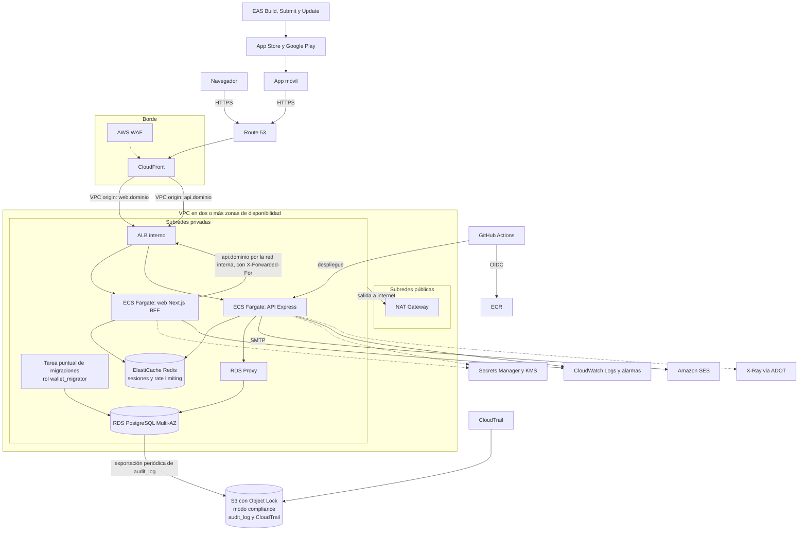

# Propuesta de despliegue en AWS

Este documento explica cómo llevaría TreoWallet a producción en AWS para una empresa regulada del sector financiero, con las alternativas descartadas y por qué. Responde la Fase 4 del enunciado (tabla de seis temas y tres preguntas por escrito).

**No se despliega nada.** La propuesta también está escrita como Terraform en [`infrastructure/`](../infrastructure/README.md): valida y sus pruebas pasan con proveedores simulados, pero nunca se ha aplicado contra una cuenta de AWS. Donde el código precisa algo de este documento, aquí se indica.

Las decisiones de fondo están en [`openspec/changes/archive/2026-10-15-delivery/design.md`](../openspec/changes/archive/2026-10-15-delivery/design.md) (D1 a D12); aquí se desarrollan.

## Cómo leer este documento

- **Lo que el repositorio ya hace** se afirma como hecho y se enlaza al código, a las pruebas o a la especificación.
- **Lo que se propone para AWS** va en tiempo condicional o marcado como propuesta. En particular, hoy **no existe** en el repositorio: un `Dockerfile` de la API o de la web, el colector de OpenTelemetry, los contadores de rate limiting en Redis, ni `lock_timeout` o `statement_timeout`. La API usa un pool de 20 conexiones para `wallet_app` y 5 para `wallet_migrator` (`api/src/platform/persistence/data-sources.ts`); la sesión de la web vive en Redis cuando hay `REDIS_URL` (`web/lib/server/redis-session-store.ts`, WEB-37) y, sin ella, en un `Map`; el rate limiting cuenta en memoria de cada instancia (el login, el registro, los estados de cuenta, `refresh`, `logout` y las operaciones de transferencias; sus topes son variables de entorno, `RATE_LIMIT_*_MAX`).
- **Los objetivos de RPO y RTO y los plazos de retención son supuestos** que deben validar riesgo y cumplimiento antes de comprometerse.

## Diagrama de arquitectura

Lectura rápida:

- **Dos dominios detrás de un solo CloudFront y un ALB** (`web.dominio` para el BFF, `api.dominio` para la API), con ruteo por host. La app móvil habla con la API; el navegador solo con el BFF, que llama a la API por la red interna.
- **Todo el cómputo y los datos están en subredes privadas.** Solo el NAT Gateway está en las públicas. El ALB es interno: CloudFront llega a él por un *VPC origin*, y su grupo de seguridad solo acepta la lista de prefijos administrada de CloudFront y al BFF. RDS y ElastiCache están además en subredes de datos sin ruta a internet.
- **El BFF llama a la API por el mismo ALB.** Dentro de la VPC, una zona privada de Route 53 resuelve `api.dominio` al ALB interno: el certificado es el mismo y la llamada no sale de la red.
- **RDS no es alcanzable desde internet.** La API entra por RDS Proxy; la tarea de migraciones entra directo con otro rol.

## 1. Cómputo de la API: ECS Fargate

**Elección:** servicio de ECS en Fargate, en subredes privadas, detrás de un ALB, con al menos dos tareas en zonas distintas y autoescalado por CPU y por peticiones por tarea. Las imágenes viven en ECR (escaneo al subir), y las tareas reciben sus secretos por referencia a Secrets Manager.

| Alternativa | Por qué se descarta |
|---|---|
| App Runner | Da menos control de red, de sidecars (el colector de OpenTelemetry) y del ciclo de despliegue, y no ofrece una forma natural de ejecutar tareas puntuales como las migraciones con otro rol de base de datos. En una empresa regulada pesa más el control que la simplicidad |
| EKS | El costo operativo de un clúster de Kubernetes para un solo servicio (dos con el BFF) no se justifica |
| Lambda + API Gateway | Cada invocación concurrente abre sus conexiones: en un pico (por ejemplo, 100 transferencias sobre la misma cuenta, que hacen cola en el bloqueo de fila) se agotan las conexiones de PostgreSQL, y hay que poner RDS Proxy desde el primer día. Suma *cold starts* a operaciones de dinero y complica los timeouts de transacciones que esperan locks |

**Migraciones como tarea puntual.** El repositorio separa dos roles: `wallet_migrator` (dueño del esquema; ejecuta migraciones y seed) y `wallet_app` (el que usa la API, sin `DELETE` ni `TRUNCATE` y solo `INSERT` en `audit_log`). La API se niega a arrancar si `DATABASE_URL` usa el dueño o un superusuario. En AWS esto se traduce en:

1. Dos secretos distintos en Secrets Manager, cada uno con su rotación. Solo la tarea de migraciones puede leer el de `wallet_migrator`.
2. En cada despliegue, antes de actualizar el servicio, una tarea ECS puntual (`aws ecs run-task`) corre el equivalente de `npm run db:migrate` con `MIGRATION_DATABASE_URL`. Si falla, el despliegue se detiene.
3. Las migraciones siguen el patrón *expand/contract*: primero se agregan columnas o tablas compatibles con la versión anterior, y solo en un despliegue posterior se retira lo que ya no se usa. Así la versión vieja sigue funcionando mientras el servicio se actualiza.
4. La API corre siempre con `wallet_app`; el rol dueño nunca está en una tarea de larga vida. Esto protege la auditoría de solo inserción (AUD) incluso si alguien compromete la API.

**El ejecutor de transferencias programadas** corre dentro de cada instancia de la API y es seguro con varias tareas: cada programada se toma con `FOR NO KEY UPDATE SKIP LOCKED` y se ejecuta exactamente una vez (ver [Concurrencia](../README.md#concurrencia) y las pruebas de `api/test/integration/concurrency/`). Con muchas tareas, la alternativa es moverlo a una tarea aparte invocada por EventBridge Scheduler.

## 2. Base de datos: RDS for PostgreSQL Multi-AZ

**Elección:** RDS for PostgreSQL (16, la misma versión que usan el entorno local y el CI), con despliegue **Multi-AZ**, cifrado con una llave de KMS administrada por el cliente, backups automáticos con **recuperación a un punto en el tiempo (PITR)** y copia de los backups a una segunda región.

| Alternativa | Por qué no ahora |
|---|---|
| Aurora PostgreSQL | Failover más rápido, almacenamiento que crece solo y réplicas de lectura baratas, pero con mayor costo base y diferencias de comportamiento que no aportan al volumen inicial. Es la **evolución natural** si el volumen crece mucho (ver la pregunta 2) |
| PostgreSQL en EC2 | Sin justificación: parches, backups y failover manuales en un entorno regulado |

Detalles de configuración propuestos: parámetros `rds.force_ssl = 1`; acceso solo desde los grupos de seguridad de la API y de la tarea de migraciones; protección contra borrado; *Performance Insights*; los backups automáticos con retención de 35 días.

**RPO y RTO como objetivos a validar.** No son compromisos: son punto de partida para discutir con riesgo y se validan con ejercicios de recuperación antes de comprometerlos.

| Escenario | RPO objetivo | RTO objetivo | Mecanismo |
|---|---|---|---|
| Caída de una zona de disponibilidad | 0 | ≤ 2 min | Réplica síncrona del standby de Multi-AZ y failover automático |
| Corrupción lógica o error humano | ≤ 5 min | ≤ 1 h | PITR a una instancia nueva y cambio del endpoint (RDS Proxy y el secreto lo ocultan a la aplicación) |
| Pérdida de la región | ≤ 1 h | ≤ 4 h | Copia de backups entre regiones y procedimiento documentado de recuperación ante desastres |

Para el ledger, lo que más importa es la integridad, no solo la disponibilidad: los `CHECK` de saldo, los triggers de suma cero y la conciliación (consultas en el README de la API) forman parte del procedimiento de recuperación, porque después de restaurar hay que comprobar que los saldos coinciden con los asientos.

## 3. Frontend web: Next.js en ECS Fargate detrás de CloudFront

El enunciado sugiere S3 + CloudFront o Amplify Hosting. **Aquí no aplica S3 + CloudFront:** la web no es un sitio estático, es un BFF que guarda la sesión en el servidor, ejecuta Server Actions y llama a la API con el access token. Es una desviación justificada, y está declarada en el [README](../README.md#estructura-del-repositorio).

**Elección:** el BFF (Next.js, salida `standalone`, `next start`) como segundo servicio ECS Fargate en el mismo cluster que la API, detrás del mismo ALB con ruteo por host y de CloudFront.

**Por qué Fargate, en orden de peso:**

1. **Confianza en la IP del cliente.** El rate limiting del login es por IP y correo, y el de `refresh` y `logout`, por IP. Si el BFF no está en `TRUSTED_PROXIES`, todas las personas de la web comparten la IP del BFF y un solo contador. La IP real del navegador solo la conoce el BFF, que la reenvía en `X-Forwarded-For`. Con el BFF en subredes privadas de la misma VPC, la API confía en ese header solo si la petición viene del CIDR de las subredes del BFF o del ALB: `TRUSTED_PROXIES` de la API contiene esos CIDR. Un BFF fuera de la VPC llamaría a la API por internet, sin IP de salida fija, y su header no se distinguiría de uno falsificado.
2. **Versión de Next.js.** La web usa Next.js 16 (App Router y Server Actions). En Fargate corre cualquier versión. La documentación de Amplify Hosting declara soporte de SSR para Next.js 12 a 15.
3. **Una sola plataforma operativa.** La API ya necesita ECS, ALB, autoescalado, ECR y su pipeline. El BFF es un segundo servicio con el mismo modelo de despliegue, observabilidad y red.
4. **Postura de red.** El BFF y la API comparten subredes privadas, grupos de seguridad y ElastiCache (sesiones del BFF y contadores de rate limiting de la API).

| Alternativa | Por qué se descarta |
|---|---|
| S3 + CloudFront | Solo sirve sitios estáticos; el BFF necesita servidor |
| Amplify Hosting con SSR | Es viable, pero exige tres condiciones (abajo). Su cómputo SSR lo administra AWS fuera de la VPC y accede a otros servicios por un rol de IAM, no por red privada, así que no alcanza ElastiCache |

**Amplify no se descarta por falta de capacidades.** Se integra con AWS WAF, permite headers personalizados, y `serverActions.allowedOrigins` es configuración de Next que funciona en cualquier hosting. Ofrece además entornos de vista previa por PR y cuesta menos con poco tráfico. Sería válido si se cumplen tres condiciones: sesiones en DynamoDB con TTL (el puerto `SessionStore` de la web permite el cambio sin tocar el resto), un header firmado con HMAC entre el BFF y la API para transportar la IP del cliente, y fijar Next.js 15 mientras Amplify no documente la 16. Con Fargate no hace falta ninguna.

**Configuración específica:**

- **`ALLOWED_ORIGINS`** (que alimenta `serverActions.allowedOrigins` en `web/next.config.ts`) incluye el dominio público. CloudFront cambia el `Host` hacia el origen, y sin esto Next rechaza las Server Actions por considerarlas de otro origen.
- **`SESSION_COOKIE_SECURE=true`** (valor por defecto en producción): la cookie se llama `__Host-sid` y lleva `Secure`. Con ese valor, leído al arrancar la tarea y no al construir la imagen, la web también envía `Strict-Transport-Security` en las páginas (dos años, con subdominios, sin `preload`) y `upgrade-insecure-requests` en la política de contenido.
- **Headers de seguridad.** La web envía `Content-Security-Policy` con un nonce por petición (en `proxy.ts`) y, en toda respuesta, `X-Content-Type-Options`, `X-Frame-Options`, `Referrer-Policy` y `Permissions-Policy`. Como el nonce cambia en cada petición, CloudFront no debe guardar el HTML de la web en caché ni reescribir esos headers con una *response headers policy* que los duplique o los contradiga. Los archivos de `_next/static` sí son cacheables.
- **Respuestas de la API sin caché.** Toda respuesta de la API lleva `Cache-Control: no-store`, así que la distribución de CloudFront de la API no debe forzar una política de caché sobre ellas (con la política administrada *CachingDisabled* basta).
- **Costo aceptado:** al menos dos tareas encendidas y sin entornos de vista previa por PR.
- **Sesiones en ElastiCache** (ver [soporte](#6-servicios-de-soporte)): el almacén en Redis ya existe y se elige con `REDIS_URL` (`rediss://` para ElastiCache con cifrado en tránsito), así que escalar a más de una tarea es configuración. La renovación única del access token sigue siendo por proceso; con varias tareas, la ventana de gracia de 30 s de la API absorbe dos renovaciones simultáneas (D2 de `web-app`).

## 4. App móvil: EAS y tiendas

- **Distribución.** La app es Expo (SDK 57). **EAS Build** genera los binarios firmados, con las credenciales de firma administradas por EAS o guardadas en Secrets Manager según lo que decida seguridad; **EAS Submit** los publica en App Store y Google Play. Se usarían canales (`preview`, `production`) alineados con los ambientes.
- **Actualizaciones OTA.** **EAS Update** solo con **firma de código** y con el mismo flujo de aprobación que un release, porque un cambio de JavaScript puede cambiar código que mueve dinero. Los cambios que tocan módulos nativos (por ejemplo, una nueva versión del SDK) van siempre por tienda.
- **Conexión segura a la API.** Solo HTTPS (TLS 1.2 o superior) contra el dominio de la API servido por CloudFront con WAF. `EXPO_PUBLIC_API_URL` apunta a ese dominio; en local es HTTP, solo para desarrollo. La API autentica al usuario, no a la app, y aplica rate limiting por IP y por usuario.
- **Sin secretos en el binario.** `EXPO_PUBLIC_*` queda embebido en el bundle y es legible por cualquiera, por eso solo lleva la URL base. Los tokens están en el almacenamiento seguro del sistema (`expo-secure-store`): el refresh token ahí y el access token solo en memoria, como ya hace la app. El contenido sensible se oculta al pasar a segundo plano.
- **Descartado por ahora:** *certificate pinning* (el riesgo de dejar la app sin servicio al rotar certificados supera el beneficio en esta etapa) y App Attest o Play Integrity (atestación de la app; van a "qué haría con más tiempo" del [README](../README.md#qué-haría-con-más-tiempo)).

## 5. Observabilidad y auditoría

| Pieza | Propuesta | Retención |
|---|---|---|
| Logs de aplicación | La API ya escribe JSON con `pino`, con `requestId` y datos sensibles enmascarados. El driver `awslogs` o FireLens los envía a CloudWatch Logs | 90 días en caliente; exportación a S3 si cumplimiento lo pide |
| Métricas y alarmas | CloudWatch: latencia, 5xx, rechazos por saldo y por límite, `REFRESH_TOKEN_REUSE_DETECTED`, errores de permiso `42501`, fallos de envío de correo, conexiones de RDS, CPU y memoria de las tareas | — |
| Trazas | OpenTelemetry SDK en la API y el BFF y colector ADOT como sidecar hacia X-Ray (propuesta: hoy no hay instrumentación) | 30 días |
| Auditoría de AWS | CloudTrail de organización hacia un bucket S3 dedicado con Object Lock | Igual que `audit_log` |
| `audit_log` (negocio y seguridad) | En caliente en RDS; exportación periódica a S3 con **Object Lock en modo compliance** | En caliente 13 meses; en S3, **plazo legal pendiente de cumplimiento** |

**Retención del `audit_log`: pendiente de cumplimiento.** Como referencia, la normativa mexicana plantea plazos de 5 años (prevención de lavado de dinero) a 10 años (registros mercantiles). El plazo real lo fija el área de cumplimiento; el diseño no cambia, porque Object Lock admite cualquier plazo. Se marca como pendiente a propósito y no se afirma una cifra.

**Dos capas de inmutabilidad.** Dentro de PostgreSQL, `audit_log` y `ledger_entries` son de solo inserción por permisos y triggers: protegen contra la aplicación y contra errores. No protegen contra alguien con acceso de administrador a la base. Esa protección la da la copia en S3 con Object Lock en modo *compliance*: ni el dueño de la cuenta puede borrar antes del plazo. Con las llaves de KMS del cliente y acceso por roles de solo lectura para auditoría.

**Alternativa descartada:** enviar logs y trazas a un proveedor externo. Es válido, pero en una empresa regulada se prefiere mantener esos datos dentro de la cuenta y de la región.

## 6. Servicios de soporte

- **ElastiCache for Redis (cifrado en tránsito y en reposo).** Almacena las sesiones del BFF y los contadores de rate limiting de la API. Sin un almacén compartido, cada instancia tendría sus propias sesiones y su propio conteo, y el límite de intentos de login dejaría de funcionar al escalar. En la API, `express-rate-limit` admite un almacén externo; en la web, el almacén de sesiones en Redis ya existe (`REDIS_URL`) y en local corre con el `docker-compose.yml` de `/web`. Se complementa con **reglas por tasa de AWS WAF** en CloudFront como primera barrera. Alternativa descartada: DynamoDB para sesiones (funciona, pero suma otro modelo de datos cuando Redis cubre sesiones y contadores con una pieza).
- **CAPTCHA del registro con AWS WAF.** Cuando la CURP, el RFC o el teléfono ya son de otra cuenta, el registro responde lo mismo y envía el mismo código que cualquiera, pero queda en revisión (IDN-03, `registration-review`): quien verifica el correo ve "en revisión" en lugar de sus cuentas, y así puede saber si una persona es cliente. Cada prueba cuesta un correo real y avisa al dueño de los datos, pero con variantes como `nombre+1@` un solo buzón sirve para muchas. El límite de 10 registros por hora por IP lo frena, pero se esquiva cambiando de IP. Un CAPTCHA en el registro vuelve cara la consulta automatizada:
  - **En la página, no en la regla sola.** El registro de la web es una Server Action, un `fetch` POST a `/register`. La acción CAPTCHA de WAF solo muestra el acertijo a peticiones que aceptan `text/html`; a un `fetch` le responde `405` sin acertijo. Por eso `/register` carga la API de JavaScript de CAPTCHA de WAF (`renderCaptcha`) con una llave de API cifrada limitada al dominio público, y el botón "Crear cuenta" se habilita al resolverlo. El token queda en la cookie `aws-waf-token` y viaja con la Server Action.
  - **La regla valida el token en CloudFront.** Una regla con acción CAPTCHA para `POST /register` en `web.dominio` deja pasar las peticiones con token válido y detiene las demás antes de llegar al BFF. Ni el BFF ni la API cambian: no verifican nada.
  - **Sin atajo por la API.** El BFF llama a la API por el ALB interno, así que WAF solo ve el tráfico público. Hoy ningún cliente público se registra directo en la API (la app móvil no tiene registro), así que una regla bloquea `POST /auth/register` en `api.dominio`. Si la app agrega registro, ese bloqueo se cambia por el SDK móvil de WAF (token por desafío silencioso) y el acertijo en una vista web.
  - **Local y pruebas.** Sin la URL de integración ni la llave configuradas, la página no carga el acertijo; en local no hay WAF, así que las pruebas e2e no cambian.
  - **Política de contenido.** La web envía una `Content-Security-Policy` con nonce que solo permite scripts propios y `connect-src 'self'`. Al cargar el script de CAPTCHA de WAF en `/register`, hay que agregar a `script-src` y a `connect-src` el origen que indique la documentación de AWS en ese momento (en `web/lib/csp.ts`); sin eso, el navegador bloquearía el acertijo. La prueba `security-headers.spec.ts` lo detectaría como una violación.
  - **Costo:** WAF cobra por cada intento de CAPTCHA, además de la regla. Las métricas de intentos y resoluciones van a CloudWatch.

  Alternativa descartada: Cloudflare Turnstile o reCAPTCHA. Son gratuitos o más baratos, pero mandan datos del navegador a un tercero fuera de la cuenta (el mismo criterio que en observabilidad), y WAF ya está en el camino de cada petición.
- **Amazon SES.** El mismo adaptador SMTP que usa Mailpit en local (`SMTP_HOST`, `SMTP_USER`, `SMTP_PASSWORD`), con DKIM, SPF y DMARC configurados y fuera del *sandbox*. Las métricas de rebote y queja van a CloudWatch. Los correos de código de un solo uso (OTP) son críticos: una alarma por fallos de envío es obligatoria. Alternativa descartada: un proveedor externo de correo (otro contrato y otro tratamiento de datos personales sin beneficio claro).
- **Secrets Manager y KMS.** Credenciales separadas de `wallet_migrator` y `wallet_app`, con rotación; secretos de la aplicación (`JWT_SECRET`, `OTP_HMAC_SECRET`, `CURSOR_SIGNING_SECRET`); credenciales SMTP. Llaves de KMS administradas por el cliente para RDS, S3, ElastiCache y los logs. **Rotación del secreto JWT (HS256):** requiere un periodo con dos secretos válidos para verificar y uno solo para firmar. Hoy la API acepta un único `JWT_SECRET`, así que la rotación sin cortes necesita un cambio de código; mientras tanto, rotar equivale a cerrar todas las sesiones. Se documenta como pendiente.
- **Amazon Time Sync Service.** El límite diario depende de la hora correcta. Las tareas de Fargate usan el reloj del host, sincronizado con Amazon Time Sync; la zona de negocio sigue siendo `America/Mexico_City` y se resuelve en la aplicación con la base IANA, no en la configuración del servidor.

## 7. CI/CD: GitHub Actions con OIDC

El repositorio ya tiene un workflow por proyecto en `.github/workflows/` (`contract`, `design-tokens`, `api`, `web` y `mobile`), cada uno con filtros de rutas: un cambio en `contract/**` o en `design-tokens/**` dispara también los de sus consumidores. Hoy corren lint, pruebas y build, no despliegan.

- **OIDC.** Cada ambiente asume un rol de IAM distinto por federación con GitHub, con condición sobre el repositorio y el ambiente. No hay llaves de AWS de larga duración en el repositorio.
- **Ambientes** `dev`, `staging` y `prod` como *GitHub Environments*, cada uno en su propia cuenta de AWS. `prod` exige aprobación manual y solo despliega desde tags.
- **Flujo de la API:** lint → typecheck → pruebas unitarias → pruebas de integración y concurrencia con PostgreSQL de servicio → build de la imagen → escaneo → push a ECR → tarea de migraciones (`wallet_migrator`) → actualización del servicio ECS con despliegue *rolling*, *circuit breaker* y rollback automático → comprobación de salud.
- **Flujo de la web:** el mismo, sin migraciones. Cambios en `web/**` no tocan la API.
- **Flujo de la app:** lint y pruebas en GitHub Actions; EAS Build y Submit para release; EAS Update con firma para cambios solo de JavaScript.
- **Contrato.** Mientras todo esté en un repositorio, `contract` y `design-tokens` se instalan como copia (`file:../contract`). Al separar los repositorios, el contrato y los tokens se publican en GitHub Packages (versión semántica, con el flujo descrito en el [README](../README.md#publicación-al-separar-los-repositorios)) y cada consumidor fija su versión.
- **Alternativa descartada:** CodePipeline. Funciona, pero el código y los CIs ya viven en GitHub, y dos sistemas de CI no aportan.

## Preguntas por escrito

### 1. ¿Cómo manejo las conexiones a PostgreSQL al escalar horizontalmente?

- **Pool por tarea con tamaño fijo.** Cada tarea de la API tiene un pool acotado (hoy 20 para `wallet_app`; se bajaría a un valor medido, por ejemplo 10) y se respeta la fórmula:

  `tareas_máximas × tamaño_del_pool + reserva ≤ max_connections`

  La reserva cubre la tarea de migraciones (pool de 5), administración y monitoreo. El autoescalado tiene un máximo de tareas que sale de despejar esta fórmula, no al revés. Ejemplo ilustrativo: con `max_connections` de 500, reserva de 50 y pool de 10, el máximo es 45 tareas.
- **RDS Proxy entre la API y RDS.** Multiplexa conexiones cuando el autoescalado agrega tareas, absorbe los picos de reconexión y acorta el efecto de un failover. Para no perder el multiplexado (*pinning*), las transacciones de la API no dependen de estado de sesión: usan `SELECT … FOR NO KEY UPDATE` dentro de la transacción y no hacen `SET` de sesión. Se prohíben los `SET` de sesión en el código, y el proxy se vigila con la métrica de conexiones ancladas.
- **Timeouts para que una cola de locks no retenga conexiones.** Una transferencia espera el bloqueo de la fila de la cuenta, y 100 transferencias sobre la misma cuenta hacen fila. Se fijan `lock_timeout` y `statement_timeout` por transacción (hoy no están configurados), un `idle_in_transaction_session_timeout`, el timeout de adquisición del pool y el timeout de la petición del ALB, de menor a mayor, para que lo primero que falle sea el que mejor se puede reintentar. Un timeout de lock se traduce en una respuesta reintentable, y la idempotencia garantiza que reintentar es seguro.
- **Lecturas aparte.** Si las lecturas pesadas (historial, estados de cuenta) compiten con las escrituras, se mueven a una réplica de lectura con su propio pool (ver la pregunta 2).

### 2. ¿Qué cambiaría si el volumen crece 100 veces?

| Presión | Cambio |
|---|---|
| Lecturas del historial y de estados de cuenta | Réplicas de lectura (o Aurora con réplicas) para `GET /accounts/{id}/movements` y los estados de cuenta. Los saldos y las transferencias siguen en el primario. Hay que tolerar el rezago de la réplica: un movimiento recién creado puede tardar en aparecer |
| Tamaño de `ledger_entries` | Particionado por rango mensual de `created_at`. El cursor del historial por `(created_at, id)` y los filtros por fecha aprovechan el *partition pruning*; las particiones viejas pasan a almacenamiento más barato. Hay que revisar `uq_ledger_entries_transfer_account` y los índices, porque en una tabla particionada la llave única debe incluir la columna de partición |
| Cuentas calientes | La cuenta de Tesorería, y cualquier cuenta que reciba o envíe muchas transferencias concurrentes, es un cuello de botella del bloqueo de fila: todas hacen fila. Opciones: cuentas de sistema fragmentadas (varias Tesorerías) o, para la Tesorería, no mantener un saldo cacheado que haya que bloquear |
| Correos | Hoy se envían en línea tras el `COMMIT`. Con ese volumen pasa a un patrón *outbox* transaccional con un worker (SQS), con reintentos y estado de entrega |
| Idempotencia | Hoy la llave es una columna única de `transfers`. Se agrega una tabla genérica `idempotency_keys` con la respuesta guardada, TTL y purga, para extender la idempotencia a otras mutaciones |
| Programadas | El ejecutor sale de las tareas de la API a un worker propio o a EventBridge Scheduler, con el mismo caso de uso |
| Base de datos | Migración a Aurora PostgreSQL; si una sola instancia escritora no alcanza, evaluar particionar por usuario |
| Borde | Reglas de WAF más finas, rate limiting en CloudFront y caché de lo que sea público (las respuestas de la API llevan `no-store`; solo se cachearía lo que se marque a propósito) |

Antes de cualquiera de estos cambios, la regla es medir: el `EXPLAIN ANALYZE` del historial con 120k asientos y las pruebas de concurrencia son la línea base contra la que se comparan.

### 3. ¿Qué herramienta de infraestructura como código usaría?

**Terraform.**

| Alternativa | Por qué no |
|---|---|
| **Terraform** (elegida) | El `plan` es un artefacto revisable que encaja con la gestión de cambios de una empresa regulada; permite políticas como código (por ejemplo, OPA); no depende del lenguaje de la aplicación; el ecosistema de módulos es maduro |
| CDK | Atractivo porque el equipo escribe TypeScript, pero el resultado (CloudFormation sintetizado) es más difícil de revisar en una aprobación de cambios |
| SAM | Está pensado para aplicaciones serverless; con Fargate no aplica |

**El código está en [`infrastructure/`](../infrastructure/README.md):** un módulo raíz para los tres ambientes, con un archivo de variables y un backend por cuenta, y pruebas con `terraform test` que corren en el CI sin credenciales. Las contraseñas se generan como valores efímeros y se escriben en argumentos de solo escritura, así que no quedan en el estado. Sigue sin haber `Dockerfile`.

## Resumen frente al enunciado

| Tema del enunciado | Sección | Decisión |
|---|---|---|
| Cómputo de la API | [1](#1-cómputo-de-la-api-ecs-fargate) | ECS Fargate; descarta App Runner, EKS y Lambda |
| Base de datos | [2](#2-base-de-datos-rds-for-postgresql-multi-az) | RDS for PostgreSQL Multi-AZ, PITR, RPO y RTO objetivo |
| Frontend web | [3](#3-frontend-web-nextjs-en-ecs-fargate-detrás-de-cloudfront) | Next.js en Fargate; descarta S3 + CloudFront y Amplify |
| App móvil | [4](#4-app-móvil-eas-y-tiendas) | EAS Build, Submit y Update; HTTPS y sin secretos |
| Observabilidad y auditoría | [5](#5-observabilidad-y-auditoría) | CloudWatch, OpenTelemetry y X-Ray, CloudTrail, S3 con Object Lock |
| CI/CD | [7](#7-cicd-github-actions-con-oidc) | GitHub Actions con OIDC; dev, staging y prod |
| Conexiones al escalar | [Pregunta 1](#1-cómo-manejo-las-conexiones-a-postgresql-al-escalar-horizontalmente) | Pool por tarea, RDS Proxy, timeouts |
| Volumen 100x | [Pregunta 2](#2-qué-cambiaría-si-el-volumen-crece-100-veces) | Réplicas, particionado, outbox, Aurora |
| Infraestructura como código | [Pregunta 3](#3-qué-herramienta-de-infraestructura-como-código-usaría) | Terraform |
