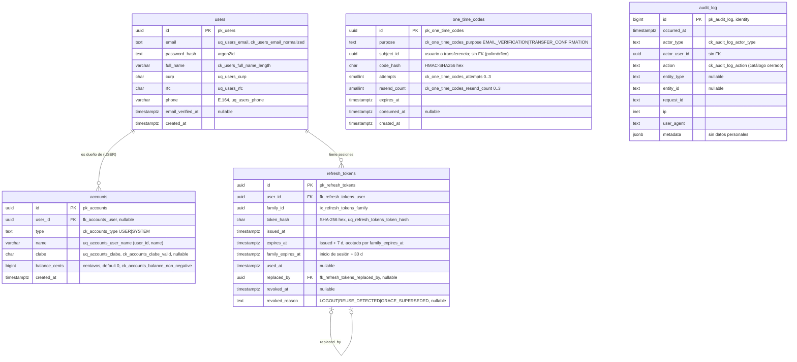

## Context

Ver `proposal.md` (Why). El proyecto `/api` no existe todavía; este change crea su base y deja listo lo que `api-ledger` necesita para mover dinero. Restricciones que dan forma al diseño:

- **Stack obligatorio del enunciado:** Node.js ≥ 20, Express, PostgreSQL ≥ 15, TypeScript estricto, TypeORM con `synchronize` desactivado y migraciones TypeORM. Donde TypeORM no alcance, este documento explica cómo se resuelve con SQL.
- **Contrato primero:** `contract/openapi.yaml` (change `contract-v1`) es la fuente de verdad. La API lo consume desde el paquete `@devchrisvaz/wallet-contract` instalado con `file:../contract` e `install-links=true`, solo para Swagger UI y pruebas de contrato. La validación de entrada se escribe a mano con Zod (decisión A1). Las operaciones de este change son `healthCheck`, `registerUser`, `verifyEmail`, `resendVerificationEmail`, `login`, `refreshSession`, `logout` y `getCurrentUser`.
- **Proyecto independiente:** lockfile y CI propios; ninguna dependencia de código con `/web` ni `/mobile`.
- **Clientes:** el BFF de `/web` llama a la API desde el servidor (reenvía `X-Forwarded-For`, `X-Request-Id` e `Idempotency-Key`); la app móvil llama directo. Para la API ambos son clientes Bearer iguales.

## Goals / Non-Goals

**Goals:**
- Estructura por capas que impida que la lógica de negocio viva en los handlers de Express.
- Identidad completa (HU1) sin enumeración de cuentas por email y con sesiones resistentes a robo de tokens y a la red móvil inestable.
- Integridad garantizada en la base: constraints con nombre, CLABE validada por función SQL, saldo no negativo, auditoría inmutable por permisos y triggers.
- Base reutilizable para `api-ledger`: puertos de reloj y correo, escritor de auditoría, códigos de un solo uso, traducción de errores, arnés de pruebas.

**Non-Goals:**
- Saldos, `GET /accounts`, fondeo, beneficiarios, transferencias e historial (change `api-ledger`).
- Recuperación de contraseña, cierre de todas las sesiones, KYC, mayoría de edad, cifrado por columna, encadenamiento por hash de la auditoría (van a "qué haría con más tiempo").
- Infraestructura de AWS (change `delivery`).

## Decisions

### 1. Módulos por contexto con capas dentro

```
api/src/
  modules/
    identity/   { domain, application, infrastructure }
    accounts/   { domain, application, infrastructure }
    audit/      { domain, application, infrastructure }
  platform/     http (app, middlewares, errores, rate limit, docs), config, logging,
                persistence (DataSources, transacciones, mapeo de errores PG), mail, clock, security
  main.ts       raíz de composición: construye adaptadores e inyecta dependencias a mano
api/db/         bootstrap.sql
api/migrations/ migraciones TypeORM (SQL explícito)
api/test/       unit/, integration/, helpers/ (arnés, contrato, privilegios)
```

- **Regla de dependencias:** `domain` no importa nada de `application`, `infrastructure`, Express ni TypeORM; `application` depende de puertos (interfaces) y no de adaptadores; los handlers HTTP solo validan, llaman a un caso de uso y traducen el resultado. Se hace cumplir con una regla de lint de imports restringidos por carpeta.
- **Inyección de dependencias manual** con funciones fábrica en `main.ts`.
- *Alternativas descartadas:* MVC plano (pone la lógica en los controladores, que el enunciado prohíbe); NestJS (el enunciado exige Express); contenedores de DI con decoradores como tsyringe o inversify (agregan magia y metadatos sin beneficio para un servicio de este tamaño).

### 2. Validación de entrada con Zod y conformidad con el contrato con Ajv (A1)

- Cada ruta declara un schema Zod escrito a mano que refleja el del contrato y además **transforma**: normaliza el email (trim y minúsculas), convierte el teléfono a E.164 y, en `api-ledger`, convierte montos a `Money`. Los objetos usan modo estricto para rechazar campos no declarados (PLT-02). Los errores de Zod se traducen a `VALIDATION_FAILED` con JSON Pointers.
- Las validaciones con dígito verificador (CURP, CLABE) y la fecha del RFC son funciones de dominio puras, reutilizadas por los schemas Zod.
- **Pruebas de contrato:** un helper de pruebas carga `openapi.yaml` del paquete, compila con Ajv (draft 2020-12, que es el dialecto de OpenAPI 3.1; modo estricto relajado para aceptar `discriminator` y `example`; formatos con `ajv-formats`) el schema de cada par operación-status, y toda prueba de integración HTTP valida su respuesta (PLT-12).
- *Alternativas descartadas:* `express-openapi-validator` (valida pero no transforma, y el enunciado pide Zod o similar); generar el yaml desde Zod (contradice contrato primero).

### 3. TypeORM: dónde se usa y dónde no alcanza

- **Dos DataSources:** `app` (rol `wallet_app`, para la API) y `migrator` (rol `wallet_migrator`, para migraciones y seed). `synchronize: false` y `migrationsRun: false` en ambos.
- **Entidades con `EntitySchema`** en `infrastructure`, sin decoradores. Así el dominio no conoce el ORM, no hace falta `emitDecoratorMetadata` y las pruebas corren con un transpilador rápido.
- **Migraciones escritas a mano** con `queryRunner.query(sql)`. TypeORM no expresa (o no lo hace con nombres controlados) lo siguiente, así que va en SQL crudo:
  - constraints `CHECK` con nombre, incluidas las que llaman a funciones (`ck_accounts_clabe_valid`);
  - funciones (`clabe_is_valid`, `forbid_mutation`) y triggers (`tg_audit_log_*`);
  - índices únicos parciales (`uq_accounts_single_system`, `uq_one_time_codes_purpose_subject`);
  - secuencias (`seq_account_number`);
  - `GRANT` y `REVOKE` explícitos por tabla para `wallet_app`.
- **Bloqueos explícitos:** `SELECT … FOR UPDATE` con `QueryRunner` dentro de transacciones manuales (rotación de refresh, verificación de correo). `api-ledger` reutiliza el mismo helper de transacción.
- **`BIGINT`:** el driver devuelve `int8` como string; un transformer de columna convierte `string ⇄ bigint` y nunca pasa por `Number`.
- *Alternativas descartadas:* `migration:generate` (genera nombres automáticos y no expresa triggers ni GRANTs); otro ORM o query builder (el enunciado exige TypeORM).

### 4. Roles, bootstrap y privilegios

```
db/bootstrap.sql  (npm run db:bootstrap → psql con BOOTSTRAP_DATABASE_URL de superusuario,
                   contraseñas por variables -v; idempotente con DO $$ … IF NOT EXISTS)
  CREATE ROLE wallet_migrator LOGIN;      dueño de las bases wallet y wallet_test y del schema app
  CREATE ROLE wallet_app      LOGIN;      sin propiedad de objetos
  REVOKE CREATE ON SCHEMA public FROM PUBLIC;  REVOKE ALL ON DATABASE … FROM PUBLIC
  GRANT CONNECT ON DATABASE … TO wallet_app;   GRANT USAGE ON SCHEMA app TO wallet_app
  ALTER ROLE … SET search_path = app
```

| Tabla | `wallet_app` |
|---|---|
| `users` | SELECT, INSERT, UPDATE |
| `accounts` | SELECT, INSERT, UPDATE |
| `refresh_tokens` | SELECT, INSERT, UPDATE |
| `one_time_codes` | SELECT, INSERT, UPDATE |
| `audit_log` | **INSERT** (sin SELECT: los inserts no usan `RETURNING`) |
| `seq_account_number`, secuencias de identidad | USAGE |
| funciones `clabe_is_valid` | EXECUTE (se revoca de PUBLIC) |

Ninguna tabla otorga `DELETE` ni `TRUNCATE` (PLT-14). Las revocaciones se modelan como `UPDATE` de columnas (`revoked_at`, `consumed_at`, `invalidated_at`). Al arrancar, la API consulta `current_user` y se niega a iniciar si coincide con el dueño del schema (PLT-08).

- *Alternativas descartadas:* `docker-entrypoint-initdb.d` (en GitHub Actions los *service containers* arrancan antes del checkout y no pueden montar archivos del repo); crear roles en migraciones (requiere `CREATEROLE` para quien migra y contraseñas dentro de las migraciones); `ALTER DEFAULT PRIVILEGES` (menos revisable que los GRANTs por migración).

### 5. Modelo de datos de este change



Constraints que no caben en el diagrama:
- `ck_accounts_balance_non_negative`: `CHECK (type = 'SYSTEM' OR balance >= 0)`.
- `ck_accounts_owner_by_type`: `CHECK ((type = 'USER') = (user_id IS NOT NULL))`.
- `ck_accounts_clabe_by_type`: `CHECK ((type = 'USER') = (clabe IS NOT NULL))`.
- `ck_accounts_clabe_valid`: `CHECK (clabe IS NULL OR clabe_is_valid(clabe))`.
- `uq_accounts_single_system`: índice único parcial sobre `(type) WHERE type = 'SYSTEM'`.
- `uq_one_time_codes_purpose_subject`: único sobre `(purpose, subject_id)`: un desafío por sujeto; reenviar reemplaza el hash en la misma fila.
- `ck_users_email_normalized`: `CHECK (email = lower(btrim(email)))`, lo que hace que `uq_users_email` sea insensible a mayúsculas.
- La cuenta "Tesorería" se inserta en la migración que crea `accounts`.

**`clabe_is_valid(text) RETURNS boolean`**, `IMMUTABLE`, en SQL puro: `^[0-9]{18}$`, suma ponderada 3-7-1 de los primeros 17 dígitos (cada producto módulo 10), verificador `(10 − suma mod 10) mod 10`. Los mismos vectores de prueba se usan para esta función y para la de TypeScript (ACC-05).

**Generación de CLABE:** la aplicación toma `nextval('seq_account_number')`, arma `banco (env) + plaza (env) + lpad(n, 11, '0')`, calcula el verificador con la función de dominio y la base vuelve a validarlo con `ck_accounts_clabe_valid`.

### 6. Autenticación

- **Contraseñas:** argon2id con los parámetros mínimos recomendados por OWASP (19 MiB, 2 iteraciones, paralelismo 1). Al arrancar se calcula un **hash ficticio** que se verifica cuando el email no existe, para igualar tiempos (IDN-08).
- **Access token:** JWT HS256 de 10 minutos firmado con `jose`; `jwtVerify` con `algorithms: ['HS256']`, `issuer` y `audience` explícitos (IDN-09). *Descartado:* `jsonwebtoken` sin lista de algoritmos (históricamente permitió confusiones de algoritmo); RS256 (un solo servicio firma y verifica, no aporta).
- **Refresh token:** 32 bytes aleatorios en base64url; se guarda su SHA-256 (con esa entropía no hace falta un hash lento ni secreto). `expires_at = min(issued_at + 7 d, family_expires_at)`.
- **Rotación con detección de reuso y ventana de gracia** (IDN-11, IDN-12), todo dentro de una transacción con la fila del token bloqueada:

```mermaid
sequenceDiagram
    participant C as Cliente
    participant A as API
    participant DB as PostgreSQL
    C->>A: POST /auth/refresh {refreshToken}
    A->>DB: BEGIN; SELECT … FROM refresh_tokens WHERE token_hash = sha256(t) FOR UPDATE
    alt no existe, vencido, familia vencida o revocado
        A-->>C: 401 SESSION_REVOKED
    else used_at IS NULL (uso normal)
        A->>DB: INSERT sucesor; UPDATE used_at = now, replaced_by = sucesor
        A-->>C: 200 TokenPair
    else usado hace ≤ 30 s y sucesor sin usar (reintento)
        A->>DB: UPDATE sucesor SET revoked_at (GRACE_SUPERSEDED); INSERT nuevo sucesor; replaced_by = nuevo
        A-->>C: 200 TokenPair
    else reuso
        A->>DB: UPDATE refresh_tokens SET revoked_at WHERE family_id = …; INSERT audit REFRESH_TOKEN_REUSE_DETECTED
        A-->>C: 401 SESSION_REVOKED
    end
    A->>DB: COMMIT
```

  Dos refresh simultáneos con el mismo token: el segundo espera el lock, encuentra `used_at` reciente y el sucesor sin usar, y aplica la rama de gracia; al final queda un solo token vigente. El momento "ahora" sale del puerto `Clock`, tomado después de obtener el lock.
- **Códigos de un solo uso** (`one_time_codes`): 6 dígitos con `crypto.randomInt`, guardados como **HMAC-SHA256 con un secreto del servidor** (`OTP_HMAC_SECRET`) y comparados en tiempo constante. *Descartados:* SHA-256 sin secreto (10⁶ combinaciones se revierten al instante si la tabla se filtra) y argon2 (lento, y con 10⁶ combinaciones sigue siendo atacable sin conocer un secreto). Un intento fallido incrementa `attempts` en una transacción propia que se confirma aunque la petición falle; si no, el contador no avanzaría.

### 7. Registro y verificación

```mermaid
sequenceDiagram
    participant C as Cliente
    participant A as API
    participant DB as PostgreSQL
    participant M as SMTP
    C->>A: POST /auth/register
    A->>A: Zod: normaliza email, valida CURP (DV), RFC (fecha), teléfono → E.164
    A->>DB: BEGIN; busca usuario por email FOR UPDATE
    alt email nuevo y datos únicos
        A->>DB: INSERT users (sin verificar); upsert one_time_codes; INSERT audit USER_REGISTERED
    else email verificado
        Note over A: sin cambios; correo de aviso al dueño
    else email sin verificar
        A->>DB: reemplaza el código si resend_count < 3 (EMAIL_VERIFICATION_RESENT)
    else choque de CURP, RFC o teléfono (pre-chequeo o 23505 en uq_users_curp/rfc/phone)
        Note over A: sin cambios; correo genérico "no pudimos completar tu registro"
    end
    A->>DB: COMMIT
    A->>M: envía el correo que corresponda (después del COMMIT; una falla solo se registra)
    A-->>C: 202 (mismo cuerpo siempre)
```

`POST /auth/verify-email` bloquea usuario y desafío, valida vencimiento, intentos y HMAC; si es correcto, en la **misma transacción** marca el correo como verificado, consume el código, abre "Principal" y "Ahorro" con su CLABE, crea la familia de refresh e inserta `EMAIL_VERIFIED`. Un email inexistente, ya verificado o con código incorrecto responde igual (`422 VERIFICATION_CODE_INVALID`).

### 8. Errores RFC 9457 y traducción de PostgreSQL

- Los casos de uso devuelven o lanzan errores de dominio con un `code` del catálogo. Un middleware final de Express los convierte en problem+json: `type = /problems/<code-en-kebab>`, `title` y `detail` en español, `status`, `code`, `requestId` (del contexto de la petición) y las extensiones del contrato. Hay un manejador 404 para rutas desconocidas.
- **Errores de PostgreSQL**, en un registro indexado por nombre de constraint:

| SQLSTATE | Constraint o caso | Resultado |
|---|---|---|
| 23505 | `uq_users_email`, `uq_users_curp`, `uq_users_rfc`, `uq_users_phone` durante el registro | Rama de choque (202 y correo genérico) |
| 23505 / 23514 | cualquier otra sin traducción registrada | 500 `INTERNAL_ERROR` + log de error |
| 23514 | `ck_accounts_balance_non_negative` | Lo registra `api-ledger` como `INSUFFICIENT_FUNDS` |
| 40P01, 40001, 42501 | — | 500 `INTERNAL_ERROR` + log de error (alerta) |

- Una prueba consulta `pg_constraint` y `pg_indexes` después de migrar y falla si algún nombre no tiene un prefijo permitido (PLT-04).

### 9. Logs, identificador de petición y contexto

- `pino` con `pino-http`: una línea JSON por petición y por evento. **`redact`** reemplaza secretos por `[REDACTED]` (`req.headers.authorization`, `*.password`, `*.accessToken`, `*.refreshToken`, `*.code`, `*.otp`); un **serializador de enmascarado** deja visible un fragmento de email, teléfono, CURP, RFC y CLABE. Un serializador convierte `bigint` a string, porque `JSON.stringify` lanza error con `bigint`.
- **`X-Request-Id`:** se acepta si cumple `^[A-Za-z0-9_-]{1,64}$` (para evitar inyección en logs); si no, se genera con `crypto.randomUUID()`. Se guarda en un contexto `AsyncLocalStorage` que leen el logger, el traductor de errores y el escritor de auditoría sin pasarlo de función en función.
- *Descartado:* `winston` (más configuración para el mismo resultado; `pino` es más rápido y tiene `redact` nativo).

### 10. IP del cliente, rate limiting y salud

- `app.set('trust proxy', TRUSTED_PROXIES)`: lista explícita desde la configuración (`loopback` en local, donde el BFF corre en la misma máquina; las subredes del ALB en AWS). Fuera de esa lista, `X-Forwarded-For` se ignora (PLT-07).
- `express-rate-limit` con almacenamiento en memoria: llaves `ip` e `ip + email normalizado` para login. La infraestructura acepta una función de llave arbitraria para que api-ledger limite por usuario autenticado (`userId`, 10 altas de beneficiarios por hora); el manejador de límite produce `429 RATE_LIMITED` con `Retry-After`. El almacenamiento compartido (ElastiCache o reglas de WAF) se documenta en la propuesta de AWS. *Descartado:* bloqueo de cuenta tras N intentos (permite dejar sin acceso a otra persona a propósito).
- `GET /health` sin autenticación y sin tocar la base (proceso vivo y listo).

### 11. Correo

Puerto `Mailer` con un adaptador SMTP (`nodemailer`): Mailpit en local (SMTP 1025, bandeja web 8025) y Amazon SES por su interfaz SMTP en AWS, sin cambiar código. Plantillas de texto y HTML en español. El envío ocurre **después del COMMIT**; una falla se registra con el destinatario enmascarado y sin el código, y el usuario puede pedir un reenvío (PLT-16). *Descartado por ahora:* patrón outbox con worker (va a "qué haría con más tiempo").

### 12. Configuración

Un schema Zod sobre `process.env` se evalúa al arrancar y aborta con el nombre de la variable inválida, sin su valor: `NODE_ENV`, `HOST` (por defecto `0.0.0.0`, para que el móvil alcance la API por la red local), `PORT` (por defecto `4000`; Next.js usa el 3000 en local), `DATABASE_URL` (rol de ejecución), `MIGRATION_DATABASE_URL`, `BOOTSTRAP_DATABASE_URL` (solo para el script), `JWT_SECRET` y `OTP_HMAC_SECRET` (al menos 32 bytes decodificados), `JWT_ISSUER`, `JWT_AUDIENCE`, `CLABE_BANK_CODE` y `CLABE_PLAZA_CODE` (3 dígitos cada uno), `SMTP_HOST`, `SMTP_PORT`, `SMTP_FROM`, `TRUSTED_PROXIES`, `LOG_LEVEL`. El README incluye `.env.example` con valores de desarrollo.

### 13. Documentación navegable

`swagger-ui-express` sirve en `/docs` el `openapi.yaml` resuelto desde el paquete del contrato (`require.resolve`), y `/openapi.yaml` lo entrega tal cual. Ambas rutas solo se montan si `NODE_ENV !== 'production'`.

### 14. Pruebas

- **Runner:** Vitest (unitarias e integración en proyectos separados). *Descartado:* Jest con ts-jest (más lento; sin ventajas aquí).
- **Unitarias:** validadores de CURP, RFC y CLABE con vectores (incluido el caso de suma múltiplo de 10), enmascarado, traductor de errores, reglas de rotación de refresh con `Clock` falso.
- **Integración contra PostgreSQL real** (`wallet_test`): el arnés aplica migraciones con la conexión `migrator`, y el código bajo prueba usa la conexión `app`. Entre pruebas, el arnés reinicia los datos con la conexión `migrator`: dentro de una transacción desactiva solo los triggers de protección de `audit_log` (`ALTER TABLE … DISABLE TRIGGER`, que el dueño puede hacer), trunca y los reactiva. El código de la aplicación nunca hace esto; es exactamente el bypass del dueño que se documenta como riesgo de AUD-05.
- **Contrato:** cada respuesta HTTP de las pruebas pasa por `expectToMatchContract(res, operationId)`.
- **Privilegios:** conectado como `wallet_app`, `UPDATE`, `DELETE`, `TRUNCATE` y `SELECT` sobre `audit_log`, y `CREATE TABLE`, deben fallar con `42501`.
- **Correo:** las pruebas de casos de uso usan un `Mailer` en memoria; una prueba del adaptador SMTP envía a Mailpit y lo confirma con su API HTTP.
- **Migraciones:** ida, vuelta e ida en CI (PLT-15).
- Cada título de prueba empieza con el ID del requisito.

### 15. Seed

`npm run db:seed` (conexión `migrator`, script en Node para poder hashear con argon2) crea en este change los usuarios demo **verificados con sus dos cuentas** (por ejemplo, Ana y Luis), con contraseñas documentadas en el README. `api-ledger` extiende el mismo comando con los ~50 usuarios adicionales, el fondeo y los ~120k asientos.

### 16. CI

`.github/workflows/api.yml`, disparado por `push` y `pull_request` con `paths: [api/**, contract/**, .github/workflows/api.yml]`:
1. Services: `postgres:16` (superusuario por variables) y `axllent/mailpit`.
2. `actions/setup-node` con Node 20; `npm ci && npm run build` en `/contract` (lo exige `file:` con `install-links`).
3. `npm ci` en `/api`, `lint`, `typecheck`.
4. `db:bootstrap` con `psql`, migraciones ida-vuelta-ida, `npm test`.

## Risks / Trade-offs

- [El dueño del schema puede desactivar los triggers de `audit_log`] → Se reconoce en AUD-05; la inmutabilidad real llega con la exportación a S3 con Object Lock (propuesta de AWS).
- [Rate limiting en memoria: cada instancia cuenta por su lado] → Aceptable en local; almacenamiento compartido o WAF en AWS.
- [El envío síncrono de correo puede hacer que las ramas del registro tarden distinto y filtrar información por tiempo] → Riesgo aceptado y documentado; el outbox lo elimina.
- [Enumeración residual: un choque de CURP, RFC o teléfono confirma a quien controla el email que ese dato ya existe] → Requiere KYC para eliminarse; mitigado con rate limiting y documentado.
- [El access token sigue vivo hasta 10 minutos después del logout] → Vida corta; revocación inmediata con lista de `jti` queda fuera de alcance.
- [HS256 con secreto compartido: rotarlo requiere redeploy] → Un solo servicio firma; se puede añadir `kid` más adelante.
- [Privilegios de secuencias de columnas identidad: no es obvio qué necesita `wallet_app`] → Se otorga `USAGE` explícito y las pruebas de privilegios lo verifican.
- [`argon2` es un módulo nativo] → Usa binarios precompilados para Node 20 en Linux; el CI lo valida en cada ejecución.
- [Reiniciar datos en pruebas requiere desactivar triggers] → Solo el arnés, con la conexión del dueño; nunca en código de aplicación.

## Migration Plan

Proyecto nuevo, sin datos previos. Despliegue local: `docker compose up -d` (PostgreSQL publicado en el puerto **5433** del host para no chocar con un PostgreSQL local en el 5432; Mailpit en 1025 y 8025; ambos configurables por variables de entorno) → `db:bootstrap` → `db:migrate` → `db:seed` → `dev`. Reversión: cada migración tiene `down`, verificado en CI con ida-vuelta-ida.

## Open Questions

- Valor concreto de `CLABE_BANK_CODE`: debe ser un código que no esté asignado a ningún banco en el catálogo de Banxico. Es un valor de configuración; se verifica y se fija en `.env.example` durante la implementación sin cambiar specs ni tareas.
