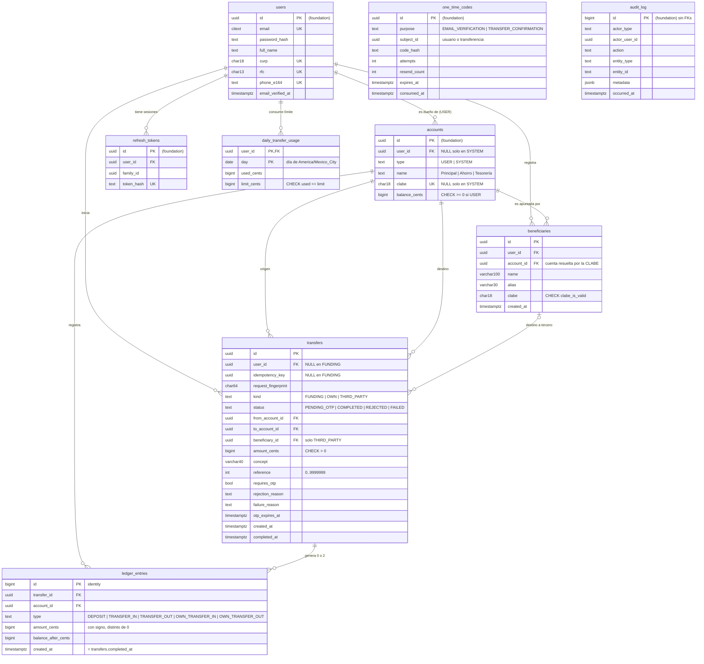
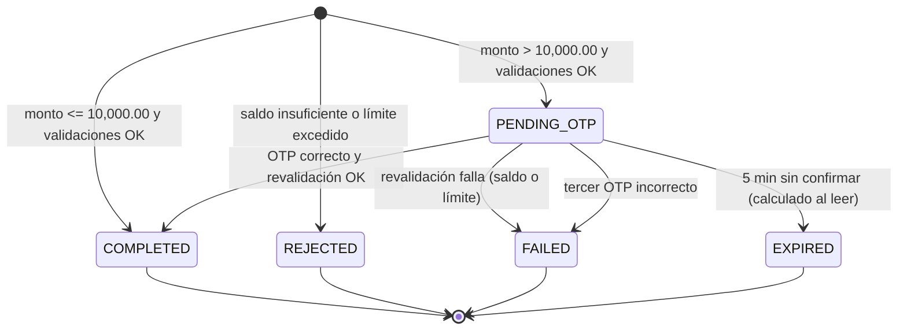

## Context

Ver `proposal.md` (Why). Este diseño parte de lo que entrega `api-foundation` y lo trata como existente:

- Capas de dominio, aplicación e infraestructura; los handlers de Express solo traducen HTTP.
- Errores RFC 9457 con `code` y `requestId`, y traducción de errores de PostgreSQL **por nombre de constraint** (PLT-01, PLT-04).
- Puertos `Clock` (inyectable en pruebas), `Mailer` (SMTP, Mailpit en local) y escritor de auditoría que recibe la transacción en curso (AUD-03).
- Rate limiting en memoria (PLT-09), configuración validada al arrancar (PLT-08), roles `wallet_migrator` y `wallet_app` con grants explícitos por migración (PLT-14).
- Tablas `users`, `refresh_tokens`, `one_time_codes` (propósitos `EMAIL_VERIFICATION` y `TRANSFER_CONFIRMATION`, código guardado como hash), `audit_log` y `accounts` (tipo `USER`/`SYSTEM`, CLABE generada, saldo en centavos con `CHECK` de no negativo para `USER`), y la función SQL `clabe_is_valid(text)`.
- Arnés de pruebas con dos conexiones (migrador para reiniciar, app para el código) y validación con Ajv de cada respuesta contra `contract/openapi.yaml`.

**Supuestos de nombres** que este change usa y que `api-foundation` debe respetar o este diseño ajustar al aplicar: `accounts.balance_cents BIGINT`, constraint `ck_accounts_balance_non_negative`, `accounts.type` en (`USER`, `SYSTEM`), función `clabe_is_valid(text)`.

Operaciones del contrato que implementa este change: `listAccounts`, `getAccount`, `listAccountMovements`, `listBeneficiaries`, `createBeneficiary`, `createTransfer`, `getTransfer`, `confirmTransfer`, `resendTransferOtp`.

## Goals / Non-Goals

**Goals:**
- Que la integridad del dinero dependa de la base de datos y no solo del código: `CHECK`, llaves únicas, trigger de suma cero, asientos inmutables y fila contador del límite.
- Concurrencia determinista y sin deadlocks, demostrada con 100 transferencias simultáneas.
- Idempotencia que resista doble clic, reintentos tras pérdida de red y peticiones simultáneas.
- Historial con rendimiento estable con más de 100k movimientos, demostrado con `EXPLAIN ANALYZE`.

**Non-Goals:**
- Retención de fondos durante el OTP, ventana móvil de 24 horas para el límite, tabla genérica `idempotency_keys`, patrón outbox para correos, comisiones y su política de redondeo, SPEI hacia otros bancos, endpoint de depósito. Quedan en "qué haría con más tiempo".
- Cambiar el contrato: este change lo implementa tal cual.

## Decisions

### 1. Modelo de datos completo

El diagrama muestra todas las tablas del sistema. Las marcadas como *(foundation)* las crea `api-foundation`; este change agrega `beneficiaries`, `transfers`, `ledger_entries` y `daily_transfer_usage`.



**Constraints nuevas (todas con nombre, para traducir errores por nombre):**

| Tabla | Constraint | Regla |
|---|---|---|
| `beneficiaries` | `uq_beneficiaries_user_clabe` | `UNIQUE (user_id, clabe)` |
| | `uq_beneficiaries_user_alias` | `UNIQUE (user_id, alias)` |
| | `ck_beneficiaries_clabe_valid` | `CHECK (clabe_is_valid(clabe))` |
| | `ck_beneficiaries_alias_trimmed`, `ck_beneficiaries_name_length` | longitud y sin espacios en los extremos |
| `transfers` | `uq_transfers_user_idempotency_key` | `UNIQUE (user_id, idempotency_key)` |
| | `ck_transfers_amount_positive` | `amount_cents > 0` |
| | `ck_transfers_distinct_accounts` | `from_account_id <> to_account_id` |
| | `ck_transfers_reference_range` | `reference BETWEEN 0 AND 9999999` |
| | `ck_transfers_concept_trimmed` | `length(concept) BETWEEN 1 AND 40 AND concept = btrim(concept)` |
| | `ck_transfers_user_key_by_kind` | `kind = 'FUNDING'` o (`user_id` y `idempotency_key` no nulos) |
| | `ck_transfers_beneficiary_by_kind` | `(kind = 'THIRD_PARTY') = (beneficiary_id IS NOT NULL)` |
| | `ck_transfers_reason_by_status` | `rejection_reason` solo en `REJECTED`, `failure_reason` solo en `FAILED` |
| | `ck_transfers_completed_at_by_status` | `(status = 'COMPLETED') = (completed_at IS NOT NULL)` |
| `ledger_entries` | `uq_ledger_entries_transfer_account` | `UNIQUE (transfer_id, account_id)` |
| | `ck_ledger_entries_amount_nonzero` | `amount_cents <> 0` |
| | `ck_ledger_entries_type` | uno de los 5 tipos |
| `daily_transfer_usage` | `pk_daily_transfer_usage` | `PRIMARY KEY (user_id, day)` |
| | `ck_daily_transfer_usage_within_limit` | `used_cents <= limit_cents` |
| | `ck_daily_transfer_usage_non_negative` | `used_cents >= 0` |

`EXPIRED` no se guarda: es `PENDING_OTP` con `otp_expires_at < now`, calculado al leer (decisión #3 de la exploración: sin dinero retenido, la expiración no tiene efectos y no necesita un job).

### 2. Concurrencia: `SELECT … FOR UPDATE` en orden determinista

**Decisión:** transacciones `READ COMMITTED` con bloqueos explícitos en un orden global único:

```
fila de daily_transfer_usage del usuario (solo THIRD_PARTY)
  → fila de la transferencia (solo al confirmar)
    → cuentas involucradas, ORDER BY id
```

- La propiedad se verifica **en la misma sentencia** que bloquea, para que no haya un hueco entre verificar y usar:
  `SELECT id, user_id, type, balance_cents FROM accounts WHERE id = ANY($ids) AND (… propiedad …) ORDER BY id FOR NO KEY UPDATE`. Si devuelve menos filas de las esperadas, la respuesta es 404. Antes de abrir la transacción se resuelve el destino (beneficiario del usuario → su `account_id`; cuenta propia) para responder 404 sin consumir la llave; la sentencia de bloqueo vuelve a filtrar por propiedad como defensa.
- **`FOR NO KEY UPDATE` y no `FOR UPDATE`:** insertar en `transfers` y en `ledger_entries` toma `FOR KEY SHARE` sobre las cuentas referenciadas por sus llaves foráneas. `FOR UPDATE` choca con `FOR KEY SHARE`, así que una transacción que ya insertó su transferencia (y tiene `KEY SHARE` sobre la cuenta A) y espera el contador podría bloquear a otra que tiene el contador y pide `FOR UPDATE` sobre A: un deadlock. `FOR NO KEY UPDATE` no choca con `FOR KEY SHARE`, pero sí entre sí, que es exactamente lo que se necesita para serializar las actualizaciones de saldo (columna que no es llave). Por la misma razón la fila de la transferencia se bloquea con `FOR NO KEY UPDATE` al confirmar.
- El límite y el saldo se leen **bajo bloqueo**; las validaciones del servicio son la regla y los `CHECK` son la red.

**Hora de la operación y día del límite.** La fila contador se identifica por `(user_id, day)`, así que el día se necesita antes de tomar el primer bloqueo, pero la hora que cuenta (`completed_at`) debe tomarse después de obtener todos los bloqueos (la `now()` de PostgreSQL es la hora de inicio de la transacción). Se resuelve así:
1. `t0 = clock.now()`, `day0 = díaCDMX(t0)`; se bloquea la fila `(user, day0)`.
2. Se bloquean transferencia y cuentas.
3. `t1 = clock.now()`; si `díaCDMX(t1) ≠ day0` (cruzó la medianoche mientras esperaba), se hace `ROLLBACK` y la operación se reintenta una vez desde el paso 1. Si no, `t1` es `completed_at` y el día es `day0`.

El reintento solo ocurre si la espera por bloqueos cruza la medianoche, y se prueba inyectando un `Clock` que devuelve 23:59:59.900 y luego 00:00:00.100.

**Alternativas descartadas:**
- **`SERIALIZABLE` con reintentos:** con 100 transferencias simultáneas desde la misma cuenta casi todas fallarían por serialización (`40001`) y el resultado dependería del número de reintentos configurado. `FOR UPDATE` las pone en fila y el resultado es predecible.
- **Bloquear el contador al final** (cuentas → contador → hora): evita el reintento de medianoche, pero las transferencias del mismo usuario retendrían sus bloqueos de cuenta mientras esperan el contador, bloqueando de paso las transferencias entrantes de otros usuarios hacia esas cuentas. Con el contador primero, las operaciones del mismo usuario hacen fila **antes** de tocar cuentas. Además se conserva el orden acordado en la exploración.
- **Bloqueo optimista con versión:** obligaría a reintentar en el caso normal de contención, justo el caso de la prueba de 100.

**Por qué no hay deadlocks:** cada transacción bloquea a lo más una fila contador (la de su usuario) y siempre antes que cualquier cuenta; las cuentas siempre en orden de `id`; la fila de transferencia solo la bloquea la confirmación y siempre antes de las cuentas. No existe un ciclo posible de espera. Un `40P01` se traduce a 500 con alerta porque indicaría un error de diseño.

### 3. Idempotencia de `createTransfer`

**Decisión:** la llave es una columna de `transfers` con `uq_transfers_user_idempotency_key` (la transferencia **es** el registro de idempotencia). El primer paso de la transacción reclama la llave:

```sql
INSERT INTO transfers (id, user_id, idempotency_key, request_fingerprint, status, …)
VALUES (…, 'PENDING_OTP' /* provisional, se corrige en la misma transacción */, …)
ON CONFLICT ON CONSTRAINT uq_transfers_user_idempotency_key DO NOTHING
RETURNING id;
```

- Si devuelve fila: es la primera petición y sigue el flujo normal; el estado definitivo se fija antes del `COMMIT`, así que nadie ve el provisional.
- Si no devuelve fila: hay conflicto. Si otra transacción con la misma llave está en curso, PostgreSQL **espera** a que termine en el índice único; después se lee la transferencia existente (visible en una sentencia nueva bajo `READ COMMITTED`) y se compara el fingerprint:
  - igual → `200` con el estado **actual** y `Idempotent-Replayed: true`, o el mismo `422` si es `REJECTED` o `FAILED` por negocio;
  - distinto → `422 IDEMPOTENCY_KEY_REUSED`.
- **Fingerprint:** SHA-256 hexadecimal de una serialización canónica de los valores **ya interpretados**: `fromAccountId | destination.type | id del destino | amount_cents | concept | reference`. Así `"100.5"` y `"100.50"` producen el mismo fingerprint.
- Las validaciones de esquema (Zod) y la resolución del destino ocurren **antes** de abrir la transacción: un `400`, `404` o `422 VALIDATION_FAILED` nunca consume la llave. Si la propiedad falla ya dentro de la transacción, se hace `ROLLBACK` y tampoco se consume.
- Los rechazos de negocio se guardan como `REJECTED` con su motivo en la misma transacción del reclamo, sin asientos y sin tocar el contador.

**Alternativas descartadas:** tabla genérica `idempotency_keys` con la respuesta serializada (más general, pero obliga a manejar peticiones "en curso", TTL y purga; queda como seguimiento documentado); verificar la llave con un `SELECT` previo (carrera entre la lectura y la inserción); no guardar los rechazos (la misma llave daría dos resultados distintos si entra dinero entre intentos).

### 4. Flujo de creación y confirmación

```mermaid
sequenceDiagram
    autonumber
    participant C as Cliente
    participant A as API (TransferService)
    participant DB as PostgreSQL
    participant M as Mailer
    C->>A: POST /transfers + Idempotency-Key
    A->>A: Zod: monto, concepto, referencia, destino
    A->>DB: BEGIN; INSERT … ON CONFLICT DO NOTHING (reclamo de la llave)
    alt llave ya usada
        A->>DB: SELECT transferencia existente
        A-->>C: 200 estado actual / 422 reutilizada
    else llave nueva
        A->>DB: lock daily_transfer_usage (si THIRD_PARTY)
        A->>DB: SELECT cuentas … ORDER BY id FOR NO KEY UPDATE (con propiedad)
        A->>A: t1 = clock.now(); validar saldo y límite
        alt rechazo de negocio
            A->>DB: status = REJECTED + audit TRANSFER_REJECTED; COMMIT
            A-->>C: 422 con transferId
        else monto > umbral
            A->>DB: status = PENDING_OTP, one_time_codes, audit; COMMIT
            A->>M: correo con código y detalle (después del COMMIT)
            A-->>C: 201 PENDING_OTP (deliveryStatus SENT o FAILED)
        else monto <= umbral
            A->>DB: asientos, saldos, contador, COMPLETED, audit; COMMIT (trigger Σ=0)
            A-->>C: 201 COMPLETED
        end
    end
```

La confirmación sigue el mismo patrón: bloquea el contador, luego la transferencia (`FOR UPDATE`), luego las cuentas; si ya está `COMPLETED` responde 200 sin tocar el código; si está vencida responde 409; valida el código con el mecanismo de `one_time_codes`; revalida saldo y límite y completa o marca `FAILED`.

### 5. Máquina de estados de la transferencia



La máquina vive en el dominio como función pura (estado actual + evento → nuevo estado o error) con pruebas unitarias de todas las transiciones, incluidas las inválidas.

### 6. Ledger de partida doble

- **Asientos:** una transferencia completada inserta exactamente dos filas en `ledger_entries` con montos `-X` y `+X`, el `type` correspondiente a cada lado (`TRANSFER_OUT`/`TRANSFER_IN`, `OWN_TRANSFER_OUT`/`OWN_TRANSFER_IN`; en el fondeo solo el lado USER es `DEPOSIT`, y el lado de la Tesorería usa `TRANSFER_OUT`), `created_at = completed_at` y `balance_after_cents` calculado a partir del saldo leído bajo bloqueo.
- **Trigger de suma cero:** `tg_ledger_entries_zero_sum`, un `CONSTRAINT TRIGGER AFTER INSERT … DEFERRABLE INITIALLY DEFERRED FOR EACH ROW` que al hacer `COMMIT` verifica, para el `transfer_id` del asiento, que haya exactamente 2 asientos, que sumen 0 y que la transferencia esté `COMPLETED`. Si no, `RAISE EXCEPTION … USING ERRCODE = 'check_violation', CONSTRAINT = 'tg_ledger_entries_zero_sum'`, de modo que el mapeo por nombre lo reconozca (y lo trate como 500 con alerta, porque indica un error de código).
- **Completadas con asientos:** `tg_transfers_completed_has_entries`, también diferido, verifica que una transferencia que pasa a `COMPLETED` tenga sus 2 asientos.
- **Inmutabilidad:** `wallet_app` solo tiene `SELECT, INSERT` sobre `ledger_entries` (sin `UPDATE`, `DELETE` ni `TRUNCATE`); además `tg_ledger_entries_immutable` (`BEFORE UPDATE OR DELETE FOR EACH ROW`) y `tg_ledger_entries_no_truncate` (`BEFORE TRUNCATE FOR EACH STATEMENT`) ejecutan la función `forbid_mutation()` que crea api-foundation para `audit_log`, y lanzan excepción incluso para el dueño. Una corrección contable se haría con un contraasiento, nunca editando.
- **Consultas de conciliación** (usadas por pruebas y documentadas para la sesión en vivo):

```sql
-- saldo = suma de asientos, por cuenta
SELECT a.id FROM accounts a
LEFT JOIN ledger_entries e ON e.account_id = a.id
GROUP BY a.id, a.balance_cents
HAVING a.balance_cents <> COALESCE(SUM(e.amount_cents), 0);          -- debe devolver 0 filas

-- suma global cero
SELECT SUM(amount_cents) FROM ledger_entries;                          -- debe ser 0

-- cadena de balance_after
SELECT * FROM (
  SELECT account_id, balance_after_cents,
         SUM(amount_cents) OVER (PARTITION BY account_id ORDER BY created_at, id) AS running
  FROM ledger_entries) t
WHERE balance_after_cents <> running;                                  -- debe devolver 0 filas
```

**Alternativas descartadas:** calcular el saldo siempre como `SUM` de asientos (sin columna de saldo): no permite un `CHECK` de no negativo y hace caro `GET /accounts`; validar la suma cero solo en código: el enunciado pide integridad en la base.

### 7. Límite diario con fila contador

- Fila `daily_transfer_usage (user_id, day)` con `limit_cents` copiado de la configuración (`DAILY_TRANSFER_LIMIT`, 50,000.00) al crear la fila, para que el `CHECK used_cents <= limit_cents` pueda vivir en la misma tabla.
- Solo las transferencias `THIRD_PARTY` la tocan. Primero `INSERT … ON CONFLICT (user_id, day) DO NOTHING` y después `SELECT … FOR UPDATE`; el `UPDATE used_cents = used_cents + $monto` ocurre únicamente en la transición a `COMPLETED`.
- El servicio valida `used + monto <= limit` para responder `DAILY_LIMIT_EXCEEDED` con `remaining`; si alguna vez la red (`ck_daily_transfer_usage_within_limit`) actúa, se traduce al mismo código y se registra un log de nivel ERROR, porque significa que la validación del servicio falló.
- `GET /accounts` lee la fila del día actual (o asume 0) y calcula `remaining` y `resetsAt` (siguiente medianoche de `America/Mexico_City` en UTC). La zona horaria es una constante del dominio, no configuración.

**Alternativa descartada:** `SUM` de transferencias del día bajo un bloqueo de la fila de `users`. Siempre lee de la fuente de verdad, pero su costo crece con los movimientos y el límite no queda protegido por la base.

### 8. OTP de transferencias

- El código se crea en `one_time_codes` con propósito `TRANSFER_CONFIRMATION` y `subject_id = transfer.id`, usando el mismo mecanismo de hash, intentos y reenvíos de `api-foundation`. `transfers.otp_expires_at` replica la vigencia para calcular `EXPIRED` sin unir tablas.
- El correo se envía **después del `COMMIT`**, de forma síncrona. Si el envío falla, la respuesta es 201 con `deliveryStatus: FAILED` y el cliente ofrece reenviar. Contenido: código, monto formateado en es-MX, `displayName` del destino y últimos 4 dígitos de la CLABE.
- Reenvío: bloquea la transferencia, verifica `PENDING_OTP` vigente y `resend_count < 3`, invalida el código anterior, crea uno nuevo con intentos en 3, mueve `otp_expires_at` y registra `TRANSFER_OTP_RESENT`.
- Valores por configuración: `OTP_THRESHOLD` (10,000.00, comparación `>`), `OTP_TTL_SECONDS` (300), `OTP_MAX_ATTEMPTS` (3), `OTP_MAX_RESENDS` (3).

**Alternativa descartada:** enviar el correo dentro de la transacción. Si el `COMMIT` fallara después de enviarlo, el usuario recibiría un código de una transferencia inexistente, y la transacción quedaría abierta durante la latencia del SMTP reteniendo bloqueos.

### 9. Beneficiarios

- Validación en el orden del requisito BEN-06; el código de banco de la plataforma viene de la configuración de `api-foundation` (ACC-03).
- Resolución: `SELECT id, user_id FROM accounts WHERE clabe = $1 AND type = 'USER'`. Se guarda `account_id` resuelto, por lo que la transferencia a un beneficiario no vuelve a buscar por CLABE.
- Idempotencia por contenido: antes de insertar se busca `(user_id, clabe)` y `(user_id, alias)`; si la CLABE existe con el mismo nombre y alias → 200; si difiere → 409. Ante una carrera, el `23505` de `uq_beneficiaries_user_clabe` o `uq_beneficiaries_user_alias` se resuelve volviendo a leer y aplicando la misma regla (200 si coincide todo, 409 si no).
- Rate limit: 10 altas por hora por usuario con el limitador de `api-foundation`.

### 10. Historial de movimientos

```sql
SELECT e.id, e.type, e.amount_cents, e.balance_after_cents, e.created_at,
       t.id AS transfer_id, t.concept, t.reference, … contraparte …
FROM ledger_entries e
JOIN transfers t ON t.id = e.transfer_id
WHERE e.account_id = $1
  AND e.created_at >= $from_utc AND e.created_at < $to_utc_exclusive   -- opcionales
  AND e.type = ANY($types)                                              -- opcional
  AND (e.created_at, e.id) < ($cursor_ts, $cursor_id)                   -- desde la 2ª página
ORDER BY e.created_at DESC, e.id DESC
LIMIT $limit + 1;                                                       -- la fila extra indica que hay otra página
```

- **Índices:** `ix_ledger_entries_account_created (account_id, created_at DESC, id DESC)` para la consulta sin tipo y `ix_ledger_entries_account_type_created (account_id, type, created_at DESC, id DESC)` para la filtrada por un tipo poco frecuente. La comparación de filas `(created_at, id) < (…)` usa el índice como límite del recorrido.
- **Cursor:** `base64url(JSON {t, id, f})` donde `f` es el hash de los filtros normalizados, más una firma HMAC-SHA256 con `CURSOR_SIGNING_SECRET`. Firma inválida o `f` distinto a los filtros actuales → `400 INVALID_CURSOR`. La firma es lo que permite detectar un cursor alterado.
- **Fechas:** `from` y `to` son días de `America/Mexico_City`; se convierten a `[from 00:00 CDMX, (to + 1) 00:00 CDMX)` en UTC, igual que la definición de día del límite.
- **Contraparte:** se obtiene uniendo el asiento opuesto de la misma transferencia y su cuenta: nombre del remitente (`users.full_name`) en entradas, alias del beneficiario en salidas a terceros, nombre de la cuenta en traspasos propios, nula en `DEPOSIT`; últimos 4 dígitos de la CLABE cuando existe.

**Alternativas descartadas:** paginación por `OFFSET` (el enunciado la prohíbe, y su costo crece con la profundidad); cursor sin firma (un cursor alterado podría producir páginas incoherentes sin que la API lo note); índice parcial por tipo (cinco índices en lugar de uno compuesto).

### 11. Dónde TypeORM no alcanza

| Necesidad | Solución |
|---|---|
| `BIGINT` sin perder precisión | El driver devuelve `int8` como string; un transformer de columna convierte `string ⇄ bigint` y el dominio usa `Money` con `BigInt`. Nunca `Number(...)` |
| Bloqueo de varias filas con verificación de propiedad y orden | SQL crudo con `QueryRunner`: `SELECT … WHERE id = ANY($1) AND … ORDER BY id FOR NO KEY UPDATE` (el `setLock` de TypeORM no permite expresar el orden, la propiedad y la variante `NO KEY` en una sola sentencia de forma legible) |
| Reclamo de la llave | `INSERT … ON CONFLICT ON CONSTRAINT … DO NOTHING RETURNING id` en SQL crudo |
| Fila contador | `INSERT … ON CONFLICT DO NOTHING` + `SELECT … FOR UPDATE` en SQL crudo |
| Trigger diferido de suma cero, triggers de inmutabilidad, constraints con nombre, grants | SQL crudo en migraciones TypeORM (`queryRunner.query`), cada una con su `down` |
| Paginación keyset con comparación de filas | SQL crudo parametrizado |
| Generación masiva del seed (`generate_series`, funciones de ventana) | SQL crudo por lotes |

Toda la transacción de una transferencia corre en un único `QueryRunner` con `startTransaction()`; el escritor de auditoría recibe ese mismo `QueryRunner` (AUD-03).

### 12. Traducción de errores de este change

| Constraint | Respuesta | Log |
|---|---|---|
| `ck_accounts_balance_non_negative` | 422 `INSUFFICIENT_FUNDS` | ERROR (la red actuó) |
| `ck_daily_transfer_usage_within_limit` | 422 `DAILY_LIMIT_EXCEEDED` | ERROR (la red actuó) |
| `uq_beneficiaries_user_clabe`, `uq_beneficiaries_user_alias` | reevaluación → 200 o 409 `BENEFICIARY_CONFLICT` | — |
| `ck_transfers_distinct_accounts` | 422 `SAME_ACCOUNT_TRANSFER` | ERROR (debió atraparse antes) |
| `ck_beneficiaries_clabe_valid` | 422 `CLABE_INVALID` | ERROR (debió atraparse antes) |
| `uq_transfers_user_idempotency_key` | no debería ocurrir (`ON CONFLICT`) → 500 | ERROR + alerta |
| `fk_transfers_from_account`, `fk_transfers_to_account`, `fk_transfers_beneficiary` | 404 `NOT_FOUND` (cuenta o beneficiario inexistente) | WARN |
| `tg_ledger_entries_zero_sum`, `tg_transfers_completed_has_entries` | 500 `INTERNAL_ERROR` | ERROR + alerta |

### 13. Valor `Money` y validación del monto

`Money` es un value object con `cents: bigint`. `Money.parse(input: string)` acepta solo `^(0|[1-9]\d{0,11})(\.\d{1,2})?$` y mayor que cero, y convierte por manipulación de strings (parte entera × 100 + centavos), nunca con aritmética de punto flotante. `toDecimalString()` siempre produce 2 decimales. El esquema Zod de entrada exige `z.string()`, por lo que un número JSON se rechaza antes del parseo. Pruebas unitarias con los vectores de la exploración (`"1250.5"`, `"100.005"`, `"0.00"`, `1250.5` número, `"1e3"`, `" 10.00"`, `"007.00"`, 13 dígitos enteros).

### 14. Seed de volumen y script de fondeo

**`npm run db:seed`** (como `wallet_migrator`), idempotente sobre una base vacía:
1. Crea usuarios verificados: Ana y Luis (credenciales demo documentadas en el README de `/api`) y ~50 usuarios generados, con CURP, RFC y teléfono sintéticos que cumplen formato y dígito verificador; sus cuentas "Principal" y "Ahorro" con CLABE de la secuencia.
2. Fondea cada cuenta desde la Tesorería con asientos de apertura al inicio del periodo (12 meses antes de ayer), con montos suficientes para que ningún saldo pueda quedar negativo, y registra `FUNDING_POSTED`.
3. Genera ~60k transferencias completadas (~120k asientos) con `generate_series` en lotes de ~5k transferencias por transacción: montos pequeños, timestamps crecientes distribuidos en los 12 meses y **terminando ayer a las 23:59 de CDMX**, con la cuenta "Principal" de Ana participando en ~60k asientos (entradas y salidas para que su saldo no se agote).
4. Calcula `balance_after_cents` con `SUM() OVER (PARTITION BY account_id ORDER BY created_at, id)` en una tabla de staging **antes** de insertar en `ledger_entries` (no se puede actualizar después, por la inmutabilidad), e inserta en orden.
5. Fija `accounts.balance_cents` al último `balance_after` de cada cuenta y ejecuta `ANALYZE`.
6. Verifica las invariantes (conciliación, suma global cero, ningún `balance_after` negativo, nada en el día actual) y **falla** si alguna no se cumple.

Las transferencias históricas sintéticas no generan eventos de auditoría (sí los fondeos); se documenta como decisión del seed. El trigger diferido se ejecuta por cada asiento; los lotes mantienen acotado su costo, y el tiempo total se mide y se anota en el README.

**`npm run db:fund -- --account <id|clabe> --amount <monto>`** usa el mismo servicio de asientos que las transferencias (no SQL directo), con actor `SYSTEM`, validando el monto con `Money.parse`.

## Risks / Trade-offs

- [La fila contador serializa todas las transferencias a terceros de un mismo usuario] → Es el comportamiento buscado; la contención es por usuario, no global.
- [La Tesorería sería un punto caliente con un endpoint de depósito] → Hoy solo se fondea en el seed y con el script; se menciona en la propuesta de AWS ("si el volumen crece 100x").
- [`balance_after` no está protegido por una constraint de la base] → Consulta de conciliación de la cadena en las pruebas y en el seed.
- [El trigger diferido agrega costo por asiento] → Se mide con el seed de 120k; si fuera relevante se cambiaría a un trigger por sentencia con tablas de transición.
- [Hora de varias instancias de la API con relojes distintos] → El `Clock` usa la hora del sistema; en AWS, Amazon Time Sync (se documenta en `aws-deploy.md`).
- [Muchas filas `REJECTED` por abuso] → Rate limiting general de la plataforma (PLT-09); las filas rechazadas son también una señal de fraude.
- [Rotar `CURSOR_SIGNING_SECRET` invalida los cursores vigentes] → Aceptable: el cliente reinicia la paginación.
- [Fuerza bruta del OTP] → 3 intentos por código y 3 reenvíos: a lo más 12 intentos sobre 10⁶ combinaciones.
- [Supuestos de nombres de `api-foundation`] → Se listan en Context; al aplicar se verifica contra su `design.md` y migraciones.

## Migration Plan

Migraciones en este orden, cada una con `down` y con sus grants explícitos para `wallet_app`:
1. `beneficiaries` (constraints, `ck_beneficiaries_clabe_valid`, grants `SELECT, INSERT`).
2. `transfers` (constraints, grants `SELECT, INSERT, UPDATE`).
3. `ledger_entries` (constraints, índices, triggers diferidos e inmutables, grants `SELECT, INSERT`).
4. `daily_transfer_usage` (constraints, grants `SELECT, INSERT, UPDATE`).
5. `tg_transfers_completed_has_entries`.

Rollback: `db:migrate:revert` en orden inverso; los `down` eliminan triggers, funciones e índices antes que las tablas.

## EXPLAIN ANALYZE

> **Pendiente:** se llena con la tarea 11.4, después de ejecutar `npm run db:seed`, con la salida real de `EXPLAIN (ANALYZE, BUFFERS)` de estas tres consultas sobre la cuenta "Principal" de Ana (~60k asientos, ~120k en total):
>
> 1. Primera página sin filtros (`limit` 20).
> 2. Filtrada por un tipo poco frecuente (`DEPOSIT`).
> 3. Rango de fechas antiguo (un mes de hace 11 meses), segunda página con cursor.
>
> Para cada una: el plan, el índice usado, la ausencia de nodo `Sort` y el tiempo de ejecución.
