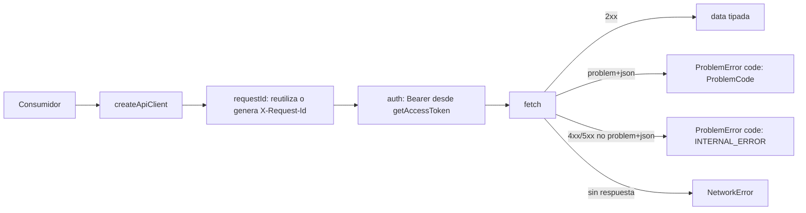
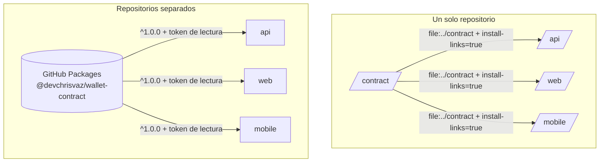

## Context

Ver `proposal.md` (Why). Restricciones que dan forma al diseño:

- Cuatro proyectos independientes en un solo repositorio, sin workspaces ni dependencias de código entre ellos; cada uno con su lockfile y su CI, y con la intención de separarlos en repositorios propios.
- Contrato primero: `contract/openapi.yaml` (OpenAPI 3.1) ya existe y es la fuente de verdad. Sus `operationId` son `healthCheck`, `registerUser`, `verifyEmail`, `resendVerificationEmail`, `login`, `refreshSession`, `logout`, `getCurrentUser`, `listAccounts`, `getAccount`, `listAccountMovements`, `listBeneficiaries`, `createBeneficiary`, `createTransfer`, `getTransfer`, `confirmTransfer` y `resendTransferOtp`.
- El paquete se ejecuta en tres entornos: la API (Node 20+, solo usa el yaml y los tipos), el servidor del BFF de Next.js (Node) y la app móvil (Hermes).
- Dinero: strings decimales en el contrato y centavos enteros en el código; nunca floats ni redondeo.

## Goals / Non-Goals

**Goals:**
- Un único lugar donde viven los tipos, el cliente HTTP, los validadores de entrada y el formato de montos para web y móvil.
- Que los validadores del paquete y los esquemas del yaml no puedan divergir sin que una prueba falle.
- Un paquete que se instale igual hoy (carpeta local) y mañana (registro), cambiando una línea por consumidor.

**Non-Goals:**
- Lógica de sesión o de refresh de tokens: el BFF (servidor) y la app móvil (SecureStore) la resuelven de forma distinta; el paquete solo ofrece el hook para inyectar el access token.
- Hooks de TanStack Query o componentes de UI: cada cliente escribe los suyos.
- Validaciones de dominio que requieren datos (por ejemplo, que la CLABE pertenezca a la plataforma): son de la API.
- Publicar en GitHub Packages en este change: solo se documenta el procedimiento.

## Decisions

### D1. Contrato primero, con el yaml escrito a mano
El yaml se escribió en la fase de especificación y el resto se deriva de él.
- *Descartado:* generar el yaml desde los esquemas Zod de la API (code-first). Contradice el modo SPEC, porque el contrato tendría que existir antes que el código, y comparar un yaml generado contra uno escrito a mano es frágil por orden y formato.

### D2. Tipos con openapi-typescript y cliente con openapi-fetch
Los tipos se generan a `src/generated/api.d.ts` y se versionan; el CI regenera y compara (`git diff --exit-code`). El cliente es `createClient<paths>()` de openapi-fetch envuelto en `createApiClient({ baseUrl, getAccessToken, getRequestId })`.
- *Descartado:* generadores de SDK completos (openapi-generator, orval). Producen mucho código, y orval acopla el cliente a TanStack Query, que no aplica a las Server Actions.
- *Descartado:* tipos escritos a mano. Divergen del contrato sin que nadie lo note.

### D3. Middlewares neutrales y errores tipados

- `ProblemError` expone `status`, `code` (unión de `ProblemCode` exportada como tipo y como arreglo de constantes), `title`, `detail`, `requestId` y las extensiones. Un `code` desconocido (contrato más nuevo en la API) se conserva como string pero se reporta como `INTERNAL_ERROR` en la unión, para que el `switch` exhaustivo de los clientes siga siendo válido.
- `NetworkError` es la única condición reintentable con la misma llave (CTR-07).
- *Descartado:* incluir un middleware de refresh automático. El BFF necesita refresh de una sola vez por sesión en el servidor y la app móvil lee de SecureStore; una implementación común sería incorrecta para ambos.

### D4. Llave de idempotencia provista por el consumidor
`createTransfer` exige la llave como parámetro (header requerido en el contrato, por lo que el tipo lo obliga). El paquete exporta `createIdempotencyKey(generator?)`: usa `globalThis.crypto.randomUUID` cuando existe (Node 20, navegadores) y, si no existe, exige un generador inyectado; la app móvil pasa el `randomUUID` de `expo-crypto`.
- *Descartado:* que el cliente genere la llave en cada llamada. Rompería los reintentos, que deben reutilizar la llave del mismo intento.
- *Descartado:* un polyfill de `crypto` dentro del paquete. Lo acoplaría a React Native.

### D5. Validadores con Zod como peerDependency
Los validadores son esquemas Zod (`amountInput`, `clabe`, `curp`, `rfc`, `phone`, `concept`, `reference`, `otpCode`) y esquemas de formulario (`registerForm`, `verifyEmailForm`, `loginForm`, `beneficiaryForm`, `transferForm`, con `destination` como `discriminatedUnion('type', …)`). Cada falla lleva un `code` estable por campo (`REQUIRED`, `INVALID_FORMAT`, `TOO_MANY_DECIMALS`, `NOT_POSITIVE`, `TOO_LARGE`, `INVALID_CHECK_DIGIT`, `INVALID_DATE`, `TOO_LONG`), el mismo vocabulario de `FieldError.code` del contrato.
- `zod` es `peerDependency` con el rango de la versión mayor vigente: si el paquete trajera su propia copia y la app otra, la composición de esquemas fallaría de forma difícil de diagnosticar.
- La lógica de dígitos verificadores vive en funciones puras (`clabeCheckDigit`, `curpCheckDigit`, `isValidCalendarDate`) que los esquemas reutilizan y que se prueban por separado.
- *Descartado:* Valibot u otra librería. El enunciado sugiere Zod y la API ya lo usa.

### D6. Montos: string → centavos con aritmética entera
`amountInput` acepta solo `string` (un número JSON falla en el tipo), valida con la expresión de `AmountInput` del contrato más la condición "mayor que cero", y transforma con `BigInt(entero) * 100n + BigInt(fraccion.padEnd(2, '0'))`. La función inversa `centsToDecimalString(bigint)` produce siempre 2 decimales. Nunca se usa `Number`, `parseFloat` ni `Math.round`.
- *Descartado:* `Math.round(parseFloat(x) * 100)`. `1.15 * 100` da `114.99999999999999`; con `Math.round` funciona por casualidad y con `Math.floor` pierde un centavo, y `1.005` muestra el mismo problema al redondear.
- *Descartado:* redondear entradas con más de 2 decimales. El dominio no tiene ninguna operación que produzca fracciones de centavo, así que se rechaza.

### D7. Paridad validadores ↔ contrato con vectores compartidos
Las pruebas cargan `openapi.yaml`, compilan los esquemas de componentes con Ajv (JSON Schema 2020-12, modo estricto relajado para palabras clave de OpenAPI como `discriminator` y `example`) y ejecutan **la misma tabla de vectores** contra el esquema del yaml y contra el validador Zod (CTR-13). Los vectores viven en `test/vectors/*.ts` y son la especificación ejecutable de montos, CLABE, CURP, RFC, teléfono, concepto y referencia.
- *Descartado:* confiar en revisiones manuales. Un cambio de patrón en el yaml sin cambiar el validador pasaría desapercibido.

### D8. `formatMXN` con operaciones de texto, sin Intl en tiempo de ejecución
`formatMXN("-1234567.50")` separa signo, parte entera y centavos como strings, agrupa la parte entera de tres en tres con `,` y devuelve `-$1,234,567.50`. Es determinista en cualquier motor y exacto para cualquier longitud.
- En Node, las pruebas usan `Intl.NumberFormat('es-MX', { style: 'currency', currency: 'MXN' }).format(string)` como **oráculo** y comparan resultados, de modo que el formato coincide con la convención de `es-MX`.
- *Descartado:* `Intl.NumberFormat` con strings en tiempo de ejecución más detección de soporte. El soporte de Hermes no está garantizado y tener dos caminos de código duplica el riesgo.
- *Descartado:* convertir a `Number` para formatear. Pierde precisión por encima de 2^53 centavos y viola la regla de no usar floats.

### D9. Build y forma del paquete
tsup genera ESM (`dist/index.mjs`), CJS (`dist/index.cjs`) y declaraciones (`dist/index.d.ts`). `package.json` declara `main`, `module`, `types` y `exports` (con `import`, `require` y `types`), más el subpath `./openapi.yaml` para que la API lo lea (Swagger UI y Ajv). `sideEffects: false`, `files: ["dist", "openapi.yaml"]`. Un script verifica que `version` coincida con `info.version` (CTR-02) y que el build no importe módulos `node:` (CTR-15).
- *Descartado:* publicar solo `exports`. Metro tiene historial de problemas con la resolución por `exports`; los campos clásicos sirven de respaldo.

### D10. Distribución local como artefacto y publicación futura

Con `install-links=true`, npm instala la carpeta como si fuera un paquete publicado: la copia e instala sus dependencias. Sin esa opción, npm crea un enlace simbólico y **no instala las dependencias** del paquete cuando la carpeta está fuera del proyecto. El paquete define un script `prepare` que construye `dist/`, y los CI de los consumidores construyen el contrato antes de instalar.
- *Descartado:* workspaces de npm. Un solo lockfile en la raíz y la mezcla de dependencias de Next y Expo contradicen la independencia de los proyectos.
- *Descartado:* GitHub Packages desde ahora. Exige token incluso para paquetes públicos, y el evaluador no podría instalar sin credenciales.
- *Descartado:* tarball dentro de cada consumidor. Funciona, pero agrega binarios al repositorio y un paso manual de sincronización.

### D11. Lint y CI
`redocly.yaml` usa las reglas recomendadas, con excepción explícita para el servidor `localhost`. `.github/workflows/contract.yml` se ejecuta ante cambios en `contract/**` con Node 20: `npm ci` → lint del contrato → generar tipos y `git diff --exit-code` → typecheck → pruebas → build → verificación de versión y de imports → `npm pack --dry-run`.

## Risks / Trade-offs

- [Los consumidores usan una versión mayor de Zod distinta] → `peerDependency` con rango de una sola versión mayor; los README de cada consumidor lo indican y npm advierte si no coincide.
- [Hermes no ofrece `crypto.randomUUID`] → `createIdempotencyKey` acepta un generador inyectado y falla con un mensaje claro si no hay ninguno disponible.
- [Metro no resuelve bien el mapa de `exports`] → campos `main`, `module` y `types` como respaldo; se comprueba al integrar el paquete en `/mobile`.
- [Con `install-links`, un cambio en `/contract` no llega a los consumidores hasta reinstalar] → el README del paquete documenta el ciclo (`npm run build` en `/contract` y `npm install` en el consumidor). Tras la fase de especificación el contrato cambia poco.
- [No hay garantía de que npm ejecute `prepare` al instalar una carpeta con `install-links`] → los CI de los consumidores construyen el contrato explícitamente antes de instalar y el README lo pide en el arranque local.
- [La API valida con su propio Zod (con transformaciones de dominio) y puede divergir del paquete] → la API ejecuta pruebas de contrato con Ajv sobre el mismo yaml; aquí, las pruebas de paridad cubren los validadores del paquete.
- [El patrón de CURP acepta `X` en el sexo por precaución] → es más permisivo que estricto; el dígito verificador sigue protegiendo contra errores de captura.
- [Vectores de CURP y RFC reales contienen datos personales] → las pruebas usan vectores sintéticos con dígito verificador calculado, nunca datos de personas reales.

## Migration Plan

Al separar los repositorios:
1. Agregar `publishConfig.registry` apuntando a GitHub Packages y un workflow de publicación al crear un tag `v*` (con `permissions: packages: write`).
2. En cada consumidor: reemplazar `"file:../contract"` por `"^<versión>"`, quitar `install-links` y agregar en `.npmrc` el scope `@devchrisvaz` apuntando a `https://npm.pkg.github.com` con `${NODE_AUTH_TOKEN}`.
3. En los CI de los consumidores: `permissions: packages: read` y el token en `NODE_AUTH_TOKEN`; dar acceso de lectura a cada repositorio consumidor desde la configuración del paquete.
4. Rollback: volver a la versión anterior fijada en el `package.json` del consumidor.
