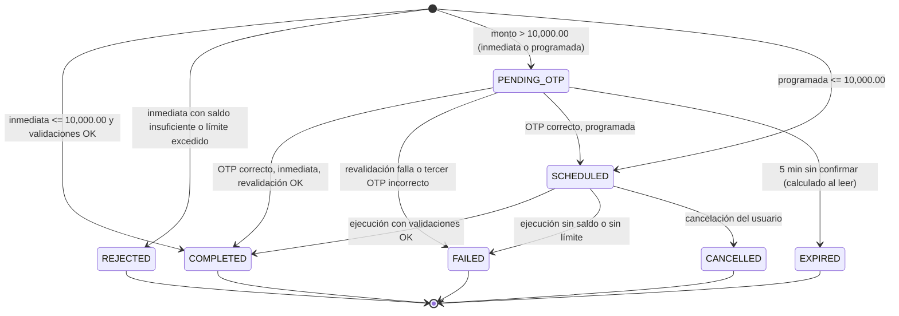

## Context

`api-ledger` resolvió cinco piezas sobre las que se monta este change:
- la creación idempotente, con la llave como columna de `transfers` y una huella de los valores interpretados;
- la confirmación con OTP;
- el límite diario con fila contador;
- el orden global de bloqueos: contador → transferencia → cuentas por `id`, con `FOR NO KEY UPDATE`;
- el reintento único si la espera por bloqueos cruza la medianoche.

`EXPIRED` no se guarda: se calcula al leer.

Una transferencia programada reutiliza todo eso. Lo nuevo es:
- un estado de espera (`SCHEDULED`);
- un estado final sin dinero (`CANCELLED`);
- un ejecutor que actúa sin usuario;
- las carreras entre ese ejecutor, la cancelación y las transferencias manuales.

## Goals / Non-Goals

**Goals:**
- Programar, confirmar, cancelar, listar y ejecutar con exactamente una ejecución por transferencia.
- Respetar el límite diario del día de ejecución y el orden de bloqueos existente.
- Pruebas deterministas con reloj falso, y pruebas de concurrencia reales contra PostgreSQL.

**Non-Goals:**
- Transferencias recurrentes (cada mes) y edición de una programada.
- Programar con hora; solo con fecha.
- Programar o cancelar desde la app móvil.
- Apartar dinero al programar.

## Decisions

### D1. Modelo de datos
La migración agrega lo siguiente a `transfers`:

| Elemento | Definición |
|---|---|
| `scheduled_for` | `date NULL`, fecha de la Ciudad de México |
| `cancelled_at` | `timestamptz NULL` |
| Constraint de estados | La constraint existente de estados agrega `SCHEDULED` y `CANCELLED` |
| `ck_transfers_scheduled_has_date` | `status NOT IN ('SCHEDULED','CANCELLED') OR scheduled_for IS NOT NULL` |
| `ck_transfers_cancelled_at_by_status` | `(status = 'CANCELLED') = (cancelled_at IS NOT NULL)` |
| `ix_transfers_scheduled_due` | `(scheduled_for, created_at, id) WHERE status = 'SCHEDULED'`, para el ejecutor |
| `ix_transfers_user_scheduled` | `(user_id, scheduled_for, created_at) WHERE status = 'SCHEDULED'`, para la lista y el tope |

- `ck_transfers_reason_by_status` y `ck_transfers_completed_at_by_status` no cambian: una programada ejecutada cumple las mismas reglas que una inmediata.
- La migración tiene `down`, que solo se puede aplicar si no existen filas con los estados nuevos. El `down` lo verifica y falla con un mensaje claro.
- `wallet_app` ya tiene `UPDATE` sobre `transfers` desde la confirmación, así que no hay privilegios nuevos.

Una segunda migración recrea `ck_audit_log_action` con `TRANSFER_SCHEDULED` y `TRANSFER_CANCELLED`, conservando `STATEMENT_EXPORTED` de `account-statements`.

*Alternativa descartada:* una tabla aparte `scheduled_transfers` que, al vencer, crea una transferencia. Separa la idempotencia (la llave vive en `transfers`) y hace que el comprobante y la auditoría tengan dos ids para la misma operación del usuario.

### D2. Máquina de estados

La función pura del dominio agrega los eventos `SCHEDULE`, `EXECUTE_OK`, `EXECUTE_FAIL` y `CANCEL`. Sus pruebas unitarias cubren todas las transiciones nuevas y las inválidas; por ejemplo, `CANCEL` desde `PENDING_OTP` o desde `COMPLETED`.

### D3. Huella de idempotencia estable
La serialización canónica actual es `fromAccountId | destination.type | id del destino | amount_cents | concept | reference`. A ella se agrega `| scheduledFor=YYYY-MM-DD` **solo cuando hay fecha**. Así, la huella de toda transferencia inmediata ya guardada no cambia (TRF-29), y una programada nunca coincide con una inmediata.

Una prueba unitaria fija la huella de un vector inmediato tomado antes del cambio.

*Alternativa descartada:* incluir siempre el campo, vacío en las inmediatas. Cambiaría todas las huellas existentes, y un reintento legítimo de una transferencia creada antes de desplegar respondería `IDEMPOTENCY_KEY_REUSED`.

### D4. Programar
El caso de uso de creación recibe `scheduledFor` ya validado en su formato por el contrato. En el dominio valida el rango con el `Clock`:
- de `díaCDMX(now) + 1` a `+ 90`;
- en terceros, que el monto no supere `DAILY_TRANSFER_LIMIT`.

Ambas son validaciones (`VALIDATION_FAILED`), así que no consumen la llave.

Dentro de la transacción, los pasos son:
1. Reclamo de la llave con `INSERT … ON CONFLICT DO NOTHING`, igual que hoy. Un conflicto sigue el camino de reintento existente.
2. Bloqueo del usuario con `SELECT id FROM users WHERE id = $1 FOR NO KEY UPDATE`, para serializar el tope (D8).
3. Conteo de las programadas activas:
   - `status = 'SCHEDULED'`;
   - o `status = 'PENDING_OTP' AND scheduled_for IS NOT NULL AND otp_expires_at > now`;
   - excluyendo la fila recién reclamada.

   Con 20 o más, se hace `ROLLBACK` y se responde 422 `SCHEDULED_LIMIT_REACHED`. No se guarda la transferencia y la llave queda libre.
4. Con monto de hasta 10,000.00: estado `SCHEDULED` con eventos `TRANSFER_CREATED` y `TRANSFER_SCHEDULED`. Con monto mayor: estado `PENDING_OTP` con el código de `one_time_codes` y el correo después del `COMMIT`, que agrega "Programada para el 20 de octubre de 2026".

No se bloquean el contador ni las cuentas: no hay saldo ni límite que validar al programar (TRF-27). La propiedad del origen y del destino se resuelve antes de la transacción, como hoy, y no puede cambiar: las cuentas no cambian de dueño y los beneficiarios no se borran.

### D5. Confirmar una programada
La confirmación lee primero la transferencia sin bloqueo para saber si es programada. `scheduled_for` nunca cambia, así que esa lectura basta para elegir el camino:
- **Inmediata:** sigue el flujo actual sin cambios (contador → transferencia → cuentas).
- **Programada:** bloquea solo la transferencia (`FOR NO KEY UPDATE`).
  - Si está en `SCHEDULED`, responde 200 sin consumir intentos.
  - Si está vencida, responde 409 `TRANSFER_EXPIRED`.
  - Si no, valida el código con el mecanismo de `one_time_codes`. Con el código correcto pasa a `SCHEDULED` con `TRANSFER_SCHEDULED` y no toca contador ni cuentas.

*Alternativa descartada:* tomar el contador también en las programadas para tener un solo camino. Pondría en fila, detrás de las transferencias del usuario, una operación que no mueve dinero.

### D6. Ejecutor dentro de la API con `SKIP LOCKED`
`ScheduledTransferRunner` (capa de aplicación, con puertos) expone `runOnce()`. En el arranque, `main.ts` lo programa cada `SCHEDULER_INTERVAL_MS` (60,000 por defecto) con una sola corrida a la vez por instancia: si una pasada sigue en curso, la siguiente se omite.

Una pasada hace lo siguiente:
1. **Candidatas, sin bloqueo:** `SELECT id, user_id, kind FROM transfers WHERE status = 'SCHEDULED' AND scheduled_for <= $hoyCDMX ORDER BY scheduled_for, created_at, id LIMIT $lote`, con `ix_transfers_scheduled_due`.
2. **Cada candidata en su propia transacción**, respetando el orden global:
   1. Si es `THIRD_PARTY`: `t0 = clock.now()`, `day0 = díaCDMX(t0)`; se crea y se bloquea la fila contador `(user, day0)`.
   2. `SELECT … FROM transfers WHERE id = $1 AND status = 'SCHEDULED' FOR NO KEY UPDATE SKIP LOCKED`. Si no devuelve fila, otra instancia la tiene o ya cambió de estado: `ROLLBACK` y se sigue con la siguiente.
   3. Las cuentas se bloquean `ORDER BY id FOR NO KEY UPDATE`.
   4. `t1 = clock.now()`. Si cruzó la medianoche respecto de `day0`, `ROLLBACK` y un reintento, como en las inmediatas.
   5. Se validan el saldo y el límite de `day0`. Si pasan: asientos, saldos, contador, `COMPLETED` con `completed_at = t1` y `TRANSFER_COMPLETED` (actor `SYSTEM`). Si no: `FAILED` con su motivo y `TRANSFER_FAILED` (actor `SYSTEM`).
   6. `COMMIT`. Si quedó `FAILED`, se envía el correo (D10).
3. **Repetición:** si el lote vino lleno, se repite la pasada hasta que venga incompleto.

La ejecución reutiliza el mismo código de validación y de asientos que `createTransfer`, extraído a un servicio del dominio de "ejecutar una transferencia ya bloqueada", para que ambos caminos no diverjan.

**Errores aislados.** Una excepción en una transferencia, por ejemplo al auditar, revierte solo esa transacción. Se registra con nivel ERROR y la pasada continúa. La transferencia sigue en `SCHEDULED` y se reintenta en la siguiente pasada (TRF-36).

**Por qué no hay deadlocks ni doble ejecución:**
- El ejecutor toma los bloqueos en el mismo orden que todos los demás.
- `SKIP LOCKED` sobre la transferencia evita que dos ejecutores esperen el uno al otro.
- Volver a filtrar `status = 'SCHEDULED'` dentro de la transacción descarta lo que otra instancia ya ejecutó o lo que el usuario canceló.

**Configuración** (validada al arrancar, PLT-08):
- `SCHEDULER_ENABLED`: `true` por defecto; `false` en el entorno de pruebas, que llama a `runOnce()` directamente.
- `SCHEDULER_INTERVAL_MS`: entre 1,000 y 3,600,000.
- `SCHEDULER_BATCH_SIZE`: 100.

**Apagado ordenado.** Al recibir `SIGTERM` se detiene el intervalo y se espera la pasada en curso antes de cerrar el pool.

*Alternativas descartadas:*

| Alternativa | Por qué no |
|---|---|
| Un schedule de EventBridge Scheduler por transferencia | Una dependencia externa por cada programación y sincronizar cancelaciones con AWS. En local necesitaría un emulador. Queda documentada como evolución para AWS: un solo schedule cada minuto que invoque `runOnce` en una tarea |
| `pg_cron` | La lógica de negocio quedaría en SQL, y la extensión no está en todas las bases administradas |
| Una cola (BullMQ con Redis) | Infraestructura nueva para un trabajo que PostgreSQL ya coordina con `SKIP LOCKED` |
| Elección de líder con `pg_advisory_lock` | Innecesaria: con `SKIP LOCKED` todas las instancias pueden correr el ejecutor y se reparten el trabajo sin coordinarse |
| Un proceso o contenedor aparte del ejecutor | Más correcto a gran escala, y queda como evolución documentada. Para esta prueba, dentro de la API se demuestra igual y se despliega con una sola imagen |

### D7. Cancelar
1. `SELECT … FROM transfers WHERE id = $1 AND user_id = $2 FOR NO KEY UPDATE`. Sin fila, 404. El bloqueo espera si el ejecutor tiene la transferencia.
2. Según el estado:
   - `SCHEDULED`: pasa a `CANCELLED` con `cancelled_at = clock.now()` y `TRANSFER_CANCELLED` (actor `USER`), y responde 200.
   - `CANCELLED`: responde 200 sin cambios ni evento.
   - Otro estado, incluido `EXPIRED` calculado: responde 409 `TRANSFER_NOT_CANCELLABLE` con `transferStatus`.

La cancelación toma un solo bloqueo (la transferencia), así que no puede formar un ciclo. La carrera con el ejecutor tiene dos salidas:
- **El ejecutor tiene la fila:** la cancelación espera, ve `COMPLETED` o `FAILED` y responde 409.
- **La cancelación tiene la fila:** el ejecutor la salta con `SKIP LOCKED`. En la siguiente pasada ya no está en `SCHEDULED`.

### D8. Tope de 20 por usuario
Para serializar por usuario se bloquea la fila de `users` con `FOR NO KEY UPDATE`. Ese bloqueo no choca con el `FOR KEY SHARE` que toman las llaves foráneas de `transfers.user_id`, y solo lo toma la programación. Con eso, dos programaciones simultáneas del mismo usuario se ponen en fila, y la segunda cuenta la primera ya confirmada (`READ COMMITTED`, sentencia nueva).

*Alternativas descartadas:*
- **`pg_advisory_xact_lock(hashtext(user_id))`.** Funciona igual, pero es un bloqueo fuera del modelo, menos visible en `pg_locks` y con riesgo de colisiones de hash.
- **No tener tope.** La lista sin paginación quedaría sin límite, y un cliente podría crear miles de programadas.

### D9. Lista de programadas
`SELECT … FROM transfers WHERE user_id = $1 AND status = 'SCHEDULED' ORDER BY scheduled_for, created_at, id`, con `ix_transfers_user_scheduled` y el mismo mapeo a `Transfer` que `getTransfer`. Con el tope de 20 no hace falta paginación.

### D10. Correo de falla
Es una plantilla nueva del puerto de correo, con lo siguiente:
- **Asunto:** "Tu transferencia programada no se realizó".
- **Cuerpo:**
  - monto con `formatMXN`;
  - `displayName` y los últimos 4 dígitos de la CLABE del destino;
  - fecha programada en palabras;
  - motivo: "saldo insuficiente" o "se alcanzó el límite diario de transferencias".

Se envía después del `COMMIT`, igual que el OTP. Si falla, se registra un WARN con el `transferId`, sin el correo del usuario.

*Alternativa descartada:* reintentar el envío del aviso con una tabla de pendientes (outbox). Es más robusto y queda como seguimiento documentado. El estado `FAILED` y el historial ya informan al usuario.

### D11. Web
- **Selector "Cuándo":** grupo de radios con "Ahora" y "Programar", y un `<input type="date">` con `min` y `max` de `schedulableRange(now)` del contrato. El formulario valida con `transferFormAt(now)`.
- **Revisión:** "Se enviará el 20 de octubre de 2026". La fecha se escribe con `Intl.DateTimeFormat('es-MX', { dateStyle: 'long', timeZone: 'UTC' })` sobre la fecha calendario, para que no se recorra un día.
- **Envío:** la Server Action de creación pasa `scheduledFor` y conserva la llave por intento (WEB-17). La de confirmación ya maneja el resultado `SCHEDULED`.
- **Resultado:** el resultado `SCHEDULED` muestra "Transferencia programada", la fecha y un enlace a `/transfers/scheduled`.
- **Página `/transfers/scheduled`:**
  - componente cliente con TanStack Query sobre el proxy (lista blanca: `transfers/scheduled`);
  - estado vacío;
  - por transferencia, un botón "Cancelar" que abre un diálogo accesible: foco atrapado, Escape, y el foco vuelve al botón;
  - la Server Action `cancelTransfer` sigue WEB-06 a WEB-08;
  - al responder, se invalida la consulta de la lista y se anuncia con una región `aria-live`.
- **Navegación:** agrega "Programadas".
- **Comprobante:** muestra `scheduledFor` cuando existe y la insignia de los estados nuevos.

### D12. Móvil
La app reinstala el contrato 1.2.0 y el paquete de diseño 1.1.0. Los mapeos de estado usan los datos del paquete, y una prueba fija que `SCHEDULED` se muestra como "Programada". No se agrega ningún control de programación (MOB-23).

### D13. Pruebas
- **Unitarias:** la máquina de estados; la huella con el vector inmediato fijo; el rango programable con reloj falso; la validación del monto mayor al límite.
- **Integración** con PostgreSQL y reloj falso:
  - todos los escenarios de TRF-27 a TRF-36;
  - el ejecutor se invoca con `runOnce()` después de mover el reloj;
  - la falla de auditoría se simula con un escritor de auditoría que lanza un error.
- **Concurrencia:**
  - dos `runOnce()` simultáneos sobre 50 vencidas, con dos instancias del runner sobre el mismo pool, y conciliación al final;
  - la carrera de cancelación contra ejecución, con dos conexiones y una barrera: la prueba bloquea la transferencia en una, lanza la otra y libera;
  - el ejecutor contra transferencias manuales desde la misma cuenta;
  - el tope con dos programaciones simultáneas.
- **Contrato:** cada respuesta nueva se valida con `expectToMatchContract`.
- **Web:** pruebas de componentes del selector, la revisión, el resultado, la página, el diálogo y el `axe`. Pruebas de las Server Actions con la API simulada.

## Risks / Trade-offs

- **[Riesgo] Reloj de la instancia y medianoche.** Si dos instancias tienen relojes con segundos de diferencia, una puede ejecutar un poco antes de las 00:00 que la otra. El día de ejecución siempre se deriva del reloj de la instancia que ejecuta, igual que en las inmediatas. Mitigación: NTP en Fargate. El margen es de segundos y no afecta la exactitud del ledger.
- **[Riesgo] Muchas programadas para el mismo día.** Mitigación: lotes de 100 y una transacción por transferencia. Varias instancias reparten el trabajo con `SKIP LOCKED`.
- **[Trade-off] Ejecutar tarde en lugar de marcar como perdida.** Una programada cuya fecha pasó se ejecuta en cuanto el proceso vuelve, y consume el límite de ese día. Se prefiere a perderla en silencio, y queda documentado.
- **[Trade-off] Sin apartar el dinero.** El usuario puede quedarse sin saldo para su programada. El aviso por correo (TRF-35) lo informa.
- **[Riesgo] Conflictos con la rama del rediseño** en el flujo de transferencia y la navegación de la web. Mitigación: componentes aparte y una nota en `redesign` para incorporarlos en su fase de aplicación.

## Migration Plan

1. Migraciones aditivas: columnas nulas, constraints que las filas existentes ya cumplen e índices parciales sobre un estado que no existe aún. Se aplican sin bloquear escrituras más que lo que dura el `ALTER TABLE`.
2. Se despliega la API con el ejecutor habilitado. Las transferencias existentes no cambian de huella (D3).
3. **Reversión:** se deshabilita `SCHEDULER_ENABLED` y se despliega la versión anterior de la API. Los `down` solo proceden si ninguna fila tiene `scheduled_for` (ver la corrección de D1 abajo). Con programadas ya creadas, la reversión es hacia adelante: no se borran datos.

## Correcciones posteriores a la implementación

- **D1, `down` protegido.** El `down` se niega si alguna fila tiene `scheduled_for`, no solo si hay filas en los estados nuevos. Quitar la columna borraría en silencio la fecha de las programadas ya ejecutadas o fallidas. Por eso el plan de reversión anterior ("cancelar las pendientes y aplicar los `down`") no podía ejecutarse: las canceladas son justo las filas que el `down` rechaza.
- **D4, orden de las validaciones.** El rango de la fecha y el monto mayor al límite se validan justo después de reclamar la llave, no antes. Si se validaran antes, un reintento que llega después de medianoche recibiría `DATE_OUT_OF_RANGE` por una transferencia que ya existe y se va a ejecutar. Una petición nueva con fecha inválida sigue revirtiéndose sin consumir la llave.
- **D6, lotes.** Un lote lleno continúa con un cursor por `(scheduled_for, created_at, id)` después de la última candidata, en lugar de repetir la misma consulta. Repetirla haría un ciclo infinito si un lote completo fallara siempre (por ejemplo, con la auditoría caída).
- **D6, primera pasada.** Al arrancar, la API corre una pasada de inmediato y después una por intervalo. Así, las vencidas salen en cuanto la API vuelve después de estar caída.
- **D6, servicio compartido.** La validación y el asiento de una transferencia ya bloqueada viven en `LockedTransferExecutor`, con la regla en el dominio. Lo usan la creación inmediata, la confirmación y el ejecutor.
- **Decisiones abiertas que se cerraron:**
  - Confirmar una programada que ya se ejecutó responde 200; si está cancelada o fallida responde 409 `TRANSFER_NOT_PENDING`.
  - `SCHEDULER_BATCH_SIZE` va de 1 a 1,000.
  - El aviso de falla que no se pudo enviar se registra con WARN, el `transferId` y sin destinatario.
- **Riesgo que queda:** la confirmación de una programada no vuelve a contar el tope (D5). Con relojes de instancias desfasados unos segundos, podrían quedar 21 en `SCHEDULED`.
