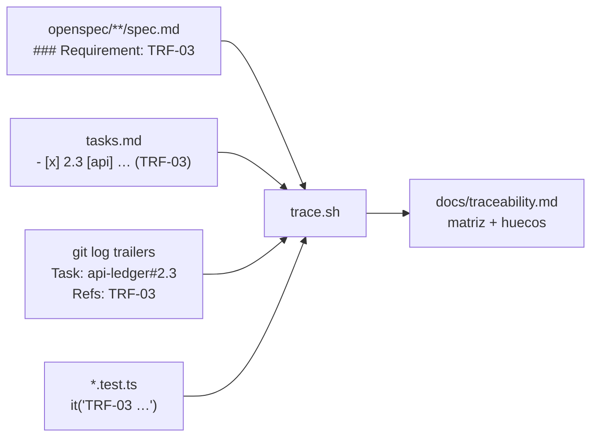

## Context

Ver `proposal.md` (Why). Este change se ejecuta al final, cuando ya existen los cuatro proyectos, sus CIs y los commits con trailers. Restricciones que dan forma al enfoque:

- **No se despliega nada.** La parte de AWS es un documento escrito y justificado (`/docs/aws-deploy.md`); el esqueleto de IaC es bonus y queda fuera.
- **La arquitectura ya está decidida** por los changes anteriores y condiciona la propuesta: API Express con PostgreSQL y locks explícitos; **web con BFF en Next.js** (necesita servidor y Redis para sesiones); OTP y verificación por **correo** (Mailpit en local); roles de base de datos separados (`wallet_migrator`, `wallet_app`); `audit_log` y `ledger_entries` solo de inserción; límite diario por día calendario en `America/Mexico_City`; rate limiting por IP + email que solo confía en `X-Forwarded-For` del BFF o del ALB.
- **Cuatro proyectos independientes** en un repositorio, cada uno con su CI y su lockfile, que se separarán en repositorios propios (`openspec/` pasará a ser un *store*; el contrato se publicará en GitHub Packages).
- **Trazabilidad evaluada:** requisitos con ID en `openspec/specs`, tareas con etiqueta e IDs, commits con trailers `Task:` y `Refs:`, pruebas cuyo título empieza con el ID.
- **El alcance se aceptó por encima de las 10–14 h** del enunciado; el README lo declara.

## Goals / Non-Goals

**Goals:**
- Que un evaluador clone el repositorio, siga el README y tenga la API (con seed de 100k), Mailpit, la web y la app móvil corriendo, y sepa correr todas las pruebas.
- Que la propuesta de AWS responda cada fila de la tabla del enunciado y las tres preguntas escritas, con decisiones y alternativas descartadas, coherente con la arquitectura real.
- Que la trazabilidad requisito → tarea → commit → prueba se pueda **generar**, no solo afirmar.
- Que el checklist de entregables del enunciado quede verificado punto por punto.

**Non-Goals:**
- Desplegar en AWS o escribir IaC ejecutable.
- Cambiar comportamiento de cualquier proyecto (si la verificación encuentra un defecto, se corrige en el change del proyecto correspondiente, no aquí).
- Un sitio de documentación; todo es Markdown en el repositorio.

## Decisions

### D1. Cómputo de la API: ECS Fargate

Servicio ECS en Fargate, en subredes privadas, detrás de un ALB, con autoescalado por CPU y por número de peticiones.

| Alternativa | Por qué se descarta |
|---|---|
| App Runner | Menos control de red y de sidecars (colector de OpenTelemetry), menos control del ciclo de despliegue y de las tareas puntuales (migraciones con el rol `wallet_migrator`). Para una empresa regulada pesa más el control que la simplicidad |
| EKS | Costo operativo de un clúster de Kubernetes para un solo servicio; no se justifica |
| Lambda + API Gateway | Cada invocación abre conexiones: en picos (como 100 transferencias simultáneas sobre la misma cuenta, que hacen cola en el `FOR UPDATE`) se agotan las conexiones de PostgreSQL. Obliga a RDS Proxy desde el día uno, suma *cold starts* a operaciones de dinero y complica los timeouts de transacciones que esperan locks |

Las **migraciones** se ejecutan como tarea ECS puntual con las credenciales de `wallet_migrator`, antes de actualizar el servicio, siguiendo el patrón *expand/contract* para que la versión anterior siga funcionando durante el despliegue. La API corre siempre con `wallet_app`.

### D2. Base de datos: RDS for PostgreSQL Multi-AZ

RDS for PostgreSQL (versión ≥ 15) con despliegue Multi-AZ, cifrado con KMS, backups automáticos con recuperación a un punto en el tiempo (PITR) y copia de backups a una segunda región.

| Alternativa | Por qué no ahora |
|---|---|
| Aurora PostgreSQL | Failover más rápido, almacenamiento que crece solo y réplicas más baratas, pero mayor costo base y diferencias de comportamiento que no aportan en el volumen inicial. Es la **evolución natural** en el escenario de 100x (D11) |
| Self-managed en EC2 | Sin justificación: parches, backups y failover manuales en un entorno regulado |

**Objetivos:**

| Escenario | RPO | RTO |
|---|---|---|
| Caída de una zona de disponibilidad | 0 (réplica síncrona del standby) | ≤ 2 min (failover automático) |
| Corrupción lógica o error humano | ≤ 5 min (PITR) | ≤ 1 h (restauración a una instancia nueva y cambio de endpoint) |
| Pérdida de la región | ≤ 1 h (copia de backups entre regiones) | ≤ 4 h (procedimiento documentado de DR) |

Los objetivos son **propuestas** que deben validarse con el área de riesgo; se documentan como tales.

### D3. Web: Next.js (BFF) en ECS Fargate detrás de CloudFront

La web no es estática: el BFF guarda la sesión en el servidor, ejecuta Server Actions y llama a la API con el access token. Por eso **no aplica S3 + CloudFront**, que es lo que sugiere el enunciado; es una desviación justificada.

| Alternativa | Por qué se descarta |
|---|---|
| S3 + CloudFront | Solo sirve sitios estáticos; el BFF necesita servidor |
| Amplify Hosting con SSR | El cómputo SSR de Amplify lo administra AWS fuera de tu VPC, así que no llega a ElastiCache en subredes privadas, que es donde viven las sesiones del BFF. Además deja menos control de cabeceras y de `serverActions.allowedOrigins` |
| **Next.js en Fargate detrás de CloudFront** (elegida) | Misma plataforma operativa que la API, acceso privado a Redis y a la API, CloudFront cachea los assets estáticos y termina TLS; WAF en CloudFront |

Detalles: `serverActions.allowedOrigins` incluye el dominio público, porque CloudFront cambia el `Host`; el BFF reenvía `X-Forwarded-For` y la API solo confía en él cuando viene del ALB interno o del BFF.

### D4. App móvil: EAS Build y tiendas

- **Distribución:** EAS Build genera los binarios firmados; EAS Submit los publica en App Store y Google Play. Las actualizaciones OTA (EAS Update) solo con firma de código y el mismo flujo de aprobación que un release, porque cambian código que mueve dinero.
- **Conexión segura:** solo HTTPS (TLS 1.2+) contra el dominio de la API servido por CloudFront con WAF; el binario no contiene secretos (la API autentica al usuario, no a la app); tokens en el almacenamiento seguro del sistema operativo.
- **Descartado por ahora:** *certificate pinning* (el riesgo de dejar sin servicio a la app al rotar certificados supera el beneficio en esta etapa) y App Attest / Play Integrity (van a "qué haría con más tiempo").

### D5. Sesiones y rate limiting: ElastiCache (Redis)

Las sesiones del BFF (en un `Map` en local) y los contadores de rate limiting (en memoria en local) pasan a ElastiCache for Redis con cifrado en tránsito y en reposo. Sin un almacén compartido, cada instancia tendría sus propias sesiones y su propio conteo, y el rate limiting dejaría de funcionar al escalar. Se complementa con **reglas por tasa de AWS WAF** en CloudFront como primera barrera.

Alternativa descartada: DynamoDB para sesiones (funciona, pero agrega otro modelo de datos cuando Redis cubre sesiones y contadores con una sola pieza).

### D6. Correo: Amazon SES

Mismo adaptador SMTP que usa Mailpit en local, apuntando a SES con DKIM, SPF y DMARC configurados y fuera del *sandbox*. Las métricas de rebote y queja van a CloudWatch. Alternativa descartada: un proveedor externo (otro contrato y otro tratamiento de datos personales sin beneficio claro).

### D7. Secretos, cifrado y tiempo

- **Secrets Manager:** credenciales separadas de `wallet_migrator` y `wallet_app` (con rotación), secreto del JWT, credenciales SMTP. Las tareas ECS las reciben por referencia, nunca en la imagen.
- **KMS:** llaves administradas por el cliente para RDS, S3, ElastiCache y los logs.
- **Rotación del secreto JWT (HS256):** requiere un periodo con dos secretos válidos para verificar; se documenta el procedimiento.
- **Tiempo:** el límite diario depende de la hora correcta. Las tareas Fargate usan el reloj del host, sincronizado con Amazon Time Sync Service; la zona de negocio sigue siendo `America/Mexico_City` vía IANA en la aplicación.

### D8. Observabilidad y auditoría

| Pieza | Propuesta | Retención |
|---|---|---|
| Logs de aplicación (JSON con `requestId` y datos sensibles enmascarados) | CloudWatch Logs | 90 días en caliente; exportación a S3 si cumplimiento lo pide |
| Métricas y alarmas | CloudWatch (latencia, 5xx, rechazos por saldo y límite, `REFRESH_TOKEN_REUSE_DETECTED`, errores de permiso `42501`, fallos de envío de correo) | — |
| Trazas | OpenTelemetry SDK + colector ADOT como sidecar → X-Ray | 30 días |
| Auditoría de AWS | CloudTrail de organización hacia un bucket S3 dedicado con Object Lock | Igual que `audit_log` |
| `audit_log` (negocio y seguridad) | En caliente en RDS (13 meses); exportación periódica a S3 con **Object Lock en modo compliance** (nadie, ni el dueño, puede borrar antes del plazo) | **A validar con cumplimiento.** Referencias en México: 5 años (prevención de lavado de dinero) a 10 años (registros mercantiles) |

La inmutabilidad dentro de PostgreSQL (permisos y triggers) protege contra la aplicación y contra errores; la protección contra un administrador de la base la da S3 con Object Lock.

**Alternativa descartada:** solo OpenTelemetry hacia un proveedor externo de observabilidad (es válido, pero en un entorno regulado se prefiere mantener logs y trazas dentro de la cuenta).

### D9. CI/CD: GitHub Actions con OIDC

- **Un pipeline por proyecto** (`contract`, `api`, `web`, `mobile`), con filtros de rutas; un cambio en `contract/**` dispara también los de sus consumidores.
- **OIDC:** cada ambiente asume un rol IAM distinto por federación con GitHub; no hay llaves de AWS de larga duración en el repositorio.
- **Ambientes dev, staging y prod** como *GitHub Environments*; prod requiere aprobación manual y solo despliega desde tags.
- **Flujo de la API:** lint → pruebas (con PostgreSQL de servicio) → build de imagen → push a ECR → tarea de migración → actualización del servicio ECS (despliegue *rolling* con *circuit breaker* y rollback automático).
- **Contrato:** se publica en GitHub Packages solo cuando se separen los repositorios.

Alternativa descartada: CodePipeline (funciona, pero el código y los CIs ya viven en GitHub; dos sistemas de CI no aportan).

### D10. Conexiones a PostgreSQL al escalar

- **Pool por tarea** con tamaño fijo (por ejemplo, 10 conexiones) y la regla `tareas_máximas × tamaño_del_pool ≤ max_connections − reserva` (la reserva cubre migraciones, administración y monitoreo).
- **RDS Proxy** entre la API y RDS: multiplexa conexiones cuando el autoescalado agrega tareas y acorta el impacto de un failover. Las transacciones de la API usan `FOR UPDATE` dentro de la transacción y no dependen de estado de sesión, lo cual evita el *pinning* del proxy; los `SET` de sesión quedan prohibidos.
- **Timeouts:** `lock_timeout` y `statement_timeout` por transacción para que una cola de locks no retenga conexiones indefinidamente.

### D11. Si el volumen crece 100 veces

| Presión | Cambio |
|---|---|
| Lecturas del historial | Réplicas de lectura (o Aurora con réplicas) para `GET /accounts/{id}/movements`; los saldos y las transferencias siguen en el primario |
| Tamaño de `ledger_entries` | Particionado por rango mensual de `created_at`; el cursor por `(created_at, id)` y los filtros de fecha aprovechan el *partition pruning*; las particiones viejas pasan a almacenamiento más barato |
| Cuentas calientes | La Tesorería (y cualquier cuenta con muchas transferencias concurrentes) se vuelve un cuello de botella del `FOR UPDATE`: cuentas de sistema fragmentadas o, para la Tesorería, no mantener un saldo cacheado que haya que bloquear |
| Correos | Patrón *outbox* con un worker (SQS) en lugar del envío síncrono tras el COMMIT |
| Idempotencia | Tabla genérica `idempotency_keys` con TTL para extender la idempotencia a otros endpoints |
| Base de datos | Migración a Aurora PostgreSQL; evaluación de particionar por usuario si una sola instancia escritora no alcanza |
| Borde | Reglas WAF más finas y caché en CloudFront de lo que sea público |

### D12. Infraestructura como código: Terraform

| Alternativa | Por qué no |
|---|---|
| **Terraform** (elegida) | El `plan` es un artefacto revisable que encaja con la gestión de cambios de una empresa regulada; permite políticas como código (OPA); no depende del lenguaje de la aplicación; ecosistema de módulos maduro |
| CDK | Atractivo porque el equipo escribe TypeScript, pero el resultado (CloudFormation sintetizado) es más difícil de revisar en una aprobación de cambios |
| SAM | Pensado para serverless; con Fargate no aplica |

El esqueleto de código queda fuera del alcance (es bonus).

### D13. README raíz y Mapa de la especificación

Estructura del README:

1. Qué es (una línea) y estado de los CIs.
2. Estructura del repositorio (cuatro proyectos independientes) y por qué no hay monorepo ni `/specs`.
3. Requisitos (Node, Docker) y **arranque local** en orden: `db:bootstrap`, `db:migrate`, `db:seed`, `dev` de la API; Mailpit (`http://localhost:8025`); Swagger UI; web; app móvil con Expo Go o simulador apuntando a la API local. Usuarios demo del seed.
4. Cómo correr las pruebas de cada proyecto (unitarias, integración contra PostgreSQL real, concurrencia).
5. **Mapa de la especificación**: tabla HU1–HU6 → IDs de requisito → change → secciones de tareas, con enlace a la matriz completa generada (`docs/traceability.md`).
6. Decisiones clave (enlaces a los `design.md`).
7. **Qué haría con más tiempo** (lista acordada).
8. Nota de alcance: se aceptó exceder las 10–14 h estimadas, y por qué.

Los comandos y puertos se toman de los README de cada proyecto (no se inventan); el README raíz enlaza a ellos en lugar de duplicar detalles.

Alternativa descartada: generar el README completo con un script (frágil y difícil de leer; solo se genera la matriz de trazabilidad).

### D14. `scripts/trace.sh`

Script Bash (requiere `git`, `grep`, `awk`; sin dependencias de Node para no crear un proyecto más en la raíz) que:

1. Lee los requisitos (`### Requirement: XXX-NN Título`) de `openspec/specs/**/spec.md` y, si aún no se archivaron, de `openspec/changes/**/specs/**/spec.md`.
2. Lee las tareas con sus IDs de `openspec/changes/**/tasks.md` (incluido `archive/`).
3. Lee los commits con `git log --format='%H%x1f%s%x1f%(trailers:key=Task,valueonly,separator=%x2C)%x1f%(trailers:key=Refs,valueonly,separator=%x2C)'`.
4. Busca pruebas cuyo título empiece con un ID (`it(`, `test(`, `describe(`) en `contract/`, `api/`, `web/` y `mobile/`, excluyendo `node_modules`.
5. Escribe en stdout una tabla Markdown `ID | Requisito | Change | Tareas | Commits | Pruebas`, seguida de una sección de **huecos** (requisitos sin tarea, sin commit o sin prueba).
6. Con `--check`, termina con código distinto de cero si hay huecos.

Se ejecuta como `scripts/trace.sh > docs/traceability.md`.

Alternativa descartada: un script en Node/TypeScript (necesitaría un `package.json` en la raíz, lo que acerca el repositorio a un monorepo).

### D15. Guion del video (≤ 5 min)

| Tiempo | Contenido |
|---|---|
| 0:00–0:30 | Arquitectura en una imagen (diagrama de aws-deploy.md o del README) y los cuatro proyectos |
| 0:30–1:30 | Web: registro, código en Mailpit, verificación, resumen de cuentas con límite restante |
| 1:30–2:30 | Web: alta de beneficiario (CLABE válida), transferencia menor a 10k con comprobante, historial con filtros |
| 2:30–3:15 | Web: transferencia mayor a 10k con OTP desde Mailpit; **intento con saldo insuficiente** y su error |
| 3:15–4:30 | Móvil: login, saldo, últimos 20 movimientos, transferencia a beneficiario con OTP; pérdida de red simulada y reintento con la misma llave; contenido oculto al pasar a segundo plano |
| 4:30–5:00 | Pruebas de concurrencia (100 transferencias, saldo al centavo) y CIs en verde |

### D16. Cierre del ai-log y verificación final

- **ai-log:** una entrada por sesión de implementación; sección final con las correcciones hechas a la AI (en especial cualquier propuesta insegura o incorrecta con el dinero) y un resumen de qué funcionó del flujo spec-first.
- **CIs:** verificación con `gh run list --branch main --workflow <archivo>` para los cuatro workflows.
- **Checklist del enunciado:** se recorre punto por punto y se anota en el README dónde está cada entregable.

## Risks / Trade-offs

- [Las decisiones de AWS aún no las revisó el usuario] → Se proponen aquí con alternativas; la tarea de redacción del documento empieza por confirmarlas.
- [Los objetivos de RPO/RTO y el plazo de retención son supuestos] → Se presentan explícitamente como objetivos a validar con riesgo y cumplimiento, no como hechos.
- [El README puede desincronizarse de los proyectos] → El README raíz enlaza a los README de cada proyecto y solo resume; la matriz se regenera con `trace.sh`.
- [`trace.sh` depende de que los commits respeten los trailers] → `--check` en un paso del cierre; los huecos se corrigen o se documentan.
- [Diferencias entre GNU y BSD en `grep`/`awk`/`sed`] → El script usa solo opciones POSIX y `grep -E`; se prueba en Linux y se documenta el requisito.
- [Exceder el tiempo del enunciado] → Decisión consciente del usuario, declarada en el README y en el ai-log.

## Open Questions

- Plazo exacto de retención de `audit_log` y CloudTrail: depende de cumplimiento; no cambia el diseño (S3 con Object Lock admite cualquier plazo).
