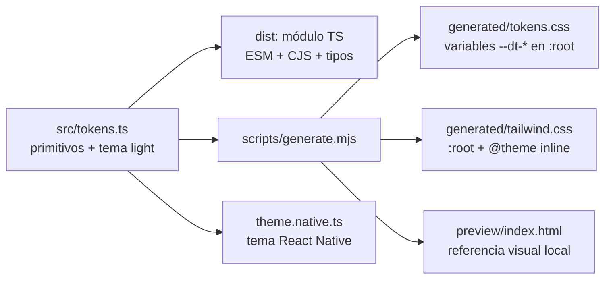

## Context

Ver `proposal.md` (Why). Restricciones que dan forma al diseño:

- Proyectos independientes sin workspaces: el sistema de diseño es un paquete propio que web y móvil consumen como artefacto, igual que `@devchrisvaz/wallet-contract`.
- La web usa Next.js con **Tailwind v4** (tokens en CSS con `@theme`, no en un preset de JavaScript). La app móvil usa Expo con `StyleSheet` y necesita valores numéricos y nombres de familia tipográfica por peso.
- DOM y React Native no comparten componentes: se comparte el **qué** (tokens, convenciones, textos e inventario de componentes) y cada cliente implementa el **cómo**.
- La dirección visual es la de treo.mx, investigada en su HTML y en el kit global de su tema (Elementor/VamTam): ver "Fuentes" al final.

## Goals / Non-Goals

**Goals:**
- Una sola fuente de tokens que genera las salidas de cada plataforma, con pruebas que impiden que diverjan.
- Contraste WCAG AA garantizado por pruebas, no por revisión manual.
- Que dos agentes que implementan web y móvil en paralelo produzcan pantallas coherentes sin coordinarse entre sí.

**Non-Goals:**
- Tema oscuro (la estructura lo permite; no se entrega ni se prueba).
- Componentes compartidos entre DOM y React Native.
- Copiar el logotipo, la iconografía propia o archivos de fuentes de Treo.
- Publicar la referencia visual fuera del repositorio.

## Decisions

### D1. Paleta: primitivos de Treo y tokens semánticos accesibles

**Primitivos** (solo se usan para definir los tokens semánticos; ningún componente los referencia):

| Primitivo | Valor | Origen en treo.mx |
|---|---|---|
| `green900` (verde profundo) | `#1C4B42` | `--vamtam-btn-bg-color` |
| `lime400` (lima) | `#B4E717` | `--vamtam-btn-hover-bg-color`, enlaces activos |
| `ink` | `#001A05` | `vamtam_accent_1` |
| `green500` (verde de marca) | `#31C454` | `vamtam_accent_2`, `_4`, `_6` |
| `green50` | `#EDF7ED` | `vamtam_accent_3` |
| `sand50` | `#F6F5F2` | fondo del megamenú |
| `white` | `#FFFFFF` | `vamtam_accent_5` |

**Tokens semánticos del tema claro** (nombre TS → variable CSS → color de Tailwind):

| Rol | TS | CSS / Tailwind | Valor | Contraste |
|---|---|---|---|---|
| Superficie | `surface.default` | `--dt-surface` / `surface` | `#FFFFFF` | |
| Superficie sutil | `surface.subtle` | `surface-subtle` | `#F6F5F2` | |
| Superficie de marca | `surface.brand` | `surface-brand` | `#EDF7ED` | |
| Superficie invertida | `surface.inverse` | `surface-inverse` | `#1C4B42` | |
| Texto principal | `text.primary` | `fg` | `#001A05` | 18.26 sobre blanco |
| Texto secundario | `text.secondary` | `fg-secondary` | `#4B5A50` | 7.30 / 6.65 sobre `surface.brand` |
| Texto atenuado | `text.muted` | `fg-muted` | `#5F6B63` | 5.57 / 5.11 sobre `surface.subtle` |
| Texto sobre acción | `text.onAction` | `fg-on-action` | `#FFFFFF` | 9.84 sobre `action.primary` |
| Texto sobre acción activa | `text.onActionActive` | `fg-on-action-active` | `#1C4B42` | 6.74 sobre lima |
| Texto sobre invertida | `text.onInverse` | `fg-on-inverse` | `#FFFFFF` | 9.84 |
| Acción | `action.primary` | `action` | `#1C4B42` | |
| Acción activa | `action.primaryActive` | `action-active` | `#B4E717` | |
| Acción deshabilitada | `action.disabled` | `action-disabled` | `#DCE2DE` | |
| Texto deshabilitado | `text.disabled` | `fg-disabled` | `#4B5A50` | ≥ 4.5 sobre `action.disabled` (lo verifica la prueba) |
| Borde | `border.default` | `border` | `#DCE2DE` | decorativo |
| Borde de campo | `border.input` | `border-input` | `#8A958D` | 3.10 (componente de interfaz) |
| Foco | `border.focus` | `focus` | `#1C4B42` | 9.84 |
| Acento de marca | `accent.brand` | `accent` | `#31C454` | **solo decorativo**: 2.29 como texto |
| Éxito | `status.success.fg` / `.bg` | `success` / `success-soft` | `#1E7B3A` / `#EDF7ED` | 5.32 / 4.84 |
| Aviso | `status.warning.fg` / `.bg` | `warning` / `warning-soft` | `#8A5A00` / `#FFF8E5` | 5.59 |
| Error | `status.danger.fg` / `.bg` | `danger` / `danger-soft` | `#B42318` / `#FEF3F2` | 6.57 / 6.05 |
| Información | `status.info.fg` / `.bg` | `info` / `info-soft` | `#1C4B42` / `#EDF7ED` | |
| Neutro | `status.neutral.fg` / `.bg` | `neutral` / `neutral-soft` | `#4B5A50` / `#F6F5F2` | |
| Dinero entrante | `money.in` | `money-in` | `#1E7B3A` | 5.32 / 4.84 sobre `surface.brand` |
| Dinero saliente | `money.out` | `money-out` | `#001A05` | 18.26 |

Ajustes frente a Treo y por qué:
- `#31C454` falla como texto (2.29:1): queda solo como acento (íconos, barra del límite diario, indicadores).
- `#7E7E7E` falla AA (4.06:1): se reemplaza por `#4B5A50` y `#5F6B63`.
- Treo no define colores de estado: se agregan éxito, aviso, error, información y neutro, armonizados con la paleta.
- El borde de Treo (negro al 10 %) no llega a 3:1: el borde de los campos es `#8A958D`.
- El foco no usa el lima: sobre blanco no se distingue. Usa `#1C4B42`.
- Sobre el lima solo va texto `#1C4B42`: el blanco sobre lima no llega a 2:1.

*Alternativa descartada:* usar los colores de Treo sin ajustes. La prueba técnica evalúa accesibilidad básica y la app muestra saldos y errores que deben leerse.

### D2. Tipografía

Work Sans (Google Fonts, licencia OFL), la misma que usa treo.mx en todos sus estilos globales. Pesos 400 y 500 como Treo, más 600 solo para saldos y montos destacados.

| Estilo | Tamaño / interlineado | Peso | *Tracking* | Uso |
|---|---|---|---|---|
| `display` | 40 / 48 | 600 | −0.5 | Saldo principal |
| `h1` | 32 / 40 | 500 | −0.5 | Título de pantalla |
| `h2` | 24 / 32 | 500 | −0.25 | Secciones |
| `h3` | 20 / 28 | 500 | 0 | Tarjetas, comprobante |
| `body` | 16 / 24 | 400 | 0 | Texto general |
| `bodySm` | 14 / 20 | 400 | 0 | Filas de movimientos, ayudas |
| `label` | 14 / 20 | 500 | 0 | Etiquetas de campos, botones |
| `caption` | 12 / 16 | 400 | 0.1 | Fechas, notas (mínimo absoluto) |

- Web: `next/font/google` con `Work_Sans` (400, 500, 600), que descarga la fuente en el build y la sirve desde el propio dominio. Pila de respaldo: `"Work Sans", system-ui, -apple-system, "Segoe UI", Roboto, sans-serif`.
- Móvil: `@expo-google-fonts/work-sans`; el tema expone la familia por peso (`WorkSans_400Regular`, `WorkSans_500Medium`, `WorkSans_600SemiBold`), porque React Native no sintetiza pesos de una familia cargada a mano.
- Montos: `font-variant-numeric: tabular-nums` en la web y `fontVariant: ['tabular-nums']` en React Native.

### D3. Espaciado, forma, elevación, foco y movimiento

- Espaciado de base 4 px: 4, 8, 12, 16, 20, 24, 32, 40, 48 y 64. En Tailwind v4 es el `--spacing` por defecto (`0.25rem`); en React Native el tema exporta la escala numérica.
- Radios: `sm` 6, `md` 9 (tarjetas, como Treo), `lg` 16 (hojas y diálogos), `pill` 9999 (botones, insignias).
- Elevación: un solo nivel para tarjetas (`0 1px 2px` y `0 1px 3px` en tinta al 6 % y 10 %; `elevation: 1` en Android). El diseño de Treo es casi plano.
- Foco: anillo de 2 px en `border.focus` con 2 px de separación, solo con `:focus-visible`.
- Área táctil mínima: 44 × 44.
- Movimiento: 150 ms y 250 ms con `cubic-bezier(0.2, 0, 0, 1)`; con `prefers-reduced-motion` (web) o `AccessibilityInfo.isReduceMotionEnabled` (móvil) no hay animación.

### D4. Una fuente, tres salidas



- **Web:** `@import "@devchrisvaz/wallet-design-tokens/tailwind.css";` después de `@import "tailwindcss";`. El archivo define las variables `--dt-*` en `:root` (tema claro) y un bloque `@theme inline` que las conecta con los nombres de Tailwind (`bg-surface`, `text-fg`, `rounded-pill`, `text-h1`…). Un tema oscuro futuro solo redefine `--dt-*` bajo `[data-theme="dark"]`. Además, `@theme { --color-*: initial; }` elimina la paleta por defecto de Tailwind, de modo que `bg-red-500` no existe y los componentes no pueden salirse del sistema (DSG-01).
- **Móvil:** `import { theme } from '@devchrisvaz/wallet-design-tokens/native'` con colores, tipografía (familia por peso, tamaño, interlineado, *tracking*), espaciado, radios, elevación y movimiento.
- **TypeScript:** el mismo objeto para pruebas y para cualquier consumidor.
- Las salidas CSS se versionan; el CI las regenera y falla si difieren (`git diff --exit-code`), igual que los tipos del contrato.
- *Alternativa descartada:* Style Dictionary. Agrega una herramienta y un formato de configuración para unas decenas de tokens que un script de 100 líneas genera con pruebas.

### D5. Convenciones de dinero, estados y movimientos como datos

```ts
transferStatus: {
  PENDING_OTP: { tone: 'warning', label: 'Pendiente de código' },
  COMPLETED:   { tone: 'success', label: 'Completada' },
  REJECTED:    { tone: 'danger',  label: 'Rechazada' },
  FAILED:      { tone: 'danger',  label: 'Fallida' },
  EXPIRED:     { tone: 'neutral', label: 'Vencida' },
}
movementType: {
  DEPOSIT:          { direction: 'in',  label: 'Depósito' },
  TRANSFER_IN:      { direction: 'in',  label: 'Transferencia recibida' },
  TRANSFER_OUT:     { direction: 'out', label: 'Transferencia enviada' },
  OWN_TRANSFER_IN:  { direction: 'in',  label: 'Traspaso recibido' },
  OWN_TRANSFER_OUT: { direction: 'out', label: 'Traspaso enviado' },
}
money: { in: { sign: '+', color: 'money.in' }, out: { sign: '−' /* U+2212 */, color: 'money.out' } }
```

- El paquete no depende del contrato: las llaves son strings. Cada cliente comprueba la exhaustividad con los tipos del contrato (`satisfies Record<TransferStatus, …>`), así que un estado nuevo en el contrato rompe la compilación del cliente hasta que se agregue.
- El monto con signo se arma en el cliente: `${sign}${formatMXN(abs)}` con `formatMXN` del contrato. `money.out` usa la tinta: el rojo queda reservado para errores.

### D6. Textos de la interfaz

Tono de Treo: cercano, de "tú", directo. Cada error dice qué pasó y qué hacer. Mensajes por `ProblemCode` (los clientes agregan los datos variables, como intentos restantes):

| `code` | Mensaje |
|---|---|
| `MALFORMED_REQUEST` | No pudimos procesar la solicitud. Intenta de nuevo. |
| `IDEMPOTENCY_KEY_MISSING`, `IDEMPOTENCY_KEY_INVALID` | No pudimos enviar la operación. Intenta de nuevo. |
| `INVALID_CURSOR` | La lista cambió. Vuelve a cargar los movimientos. |
| `UNAUTHENTICATED` | Tu sesión terminó. Inicia sesión de nuevo. |
| `INVALID_CREDENTIALS` | El correo o la contraseña no coinciden. |
| `SESSION_REVOKED` | Cerramos tu sesión por seguridad. Inicia sesión de nuevo. |
| `EMAIL_NOT_VERIFIED` | Confirma tu correo con el código que te enviamos. |
| `NOT_FOUND` | No encontramos lo que buscas. |
| `BENEFICIARY_CONFLICT` | Ya tienes un beneficiario con esa CLABE o con ese alias. |
| `TRANSFER_NOT_PENDING` | Esta transferencia ya no está pendiente. |
| `TRANSFER_EXPIRED` | El código venció. Crea la transferencia de nuevo. |
| `VALIDATION_FAILED` | Revisa los campos marcados. |
| `INSUFFICIENT_FUNDS` | No tienes saldo suficiente para esta transferencia. |
| `DAILY_LIMIT_EXCEEDED` | Esta transferencia supera lo que te queda del límite de hoy. |
| `SAME_ACCOUNT_TRANSFER` | Elige una cuenta de destino distinta a la de origen. |
| `IDEMPOTENCY_KEY_REUSED` | Esta operación ya se envió con otros datos. Empieza una transferencia nueva. |
| `CLABE_INVALID` | Revisa la CLABE: el dígito verificador no coincide. |
| `CLABE_NOT_IN_PLATFORM` | Esa CLABE no pertenece a una cuenta de TreoWallet. |
| `BENEFICIARY_IS_OWN_ACCOUNT` | Esa CLABE es tuya. Para mover dinero entre tus cuentas, elige "Mis cuentas". |
| `OTP_INVALID` | El código no es correcto. |
| `OTP_ATTEMPTS_EXHAUSTED` | Agotaste los intentos. Cancelamos la transferencia. |
| `RESEND_LIMIT_REACHED` | Ya reenviamos el código el máximo de veces. |
| `VERIFICATION_CODE_INVALID` | El código no es correcto o ya venció. |
| `RATE_LIMITED` | Hiciste demasiados intentos. Espera un momento y vuelve a intentar. |
| `INTERNAL_ERROR` | Algo falló de nuestro lado. Intenta de nuevo en unos minutos. |

`problemMessage(code)` devuelve el de `INTERNAL_ERROR` para un `code` desconocido (DSG-12).

### D7. Inventario de componentes

Cada cliente implementa estos componentes con sus tokens; las pantallas se construyen solo con ellos.

| Componente | Variantes | Estados | Accesibilidad |
|---|---|---|---|
| `Wordmark` | completo, compacto | | Texto "TreoWallet": "Treo" en `text.primary`, "Wallet" en `action.primary`, Work Sans 600. Sin el logo de Treo |
| `Button` | primary, secondary (borde `action.primary`), ghost, destructive (`status.danger.fg`) | reposo, hover/presionado (primary → lima), foco, deshabilitado, enviando (spinner, mismo tamaño) | Píldora, alto mínimo 44, `aria-busy`/`accessibilityState.busy` al enviar |
| `TextField` | texto, correo, contraseña | reposo, foco, error, deshabilitado | Etiqueta visible arriba; ayuda y error debajo, asociados al campo (`aria-describedby`; `accessibilityHint`) |
| `AmountField` | | igual que `TextField` | Prefijo `$`, teclado decimal, valor como string, sin floats; valida con `amountInput` del contrato |
| `OtpField` | 6 dígitos | reposo, error, deshabilitado | Un solo input con espaciado visual; acepta pegar; `autocomplete="one-time-code"` / `textContentType="oneTimeCode"` |
| `Select` | cuenta, beneficiario | reposo, foco, error | Nativo en la web; lista en hoja inferior en móvil |
| `AccountCard` | | normal, seleccionada | Nombre, CLABE enmascarada salvo los últimos 4, saldo en `display` con dígitos tabulares; fondo `surface.brand`, radio `md` |
| `MovementRow` | entrada, salida | | Etiqueta del tipo, contraparte, concepto, fecha en `caption`, monto con signo y color de D5 |
| `StatusBadge` | tonos de D5 | | Píldora con `status.<tono>.bg` y texto `status.<tono>.fg`; el color nunca es la única señal (siempre lleva la etiqueta) |
| `InlineAlert` | success, warning, danger, info | | `role="alert"` para errores, `role="status"` para el resto; en móvil, `accessibilityLiveRegion` |
| `EmptyState` | | | Título, una línea de ayuda y una acción |
| `Skeleton` | línea, tarjeta | | Pulsa salvo con movimiento reducido; oculto para lectores de pantalla |
| `Receipt` | | | Comprobante: estado, monto, origen, destino (alias y CLABE enmascarada), concepto, referencia, fecha y folio (`transferId`) |
| `DailyLimitMeter` | | | Barra en `accent.brand` sobre `status.neutral.bg`, texto "Te quedan $X hoy" en `text.secondary`; `role="meter"` con valores |
| `PrivacyOverlay` (solo móvil) | | | Superficie `surface.inverse` con el `Wordmark` en `text.onInverse` al pasar a segundo plano |

### D8. Distribución, verificación y referencia visual

- Igual que el contrato: `file:../design-tokens` con `install-links=true`, `"private": true`, build ESM + CJS + tipos con tsup, `check:exports`, `check:no-node-imports` (debe funcionar en Hermes), prueba de humo y `verify:install`. Subpaths: `.` (tokens, datos y textos), `./native` (tema de React Native), `./tokens.css` y `./tailwind.css`.
- `preview/index.html` se genera desde los tokens (muestras con su contraste, escala tipográfica, botones, insignias, filas de movimiento) y se abre localmente; no se publica.
- CI propio: `.github/workflows/design-tokens.yml`, disparado por `design-tokens/**`.

## Risks / Trade-offs

- [Work Sans podría no incluir cifras tabulares (`tnum`)] → La web lo verifica visualmente al implementar `AccountCard`; si no las tiene, se mantiene la propiedad (no rompe nada) y se documenta.
- [`--color-*: initial` también quita colores que Tailwind usa por defecto en algunos utilitarios] → La web lo comprueba al integrar; los colores necesarios (`transparent`, `currentColor`) no son variables de tema.
- [La fuente en React Native carga de forma asíncrona] → La app mantiene la pantalla de carga de Expo hasta que `useFonts` termina.
- [Usar la identidad de Treo en un proyecto propio] → Es una prueba técnica dirigida a Treo; no se copian logotipos ni archivos con licencia, y no se publica fuera del repositorio.
- [Duplicar en dos clientes la implementación de los componentes] → Inevitable entre DOM y React Native; se mitiga con este inventario, los datos compartidos de D5 y D6, y los mismos tokens.

## Fuentes

- `https://treo.mx`: HTML de la página de inicio, el kit global de Elementor (`wp-content/uploads/elementor/css/post-11.css`) y las variables del tema VamTam (`--vamtam-btn-*`, `--e-global-color-vamtam_accent_*`, tipografía global Work Sans).
- Contraste calculado con la fórmula de luminancia relativa de WCAG 2.x.
