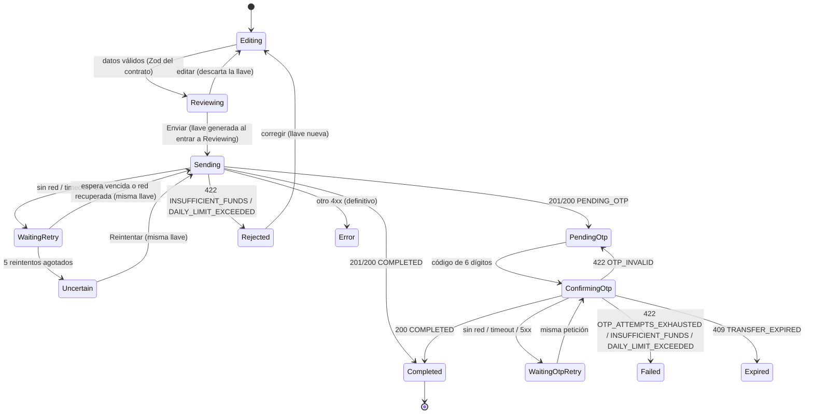
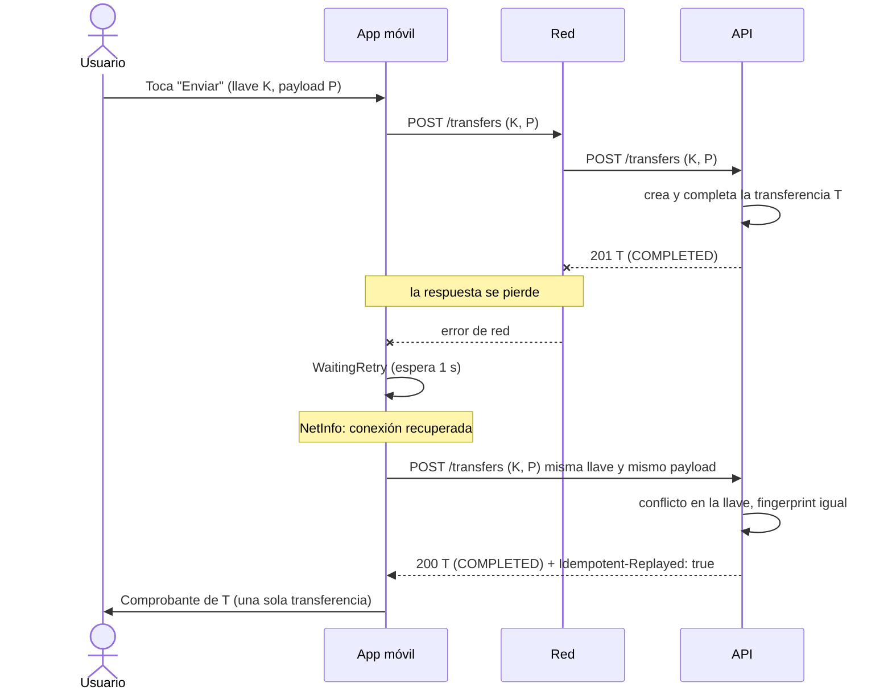

## Context

Ver `proposal.md` (Why). La app móvil es el cuarto proyecto independiente del repositorio: no comparte código fuente con `/web` ni con `/api`, solo consume el artefacto `@devchrisvaz/wallet-contract` (contrato OpenAPI 3.1, tipos, cliente tipado, validadores Zod y `formatMXN`). Habla directamente con la API usando `Authorization: Bearer`, a diferencia de la web, que pasa por un BFF.

Operaciones del contrato (`contract/openapi.yaml`) que usa la app: `login`, `refreshSession`, `logout`, `getCurrentUser`, `listAccounts`, `listAccountMovements` (con `limit=20` y sin filtros), `listBeneficiaries`, `createTransfer`, `getTransfer`, `confirmTransfer` y `resendTransferOtp`.

Restricciones que vienen de decisiones previas:
- Montos como strings decimales; nunca floats ni redondeo (decisión #5).
- `Idempotency-Key` generada una vez por intento; reintentos con la misma llave; los reintentos reconocidos responden `200` con el estado actual e `Idempotent-Replayed: true` (D1).
- Access token de 10 minutos; refresh rotativo con ventana de gracia de 30 s en la API, pensada precisamente para la pérdida de red en móvil (D2).
- Errores RFC 9457: los clientes deciden por `code` (D7).
- Toda transferencia mayor a 10,000.00 MXN pide OTP, que llega por correo (Mailpit en local).

## Goals / Non-Goals

**Goals:**
- Que una pérdida de red a mitad de una transferencia nunca produzca una transferencia duplicada ni un estado falso en pantalla (MOB-09, MOB-10, MOB-11, MOB-12).
- Tokens solo en el almacenamiento seguro del sistema operativo o en memoria (MOB-02).
- Contenido oculto en segundo plano (MOB-16).
- La lógica crítica (reintentos, llave, sesión) en módulos de TypeScript puro, probables sin renderizar pantallas.

**Non-Goals:**
- Registro, verificación de correo y alta de beneficiarios: se hacen en la web.
- Filtros y paginación del historial: el móvil muestra solo los últimos 20 (alcance reducido del enunciado).
- Transferencias entre cuentas propias desde el móvil: el enunciado limita el móvil a beneficiarios ya registrados (y una cuenta propia no puede registrarse como beneficiario, BEN).
- Desbloqueo biométrico (bonus) y recuperar un intento cuando el sistema operativo mata la app: van a "qué haría con más tiempo".
- Distribución por tiendas o EAS: se describe en `docs/aws-deploy.md` (change `delivery`).

## Decisions

### 1. Expo administrado con Expo Router

El proyecto se crea con Expo (SDK vigente al crearlo), TypeScript estricto y Expo Router para la navegación por archivos. Todos los módulos nativos usados (`expo-secure-store`, `@react-native-community/netinfo`, `expo-crypto`, `expo-screen-capture`) están incluidos en Expo Go, de modo que el evaluador puede correr la app sin compilar un cliente propio.

- *Alternativa descartada:* React Native CLI sin Expo. Requiere Xcode o Android Studio para probar y el enunciado recomienda Expo.
- *Alternativa descartada:* React Navigation configurado a mano. Funciona igual, pero Expo Router da rutas tipadas y menos código de configuración.

### 2. Consumo del contrato como artefacto

`package.json` declara `"@devchrisvaz/wallet-contract": "file:../contract"` y `mobile/.npmrc` fija `install-links=true`. Con eso npm instala una copia del paquete (con sus dependencias) en `node_modules` en lugar de un enlace simbólico, y Metro lo resuelve como cualquier paquete del registro, sin `watchFolders` ni configuración de monorepo. Al separar los repositorios se cambia esa línea por la versión publicada en GitHub Packages.

- *Alternativa descartada:* workspaces o enlaces simbólicos. Rompen la independencia del proyecto y obligan a configurar Metro para seguir enlaces.
- Si Metro no resuelve el campo `exports` del paquete, se usa el respaldo `main`/`types` que el paquete también publica (riesgo verificado en la primera tarea).

### 3. Cliente HTTP

Se usa `createApiClient()` del paquete de contrato (openapi-fetch tipado por las rutas del contrato) con tres middlewares propios del móvil:

1. **Autenticación:** agrega `Authorization: Bearer <access>` desde memoria.
2. **Renovación de una sola vez (MOB-03):** ante `401` con `code` `UNAUTHENTICATED`, espera una promesa compartida de renovación (si ya hay una en curso, la reutiliza), guarda el nuevo refresh token y repite la petición original una sola vez. Ante `SESSION_REVOKED` limpia la sesión y navega al inicio de sesión.
3. **Tiempo de espera:** `AbortController` con 15 s por intento, para que una red colgada se trate como pérdida de red y no como espera infinita.

El middleware del paquete ya interpreta las respuestas `application/problem+json` en un `ProblemError` tipado con `code`, `requestId` y las extensiones (`transferId`, `remaining`, `attemptsRemaining`).

### 4. Datos del servidor con TanStack Query

Las lecturas (`listAccounts`, `listAccountMovements` con `limit=20`, `listBeneficiaries`, `getCurrentUser`) usan `useQuery`, que da de forma uniforme los estados de carga, vacío y error de cada pantalla, además del refresco manual (MOB-05). Al terminar una transferencia `COMPLETED` se invalidan las consultas de cuentas y movimientos (MOB-13).

- *Alternativa descartada:* `useEffect` con `fetch`. Cada pantalla tendría que reimplementar carga, error y refresco.

### 5. Máquina de estados del intento de transferencia

El envío de una transferencia no usa los reintentos genéricos de `useMutation`. Lo controla un módulo de TypeScript puro, `transferAttempt`, que guarda la llave, el payload congelado y la política de reintentos, y que se prueba con temporizadores falsos sin renderizar nada.



Reglas:
- **Llave (MOB-09):** UUID v4 generado con `expo-crypto` al pasar a `Reviewing`, es decir, una sola vez por intento. Volver a `Editing` la descarta. No se usa `crypto.randomUUID` global porque su disponibilidad en Hermes depende de la versión.
- **Payload congelado:** el cuerpo que se envía en `Sending` se guarda serializado; todos los reintentos mandan exactamente los mismos bytes. Así la API calcula el mismo fingerprint y nunca responde `IDEMPOTENCY_KEY_REUSED` por un reintento legítimo.
- **Qué se reintenta (MOB-10):** error de red (`TypeError` de `fetch`), tiempo de espera agotado y `5xx`. Los `4xx` son definitivos. `429` es definitivo para el reintento automático: se muestra la cuenta regresiva de `Retry-After` y el reintento manual usa la misma llave, porque la petición no llegó a ejecutarse.
- **Espera:** 1 s, 2 s, 4 s, 8 s y 16 s, con ±20 % de variación aleatoria; máximo 5 reintentos.
- **Red recuperada:** si NetInfo informa que la conexión volvió mientras se espera un reintento, se cancela el temporizador y se reintenta de inmediato.
- **Botón deshabilitado:** desde `Sending` hasta un estado definitivo o `Uncertain`. El doble toque no puede producir dos peticiones porque el estado `Sending` ignora un segundo evento de envío.
- **Confirmación del OTP:** sigue la misma política (llamada idempotente por estado en la API); un reintento que encuentra la transferencia `COMPLETED` recibe `200` sin consumir intentos.

- *Alternativa descartada:* `useMutation` con `retry` y el `onlineManager` de TanStack. Pausa y reanuda mutaciones, pero esconde el estado "incierto" que exige MOB-11 y hace más difícil probar que el payload y la llave no cambian entre reintentos.

### 6. Pérdida de red a mitad de una transferencia



### 7. Sesión y almacenamiento de tokens

- **Refresh token:** `expo-secure-store` (Keychain en iOS, Keystore en Android) con accesibilidad `WHEN_UNLOCKED_THIS_DEVICE_ONLY`, para que no viaje en respaldos ni a otro dispositivo.
- **Access token:** solo en memoria, dentro del módulo de sesión.
- **Orden al renovar:** primero se guarda el refresh nuevo en el almacenamiento seguro y después se usa el access nuevo. Si la escritura falla, la sesión sigue en memoria y el siguiente arranque pedirá credenciales.
- **Arranque:** si hay refresh guardado, se renueva antes de mostrar la primera pantalla; si falla con `SESSION_REVOKED`, se borra y se muestra el inicio de sesión.
- **Defensa contra `AsyncStorage`:** regla `no-restricted-imports` de ESLint que prohíbe `@react-native-async-storage/async-storage` en todo el proyecto, más una prueba que lo verifica (MOB-02).

- *Alternativa descartada:* `AsyncStorage`. Lo prohíbe el enunciado: guarda en claro.
- *Alternativa descartada:* MMKV cifrado. Requiere un cliente de desarrollo propio y no corre en Expo Go.

### 8. Pantalla de privacidad

Un componente en la raíz de la navegación escucha `AppState`. Con `inactive` (iOS, al abrir el selector de apps) o `background`, monta una vista opaca a pantalla completa que solo muestra el logotipo; con `active`, la retira. En Android, `AppState` no emite `inactive` antes de la captura del selector de apps, así que además se activa `expo-screen-capture` (`FLAG_SECURE`) mientras hay sesión, lo que deja en blanco la miniatura y bloquea capturas de pantalla.

- *Alternativa descartada:* solo el overlay. En Android la miniatura del selector de apps puede capturarse antes de que el overlay se monte.

### 9. Montos, validación y errores

- **Formato:** todos los montos se muestran con `formatMXN` del paquete de contrato, que formatea a partir del string decimal y trae la alternativa por si `Intl` en Hermes no formatea strings de forma exacta (MOB-15).
- **Validación (MOB-08):** el formulario usa los esquemas Zod del paquete (monto con 0 a 2 decimales y mayor que 0, concepto, referencia). El monto viaja como el string que capturó el usuario, normalizado sin separadores; nunca pasa por `Number`.
- **Mensajes (MOB-14):** un `switch` exhaustivo sobre la unión `ProblemCode` que exporta el paquete; TypeScript avisa si el contrato agrega un código nuevo. El caso por defecto muestra un mensaje genérico con el `requestId`.
- **Etiquetas de movimientos:** `DEPOSIT` → "Depósito", `TRANSFER_IN` → "Transferencia recibida", `TRANSFER_OUT` → "Transferencia enviada", `OWN_TRANSFER_IN` → "Traspaso recibido", `OWN_TRANSFER_OUT` → "Traspaso enviado".

### 10. Mapa de pantallas y estados

```mermaid
flowchart TD
    Start([Arranque]) -->|hay refresh y renueva| Home
    Start -->|sin refresh o SESSION_REVOKED| Login
    Login[Iniciar sesión<br/>estados: inactivo · enviando · error · bloqueado 429 · correo sin verificar] -->|200| Home
    Home[Saldo de cuentas<br/>estados: carga · vacío · error · actualizando] --> Movs
    Home --> Bene
    Home -->|Cerrar sesión| Login
    Movs[Últimos 20 movimientos<br/>estados: carga · vacío · error]
    Bene[Elegir beneficiario<br/>estados: carga · vacío "regístralos en la web" · error] --> Form
    Form[Datos de la transferencia<br/>cuenta origen · monto · concepto · referencia<br/>errores por campo] --> Review
    Review[Confirmación<br/>resumen · aviso de OTP si > 10,000.00] -->|Editar| Form
    Review -->|Enviar| Sending
    Sending[Enviando<br/>botón deshabilitado · reintentando N de 5] --> Result
    Sending --> Otp
    Sending --> Uncertain
    Sending --> Rejected
    Uncertain["Estado incierto<br/>No pudimos confirmar el estado · Reintentar"] -->|misma llave| Sending
    Otp[Código OTP<br/>correo enmascarado · tiempo restante · intentos · reenviar] --> Result
    Otp --> Failed
    Rejected[Rechazada<br/>saldo insuficiente · límite diario con restante] -->|Corregir| Form
    Failed[No realizada<br/>intentos agotados · vencida · saldo o límite al confirmar]
    Result[Comprobante<br/>datos devueltos por la API] --> Home
```

La pantalla de privacidad (decisión 8) se superpone a cualquiera de estas pantallas cuando la app deja de estar activa.

### 11. Configuración para desarrollo local

La URL de la API se lee de `EXPO_PUBLIC_API_URL` (Expo la incorpora al bundle) y se valida al arrancar; si falta o no es una URL `http(s)`, la app muestra una pantalla de error de configuración (MOB-17). El README documenta:
- Usar la IP de la red local del equipo (por ejemplo `http://192.168.1.50:4000`), con la API escuchando en `0.0.0.0`; en el emulador de Android, `http://10.0.2.2:4000`.
- Abrir la bandeja de Mailpit (`http://localhost:8025` en el equipo) para leer los OTP.
- Usuarios del seed para la demo (Ana y Luis) y sus beneficiarios.

### 12. Pruebas y CI

- **jest-expo** con **@testing-library/react-native**.
- `transferAttempt`: llave única por intento, payload idéntico en reintentos, espera exponencial con temporizadores falsos, reintento inmediato al recuperar la red (NetInfo simulado), paso a `Uncertain` tras 5 fallos, `4xx` definitivo, réplica `200` con `Idempotent-Replayed`, doble toque con una sola petición.
- Sesión: tokens solo en `expo-secure-store` (simulado), ningún uso de `AsyncStorage`, renovación de una sola vez con tres peticiones simultáneas, limpieza ante `SESSION_REVOKED` y logout sin red.
- Pantallas: privacidad con `AppState` simulado; mensajes por `code` (`INSUFFICIENT_FUNDS`, `DAILY_LIMIT_EXCEEDED` con `remaining`, `INTERNAL_ERROR` con `requestId`); validación del monto `100.005`.
- El título de cada prueba empieza con el ID del requisito (`MOB-10 …`).
- **CI** (`.github/workflows/mobile.yml`): se dispara con cambios en `mobile/**`, `contract/**` o el propio workflow; compila el paquete de contrato, ejecuta `npm ci` en `/mobile` y corre lint, `tsc --noEmit` y pruebas. No compila binarios.

### 13. Estilos con el sistema de diseño compartido
- `StyleSheet` con el tema de `@devchrisvaz/wallet-design-tokens/native` (instalado con `file:../design-tokens` e `install-links=true`, igual que el contrato): colores semánticos, tipografía con la familia por peso, espaciado, radios, elevación y movimiento. Ningún color ni tamaño se escribe a mano.
- Work Sans con `@expo-google-fonts/work-sans` (400, 500, 600); la pantalla de carga de Expo se mantiene hasta que `useFonts` termina.
- Las pantallas se construyen con los componentes del inventario de `design-system` (D7 de ese change) en `components/ui`; los mensajes de error, las etiquetas de estados y de movimientos salen del mismo paquete (`problemMessage`, `transferStatus`, `movementType`), así que la app dice lo mismo que la web.
- La pantalla de privacidad (decisión 8) usa `surface.inverse` con el `Wordmark` en `text.onInverse`.
- *Alternativa descartada:* NativeWind para reutilizar las clases de Tailwind de la web. Agrega una capa de compilación a Metro y el tema numérico de React Native ya cubre lo necesario.

## Risks / Trade-offs

- [`Intl.NumberFormat` en Hermes no formatea strings de forma exacta] → `formatMXN` del paquete trae una alternativa (parte entera como `BigInt` más centavos) y sus propias pruebas; en el móvil se agrega una prueba de formato.
- [Metro no resuelve el campo `exports` del paquete de contrato] → el paquete publica también `main` y `types`; se verifica en la primera tarea, antes de construir pantallas.
- [Android captura la miniatura del selector de apps antes del overlay] → `FLAG_SECURE` mediante `expo-screen-capture` mientras hay sesión.
- [La respuesta del refresh se pierde y el reintento parece un reuso] → la ventana de gracia de 30 s de la API (D2) lo cubre; el móvil reintenta la renovación con el mismo refresh token dentro de esa ventana.
- [El sistema mata la app durante `Sending`] → el intento en memoria se pierde y el usuario podría no ver el resultado; la transferencia sigue siendo única por la llave y aparece en los movimientos. Persistir el intento queda en "qué haría con más tiempo".
- [HTTP sin TLS hacia la IP local] → aceptable solo en desarrollo con Expo Go; en producción la URL es HTTPS (ver `docs/aws-deploy.md`).
- [Reloj del dispositivo desfasado] → la cuenta regresiva del OTP es orientativa; la API decide el vencimiento y la app reacciona a `TRANSFER_EXPIRED`.
- [Duplicar la política de reintentos respecto a la web] → es intencional: los proyectos no comparten código; la política vive en el diseño y en las pruebas de cada cliente.

## Notas de implementación

Hallazgos y ajustes que surgieron al implementar.

### N1. Resolución de los paquetes locales (tarea 1.2)

- Sin dispositivo ni simulador, la resolución con Metro se comprobó con `npx expo export --platform android` y `--platform ios` (Expo SDK 57), que ejecuta Metro y compila el bundle a bytecode de Hermes. Los mapas de fuentes muestran que Metro toma `@devchrisvaz/wallet-contract/dist/index.mjs` y `openapi-fetch/dist/index.mjs` (condición `import` del campo `exports`, porque la app usa sentencias `import`) y `@devchrisvaz/wallet-design-tokens/dist/native.cjs` para el subpath `./native`. No hizo falta `watchFolders` ni el respaldo `native/`.
- **Hueco en `/contract` (no bloquea):** la salida CommonJS del paquete (`dist/index.cjs`) falla al llamar a `createApiClient`: tsup la compila con `__toESM(require("openapi-fetch"), 1)`, que en modo Node toma como `default` todo el objeto de exports de openapi-fetch, y la llamada lanza `TypeError: (0 , import_openapi_fetch.default) is not a function` (se reproduce cargando `dist/index.cjs` con `require` en Node y llamando a `createApiClient`). La prueba de humo del paquete solo comprueba que `createApiClient` sea una función. Metro no se ve afectado porque resuelve la salida ESM; en Jest, que resuelve con la condición `require`, `jest.config.js` mapea el paquete a `dist/index.mjs` y lo transforma con el mismo Babel de jest-expo, igual que Metro. No se modifica `/contract`: queda reportado para corregirlo allí (por ejemplo, con la opción de interoperabilidad de tsup y una prueba de humo que llame al cliente).

### N2. Textos de la interfaz: manda el paquete de diseño (tarea 2.6 y siguientes)

El change `design-system` se escribió después de esta especificación y fija los textos en `problemMessage` (DSG-12) y las convenciones de dinero (DSG-09). Donde un escenario de `mobile-app` citaba otro texto, la app usa el del paquete, para decir lo mismo que la web, y el escenario se actualizó en este change:

| Requisito | Texto anterior del escenario | Texto que muestra la app |
|---|---|---|
| MOB-14 | "Saldo insuficiente para esta transferencia" | "No tienes saldo suficiente para esta transferencia." |
| MOB-01 | "Email o contraseña incorrectos" | "El correo o la contraseña no coinciden." |
| MOB-01 | (correo sin verificar) | "Confirma tu correo con el código que te enviamos. La verificación se completa en la web de TreoWallet." (texto del paquete más la indicación de la web) |
| MOB-03 | "Tu sesión expiró" | "Cerramos tu sesión por seguridad. Inicia sesión de nuevo." |
| MOB-06 | Salida "-$150.00", entrada "$25,000.00" | Salida "−$150.00" (U+2212, tinta) y entrada "+$25,000.00" (verde), convención de DSG-09 |
| MOB-12 | "Código incorrecto, te queda 1 intento" | "El código no es correcto. Te queda 1 intento." |
| MOB-08 | "Máximo 2 decimales" | "El monto admite máximo 2 decimales" (mensaje de `amountInput` del contrato, igual que en la web) |
| MOB-08 | "la referencia solo admite de 1 a 7 dígitos" | "La referencia solo admite dígitos" (mensaje de `reference` del contrato; la ayuda del campo dice "De 1 a 7 dígitos.") |

Los mensajes se deciden con un `switch` exhaustivo sobre `ProblemCode` (comprobado con una mutación de tipos: quitar un `case` rompe `tsc`) y `problemMessages satisfies Record<ProblemCode, string>` comprueba que el paquete tenga un texto para cada code. La app agrega solo los datos variables: lo que queda del límite (`remaining` con `formatMXN`), los intentos restantes y el `requestId` como "Folio para soporte" en `INTERNAL_ERROR` (un code desconocido llega como `INTERNAL_ERROR`). Sin respuesta de la API (`NetworkError`), el texto es propio de la app porque no hay `code`: "No pudimos conectar con TreoWallet. Revisa tu conexión e intenta de nuevo."

### N3. Idempotency-Key ausente en silencio (tarea 4.8)

La prueba de pantalla "corregir tras un rechazo usa otra llave" detectó que, en Jest, las peticiones a `POST /transfers` salían **sin** `Idempotency-Key`: los módulos nativos de Expo están simulados y `randomUUID` de `expo-crypto` devolvía `undefined`; `createIdempotencyKey(randomUUID)` lo pasaba tal cual y openapi-fetch omite los headers con valor `undefined` sin avisar. Las pruebas unitarias de `transferAttempt` no lo veían porque inyectan su propio generador. Correcciones: `TransferAttempt.review` lanza un error si el generador no entrega una llave (nunca se envía una transferencia sin ella), `jest.setup.ts` simula `expo-crypto` con UUID v4 reales, y las pruebas de pantalla verifican que cada `Idempotency-Key` enviada sea un UUID v4. Hueco menor en `/contract`: `createIdempotencyKey(generator)` podría validar que el generador devuelva un UUID.

### N4. Otras decisiones de implementación

- **Versiones:** Expo SDK 57 (plantilla `default` de `create-expo-app`, rutas en `src/app`), React Native 0.86, TypeScript 6.0 (compatible con typescript-eslint, que admite `<6.1`), TanStack Query 5, Testing Library 14 (`render` y `fireEvent` asíncronos) y jest-expo 57.
- **Colores de la configuración nativa:** `app.json` fija `#FFFFFF` como fondo de la pantalla de carga y del ícono adaptable de Android. Es configuración estática de compilación, no estilos de la app, y coincide con `surface.default`; los componentes y pantallas solo usan el tema (una prueba recorre `src` y rechaza colores, tamaños, familias, espaciados o radios escritos a mano).
- **Selector de beneficiario:** la pantalla de elección usa `OptionRow`, la opción del `Select` del inventario, para no agregar un componente fuera de D7.
- **Una pantalla para todo el intento:** la ruta `transfer/send` muestra captura, confirmación, envío, código, resultado o falla según el estado de `TransferAttempt`; así el intento (llave, payload congelado, temporizadores) vive en un solo lugar y se descarta al salir.
- **Pruebas sin la API real:** una API simulada que registra cada petición (método, ruta, headers y cuerpo exacto) y responde por ruta; para el caso borde de la tarea 4.11, una API simulada con la semántica de idempotencia de la API. Los temporizadores falsos de TanStack Query se evitan con `gcTime` infinito en pruebas.

