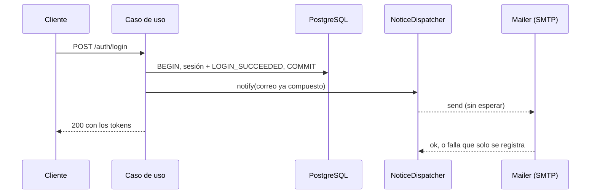

## Context

La API ya limita el login, el registro, la verificación, el reenvío, el alta de beneficiarios y los estados de cuenta (PLT-09, IDN-15, BEN-10, HIS-11), pero no `refresh`, `logout` ni las cuatro operaciones de transferencias que mueven dinero o gastan intentos de código. `Cache-Control: no-store` lo envía solo el estado de cuenta. La web (`web/next.config.ts`, `web/proxy.ts`) solo desactiva `X-Powered-By` y publica la ruta pedida en una cabecera interna. Y los correos transaccionales de hoy cubren el registro, el OTP, el aviso al dueño de unos datos (IDN-16) y la falla de una programada (TRF-35): ninguno avisa de lo que la persona hizo o de lo que alguien más hizo con su cuenta.

Las decisiones del usuario ya tomadas son: aviso en **cada** inicio de sesión con contraseña (no solo desde un dispositivo nuevo) y comprobante al **remitente** de cada transferencia a un tercero completada. Los valores de los límites y de los headers son propuestas de este documento.

## Goals / Non-Goals

**Goals:**
- Que ninguna operación de identidad ni de transferencias pueda repetirse sin tope desde un cliente o una IP.
- Que ninguna respuesta de la API con tokens o datos del usuario pueda guardarse en un caché.
- Que la web envíe una política de contenido sin `unsafe-inline` en los scripts y los demás headers de seguridad, y que eso se compruebe en un navegador real, en desarrollo y en producción.
- Que la persona reciba un correo por cada hecho de seguridad o de dinero de arriba, sin que el correo pueda fallar ni cambiar la respuesta.

**Non-Goals:**
- Límites compartidos entre instancias (Redis o reglas de WAF). Siguen en "qué haría con más tiempo".
- Segundo factor, rotación del secreto del JWT, revocación inmediata del access token y los demás pendientes de la lista nueva del README: se documentan, no se construyen.
- Avisar solo desde un dispositivo nuevo. Pide un identificador de dispositivo y una tabla de dispositivos conocidos; queda en el README (D9).
- Headers de seguridad en la API (`nosniff`, CSP, etc.). La API responde JSON y PDF a clientes que no son páginas; la política de contenido es de la web. Tampoco se agregan `Cross-Origin-Opener-Policy` ni `Cross-Origin-Resource-Policy`, que protegen contra riesgos que esta web no tiene (no abre ventanas de terceros ni sirve recursos a otros sitios).
- Un panel de reportes de CSP (`report-to`). No hay dónde recibirlos; la verificación previa al despliegue es la prueba e2e (D6).

## Decisions

### D1. Solo el tope es configurable; la ventana es fija en el código
Cada límite nuevo tiene una variable de entorno con su tope, validada al arrancar (PLT-08, PLT-19), y una ventana fija en el código, igual que los límites de hoy.

| Operación | Llave | Ventana | Tope por defecto | Variable |
| --------- | ----- | ------- | ---------------- | -------- |
| `POST /auth/refresh` | IP | 15 min | 120 | `RATE_LIMIT_REFRESH_MAX` |
| `POST /auth/logout` | IP | 15 min | 60 | `RATE_LIMIT_LOGOUT_MAX` |
| `POST /transfers` | usuario | 10 min | 30 | `RATE_LIMIT_TRANSFER_CREATE_MAX` |
| `POST /transfers/{id}/confirm` | usuario | 15 min | 15 | `RATE_LIMIT_TRANSFER_CONFIRM_MAX` |
| `POST /transfers/{id}/otp/resend` | usuario | 15 min | 6 | `RATE_LIMIT_TRANSFER_RESEND_MAX` |
| `POST /transfers/{id}/cancel` | usuario | 10 min | 20 | `RATE_LIMIT_TRANSFER_CANCEL_MAX` |

Cada variable es un entero entre 1 y 10000. Los valores son más holgados que los de la propuesta inicial en tres casos, por estas razones:
- **`refresh` 120 y `logout` 60 (propuesta: 60 y 30).** La llave es la IP, y muchas personas comparten IP (oficina, universidad, red móvil con CGNAT). Un cliente legítimo renueva cada ~10 minutos, así que una sesión usa 1.5 renovaciones por ventana; 120 alcanza para unas 80 sesiones tras una misma IP. El límite existe para frenar inundaciones, no para racionar sesiones.
- **`confirm` 15 (propuesta: 10).** La base ya limita los intentos del código a 3 por transferencia (`OTP_MAX_ATTEMPTS`, máximo 3), así que el tope por usuario cubre varias transferencias: 5 transferencias con los 3 intentos gastados caben justo. Con 10, dos reintentos de red en una confirmación (que cuentan, D4) dejan sin margen a una persona con un código mal tecleado.
- **`resend` 6 (propuesta: 5).** `OTP_MAX_RESENDS` permite 3 reenvíos por transferencia; 6 deja que dos transferencias usen su máximo.

`create` 30 y `cancel` 20 se quedan: una persona que repite 5 veces una transferencia por la red (la política de MOB-10) gasta 6 peticiones de la misma llave, así que 30 son 5 transferencias con todos sus reintentos en 10 minutos.

- _Alternativa descartada:_ configurar también la ventana. Dobla las variables (doce) y cambia el significado del `Retry-After` que ven los clientes. Con el tope alcanza para ajustar un incidente, y la ventana se cambia con una versión.
- _Alternativa descartada:_ un solo tope para todas las transferencias. Un `create` tiene un costo y un riesgo distintos al de un `resend` (un correo por llamada), y las pruebas necesitan subir uno sin tocar los demás.
- _Alternativa descartada:_ los topes de la propuesta inicial (60 y 30). Se descartan por el caso de las IP compartidas; si el usuario prefiere esos valores, son solo el valor por defecto de dos variables.

### D2. Las pruebas suben los límites de transferencias; las pruebas de límites usan los suyos
Las pruebas de concurrencia (`test/integration/concurrency/`) lanzan ~100 transferencias simultáneas de un usuario y afirman el saldo, el contador y los asientos. Con el tope por defecto se toparían con el `429` y dejarían de afirmar lo que afirman. `testConfig` (`api/test/helpers/app.ts`) sube los cuatro topes de transferencias a un valor que ninguna suite alcanza (10 000, el máximo); la prueba de cada límite construye su aplicación con un tope chico (por ejemplo 3) y comprueba el `429`. Los de `refresh` y `logout` no se suben: ninguna suite se acerca a ellos.

- _Alternativa descartada:_ que cada suite de concurrencia pase su propia configuración. Son siete archivos y cualquier suite nueva volvería a fallar por una causa ajena.
- _Alternativa descartada:_ desactivar los límites en pruebas con un interruptor. Un interruptor que apaga la protección es un riesgo en producción; subir el tope usa el mismo código.

### D3. Llave del límite: IP para lo público, usuario para lo autenticado
`refresh` y `logout` son públicos (el token va en el cuerpo), así que se limitan por IP (la de `trust proxy`, PLT-07). Las operaciones de transferencias exigen access token, así que se limitan por usuario con la llave `<nombre>:<userId>`, después de autenticar y antes de validar el cuerpo, como el estado de cuenta (HIS-11): una petición rechazada por validación también cuenta, y una sin token no gasta el cupo de nadie.

- _Alternativa descartada:_ limitar `refresh` por hash del refresh token. Frenaría la inundación de una sesión, pero no la de tokens inventados, que es el abuso más barato, y el hash exigiría leer el cuerpo antes de limitar.
- _Alternativa descartada:_ limitar las transferencias por IP. Dos personas tras la misma IP se estorbarían, y una sola persona con varias IP no se frenaría.
- _Alternativa descartada:_ limitar por `Idempotency-Key`. La llave la inventa el cliente: un atacante manda una distinta en cada petición.

**Riesgo conocido.** Si `TRUSTED_PROXIES` no incluye al BFF, todas las personas de la web comparten la IP del BFF y el límite de `refresh` las cuenta juntas (lo mismo que ya pasa con el login). La propuesta de AWS ya lo exige (sección 3, punto 1).

### D4. Los reintentos y las repeticiones de una llave cuentan
Una repetición con la misma `Idempotency-Key` es otra petición HTTP y gasta cupo. No se exenta, porque obligaría a leer la base antes de limitar y porque un atacante repetiría la llave para inundar. El margen está en los topes (D1), no en una excepción.

### D5. `no-store` en toda la API, salvo la documentación
Un middleware al inicio de la cadena (antes de los routers) fija `Cache-Control: no-store` en cada respuesta, así que lo llevan también los `4xx` y `5xx` de problem+json, el `404` de una ruta inexistente, el `429` de un límite y los errores de cuerpo ilegible. Quedan fuera `GET /docs` y `GET /openapi.yaml`: no existen en producción (PLT-11) y el Swagger UI se sirve mejor con su caché. `GET /health` **sí** lleva `no-store`: una respuesta `ok` guardada por un CDN o un balanceador ocultaría una caída.

- _Alternativa descartada:_ ponerlo solo en las rutas con tokens o datos. La próxima ruta que alguien agregue nacería sin él. Con el middleware global la protección es la regla, y la excepción es la que hay que justificar.
- _Alternativa descartada:_ agregar `Pragma: no-cache` y `Expires: 0`. Son para HTTP/1.0; todo lo que está delante de la API habla HTTP/1.1 o superior.

### D6. CSP con nonce por petición, generado en `proxy.ts`
Según la documentación de Next.js 16 (guía de Content Security Policy), `proxy.ts` genera un nonce por petición (`crypto.randomUUID()` en base64), arma la política y la escribe en los headers de la petición (para que Next lea el nonce y lo ponga en sus scripts) y en los de la respuesta. La política:

```
default-src 'self';
script-src 'self' 'nonce-<nonce>' 'strict-dynamic' [+ 'unsafe-eval' solo en desarrollo];
style-src 'self' 'nonce-<nonce>';
img-src 'self' data: blob:;
font-src 'self';
connect-src 'self';
object-src 'none';
base-uri 'self';
form-action 'self';
frame-ancestors 'none';
[upgrade-insecure-requests solo con SESSION_COOKIE_SECURE]
```

- **`strict-dynamic`** deja que los scripts con nonce carguen los suyos (los chunks de Next) sin enumerar orígenes, y hace que los navegadores nuevos ignoren `'self'` en `script-src`; `'self'` queda para los navegadores que no lo entienden.
- **`unsafe-eval` solo en desarrollo:** React lo usa para reconstruir pilas de llamadas en `next dev`. La compilación de producción no lo necesita y la prueba de producción lo comprueba (D12).
- **`style-src` con nonce, sin `unsafe-inline`.** El código no usa el atributo `style` en el marcado del servidor (no hay `style={{…}}` en `app/` ni en `components/`), y Tailwind sale en archivos CSS de `'self'`. **Regla de respaldo:** si la verificación de D12 muestra violaciones de estilo que vienen de Next o de una librería y no del código del proyecto, se agrega solo `style-src-attr 'unsafe-inline'` (los atributos), nunca `'unsafe-inline'` en `style-src`, y se anota en este documento con la violación que lo exigió. Un estilo inyectado no ejecuta código; un script sí.
- **`connect-src 'self'`:** el navegador solo habla con la propia web; el BFF habla con la API desde el servidor.
- **`upgrade-insecure-requests` solo con HTTPS:** con HTTP en local (`SESSION_COOKIE_SECURE=false`) rompería la carga de los recursos.

**Efecto en el renderizado.** El nonce solo puede aplicarse al renderizar en el servidor con el header de la petición; una página estática se genera en el build, sin petición. Con la política en `proxy.ts`, **todas las páginas se renderizan por petición**, incluidas las públicas (inicio de sesión, registro) que hoy pueden prerenderizarse. El costo es el de renderizar un formulario pequeño en cada visita; los archivos de `_next/static` siguen siendo estáticos y con caché larga. Las páginas del grupo `(app)` ya eran dinámicas porque leen la sesión.

**Alcance.** El proxy sigue sin correr en `bff/`, `_next/` ni el favicon (WEB-09, WEB-22): la CSP vale para documentos HTML, y esas rutas devuelven JSON, PDF o archivos estáticos. Conserva su comportamiento de publicar `x-wallet-path`.

**Futuro CAPTCHA de WAF.** La propuesta de AWS (sección 6) carga la API de JavaScript de CAPTCHA de WAF en `/register`. Cuando se haga, `script-src` y `connect-src` necesitarán el origen que indique la documentación de AWS WAF en ese momento (el del script de CAPTCHA y el de las llamadas que haga), y el script se cargaría con el nonce de la página de registro. Quedó anotado en `docs/aws-deploy.md`.

- _Alternativa descartada:_ CSP estática en `next.config` con `'unsafe-inline'` en `script-src`. Mantiene las páginas estáticas, pero un script inyectado se ejecutaría: justo lo que la política debe impedir.
- _Alternativa descartada:_ empezar con `Content-Security-Policy-Report-Only`. Sirve cuando hay un lugar donde recibir los reportes; aquí no lo hay, y la prueba e2e que falla ante una violación (D12) da la misma información antes de desplegar.
- _Alternativa descartada:_ hashes en lugar de nonce. Next genera scripts en línea con contenido distinto por página y por petición (los datos de React Server Components); los hashes no son estables.

### D7. Headers estáticos con `headers()` de `next.config`
El proxy no corre en `bff/` ni en `_next/`, así que los headers que no dependen de la petición se declaran en `headers()` de `next.config.ts` con `source: '/:path*'`, que aplica a todas las respuestas, incluidas esas rutas.

| Header | Valor | Razón |
| ------ | ----- | ----- |
| `X-Content-Type-Options` | `nosniff` | El navegador respeta el `Content-Type` (el PDF y el JSON del BFF). |
| `X-Frame-Options` | `DENY` | Respaldo de `frame-ancestors 'none'` para navegadores sin CSP y para las respuestas del BFF, que no llevan CSP. |
| `Referrer-Policy` | `strict-origin-when-cross-origin` | Ver abajo. |
| `Permissions-Policy` | `camera=(), microphone=(), geolocation=(), payment=(), usb=(), serial=(), bluetooth=(), accelerometer=(), gyroscope=(), magnetometer=(), midi=(), display-capture=()` | La web no usa ninguna de esas capacidades; si un script inyectado las pidiera, el navegador las negaría. Solo funciones que Chrome, Firefox y Safari reconocen, para no llenar la consola de avisos. |
| `Strict-Transport-Security` | `max-age=63072000; includeSubDomains`, solo con `SESSION_COOKIE_SECURE=true` | HSTS por HTTP en local fijaría `localhost` a HTTPS en el navegador de quien desarrolla. Sin `preload`: entrar a la lista de precarga es una decisión de dominio difícil de revertir. |

**`Referrer-Policy`.** Se elige `strict-origin-when-cross-origin` y no `no-referrer`. Con `no-referrer`, el navegador envía `Origin: null` en los `POST` del mismo origen, y las Server Actions comparan `Origin` con `Host` (WEB-06): el inicio de sesión y toda mutación fallarían. Con la política elegida, los enlaces que salen del sitio reciben solo el origen; las URL con ids de cuenta no salen. La prueba e2e de inicio de sesión lo cubre.

- _Alternativa descartada:_ poner estos headers también en el proxy. Duplica la fuente de verdad y no cubre `bff/` ni `_next/`.

### D8. Los avisos salen después del COMMIT y la respuesta no los espera
Un `NoticeDispatcher` recibe el correo ya compuesto y lo envía con `deliverAfterCommit` **sin que el caso de uso espere el resultado**: lanza el envío, guarda la promesa en un conjunto y la quita al terminar. Una falla solo se registra con el destinatario enmascarado (PLT-16), nunca llega a la respuesta. Para las pruebas y el apagado ordenado expone `drain()`, que espera los envíos pendientes. Los correos de hoy (código de verificación, OTP) sí se esperan, porque la respuesta informa su estado de entrega o porque la persona los necesita para seguir; un aviso no.



- _Alternativa descartada:_ esperar el envío como el OTP. Con el SMTP caído, cada inicio de sesión, comprobante y alta de beneficiario tardaría hasta 15 segundos más (5 de conexión, 5 de saludo y 10 de socket) por un correo que no cambia el resultado.
- _Alternativa descartada:_ outbox transaccional. Es la solución correcta (reintentos), pero ya está en "qué haría con más tiempo" para todos los correos y pide una tabla, un proceso y su monitoreo.
- **Costo.** Un envío en vuelo al apagar el proceso se pierde. `drain()` con un tope de espera lo reduce en el cierre ordenado; un `SIGKILL` lo pierde, como cualquier correo sin outbox.

### D9. Qué dice cada aviso y cuándo sale
Todos usan la plantilla común (`layout`), texto y HTML escapado, fecha y hora de la Ciudad de México, montos en es-MX con `Money`, y nunca llevan la CLABE completa, contraseñas, tokens ni códigos. Los que preguntan "¿fuiste tú?" dicen que, si no, la persona responda el correo (no hay recuperación de contraseña ni canal de soporte propio todavía; es lo que ya hace IDN-16).

| Aviso | Sale cuando | No sale cuando | Contenido |
| ----- | ----------- | -------------- | --------- |
| "Iniciaste sesión en TreoWallet" (IDN-18) | `POST /auth/login` responde `200` | `401`, `403`, `429`; `refresh`; `verify-email` | Fecha y hora, tipo de cliente (D10), IP enmascarada |
| "Cerramos una sesión por seguridad" (IDN-19) | Se detecta el reuso de un refresh token y se revoca la familia | Un refresh vencido, desconocido o ya revocado; el reintento dentro de la ventana de gracia | Fecha y hora; que debe iniciar sesión de nuevo |
| "Agregaste a <alias> como beneficiario" (BEN-12) | `POST /beneficiaries` responde `201` | La repetición idéntica (`200`), `409`, `422` | Nombre, alias, últimos 4 de la CLABE, fecha y hora |
| "Transferencia realizada" (TRF-38) | Una transferencia a un beneficiario llega a `COMPLETED`: al crear, al confirmar con el código, o al ejecutarla el ejecutor de programadas | Repeticiones de la llave, confirmar una ya completada, traspasos entre cuentas propias, fondeos (`db:fund`, seed), el destinatario | Monto, nombre del destino y últimos 4 de la CLABE, concepto, referencia si hay, fecha y hora, id de la transferencia |

**Un solo aviso por hecho.** El comprobante sale solo en la ejecución que cambió el estado a `COMPLETED`; las rutas que encuentran la transferencia ya completada (la repetición, la confirmación repetida, la carrera de dos confirmaciones) no envían nada. Para el reuso del refresh: una vez revocada la familia, el mismo token ya no cae en el caso de reuso (la familia está revocada, IDN-12), así que un atacante con un token viejo no puede inundar el buzón del dueño.

**Otro destinatario.** El correo se envía al email del dueño de la sesión o de la transferencia, nunca a uno que venga del cuerpo de la petición.

- _Alternativa descartada:_ avisar solo desde un dispositivo nuevo. Es lo que hacen los bancos para no cansar, pero necesita identificar dispositivos (cookie o identificador del lado del cliente, una tabla de dispositivos conocidos, qué hacer con el navegador que borra sus cookies). Se registra en "qué haría con más tiempo".
- _Alternativa descartada:_ avisar también del `403` de correo sin verificar o de registro en revisión. Quien llegó ahí conoce la contraseña, pero no entró; el aviso diría "iniciaste sesión" sin que fuera cierto.
- _Alternativa descartada:_ comprobante también al destinatario. No es lo que se pidió; además, el destinatario puede ser de otra institución o no tener cuenta aquí.

### D10. Qué cliente inició la sesión: el `User-Agent`, descrito sin tocar el valor
La API ya guarda el `User-Agent` de cada petición en el contexto (PLT-05) y en la auditoría (AUD-01). Para que describa al cliente real, el BFF de la web lo **reenvía** tal como lo envió el navegador (`web/lib/server/request-context.ts` y el cliente de la API); hoy la API ve el de Node, así que `audit_log.user_agent` de las acciones web es incorrecto. La app lo fija ella misma (MOB-32) con un token propio: `TreoWallet-App/<versión> (<ios|android>)`.

`describeClient(userAgent)` es una función pura de unas 30 líneas, sin dependencias, con reglas en orden:
- con el token `TreoWallet-App/` → app, con el sistema (`iOS` o `Android`);
- si no, navegador: `Edg/` → Edge, `OPR/` → Opera, `Firefox/` o `FxiOS/` → Firefox, `Chrome/` o `CriOS/` → Chrome, `Safari/` con `Version/` → Safari; y sistema: `Windows NT` → Windows, `Android` → Android, `iPhone` o `iPad` → iOS, `Mac OS X` → macOS, `CrOS` → ChromeOS, `Linux` → Linux;
- cualquier otra cosa, o un valor vacío o enorme → "un dispositivo".

El texto resultante es "Chrome en Windows", "la app de TreoWallet en Android" o "un dispositivo". El `User-Agent` crudo no se pone nunca en el correo (lo controla quien llama).

- _Alternativa descartada:_ la librería `ua-parser-js` o similar. Cubre mil casos que aquí no importan, suma una dependencia en la ruta de autenticación y ha tenido cambios de licencia.
- _Alternativa descartada:_ reconocer la app por el `User-Agent` por defecto de React Native (`okhttp/…`, `CFNetwork/…`). Depende de la librería de red de cada sistema y cambia sin aviso.
- _Alternativa descartada:_ un header propio (`X-Client`). El `User-Agent` es el campo estándar y el que ya se audita.

La IP del aviso se enmascara: IPv4 sin el último octeto (`203.0.113.*`), IPv6 con sus primeros tres grupos (`2001:db8:85a3:*`).

### D11. Contrato 1.6.0
`logout` ya puede responder `429` desde D3, y el contrato no lo dice. Se declara con la misma respuesta `RateLimited` de las demás y se publica como versión menor (1.6.0): un cliente que ya maneja `RATE_LIMITED` en otras rutas no cambia. Como en `registration-review` (D7), los consumidores viven en este repositorio y se reinstalan en el mismo change.

### D12. Cómo se comprueba la política de contenido
- **Pruebas de configuración (vitest):** `proxy.ts` arma la política con el nonce de la petición, con y sin `unsafe-eval`, con y sin `upgrade-insecure-requests`; dos peticiones tienen nonces distintos; `x-wallet-path` se conserva; `next.config` declara los headers estáticos y `Strict-Transport-Security` solo con HTTPS.
- **Playwright (`web/e2e/security-headers.spec.ts`):** recorre las páginas públicas (inicio de sesión, registro, verificación) y las autenticadas con la API simulada (resumen, movimientos, beneficiarios, transferir, programadas), registra los mensajes de consola y los eventos `securitypolicyviolation`, y falla ante cualquiera. También comprueba que la respuesta trae los headers de D7, que el inicio de sesión funciona con `Referrer-Policy` (por D7) y que un script en línea sin nonce no se ejecuta.
- **Compilación de producción:** `next build` y `next start` contra `e2e/fake-api.mjs`, en puertos propios, con la misma prueba. `next dev` y producción difieren (`unsafe-eval`, el HTML que Next genera), así que solo la segunda dice que lo que se despliega funciona. Queda como un segundo archivo de configuración de Playwright (`playwright.prod.config.ts`) y el script `test:e2e:prod`.

### D13. Un `429` en los clientes
- **Web.** La renovación borra la sesión solo ante `401` (el `SESSION_REVOKED` de la API, WEB-04); un `429` en `refresh` se propaga como error de esa petición y la sesión queda intacta. Las Server Actions de transferencias ya convierten el `ProblemError` en un valor con `code` y `retryAfter` (WEB-08) y la pantalla muestra el mensaje `RATE_LIMITED` del paquete de diseño. Esto ya funciona; el change agrega las pruebas que no existían y corrige lo que falle (WEB-40).
- **App.** La renovación cierra la sesión solo ante `401` o `422` (MOB-03); un `429` no. El intento de transferencia ya trata el `429` como definitivo (no se reintenta solo, MOB-10) y muestra la espera. Falta cubrir confirmar y reenviar con pruebas (MOB-31).

### D14. Los pendientes se documentan, no se construyen
El README gana quince puntos en "¿Qué haría con más tiempo?", cada uno con su estado de hoy y la fuente que lo originó (otros `design.md`, la propuesta de AWS). No se retira ninguno de los existentes: ninguno queda cumplido por este change (el aviso de inicio de sesión no es recuperación de contraseña, ni los límites son compartidos entre instancias).

## Risks / Trade-offs

- **Límites por IP con IP compartida** (D1, D3). Una oficina muy grande podría tocar el tope de `refresh`. Son variables de entorno: se suben sin desplegar código.
- **Todas las páginas de la web se renderizan por petición** (D6). Pierden la posibilidad de servirse desde un CDN, que no es una ventaja hoy (no hay CDN delante).
- **La CSP puede romper una página que no está en el recorrido de la prueba** (D12). El recorrido cubre todas las pantallas del producto; una pantalla nueva debe agregarse a la lista.
- **Un aviso en vuelo puede perderse** (D8). Aceptado hasta que exista el outbox.
- **Un aviso por cada inicio de sesión cansa** (D9). Es la decisión del usuario; el punto "solo desde un dispositivo nuevo" está en el README como mejora.
- **El correo de inicio de sesión puede usarse para molestar a alguien con su propia contraseña.** Solo sale con la contraseña correcta, y el login ya está limitado a 5 intentos por IP y email y a 20 por IP cada 15 minutos.
- **El texto del OTP de transferencias ya dice "cambia tu contraseña"** (TRF-15), aunque todavía no hay cambio de contraseña. No se toca aquí; queda anotado.
