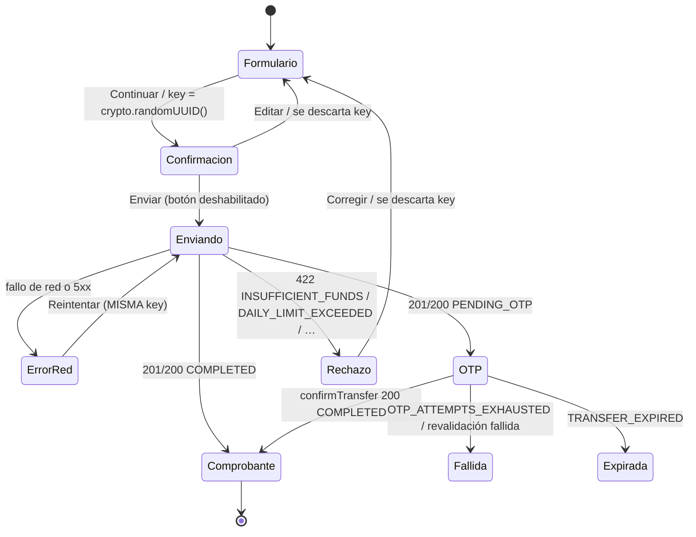
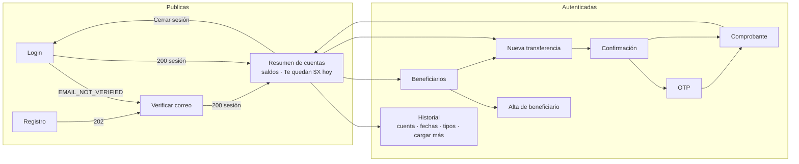
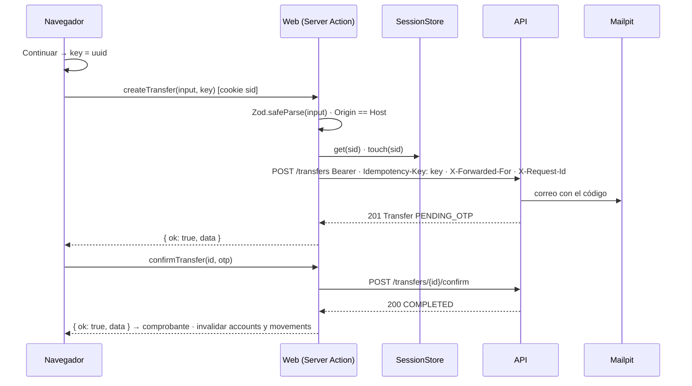

## Context

Ver `proposal.md` para la motivación. Requisitos en `specs/web-app/spec.md` (WEB-01 a WEB-23).

Restricciones que dan forma al diseño:
- `/web` es un proyecto independiente: lockfile y CI propios, sin workspaces. Consume el paquete `@devchrisvaz/wallet-contract` con `"file:../contract"` e `install-links=true` en su `.npmrc` (se instala como si viniera de un registro, sin enlaces simbólicos).
- La API (`contract/openapi.yaml`) es **solo Bearer** y entrega los tokens en el body. Toda la lógica de cookies vive en la web.
- La API confía en `X-Forwarded-For` solo cuando viene del BFF o del ALB (lo implementa `api-foundation`).
- Los montos llegan y se envían como strings decimales; el navegador nunca hace aritmética con ellos.
- La documentación de Next.js 16 confirma tres puntos que definen este diseño: las Server Actions comparan `Origin` con `Host` (y aceptan `serverActions.allowedOrigins` detrás de proxies); no deben usarse para leer datos porque se encolan y ejecutan en secuencia; y los errores esperados deben devolverse como valor, tratando cada acción como un endpoint público.

## Goals / Non-Goals

**Goals:**
- Que ningún token llegue al navegador y que la sesión expire por inactividad.
- Que un doble clic, un reintento o una pérdida de red nunca produzcan dos transferencias.
- Pantallas simples con estados de carga, vacío y error, accesibles con teclado.
- Validación idéntica en el formulario y en el servidor, tomada del contrato.

**Non-Goals:**
- Un sistema de diseño propio: la web usa el del change `design-system` (`@devchrisvaz/wallet-design-tokens`), compartido con la app móvil.
- Renderizado de datos en Server Components: todas las pantallas con datos son componentes cliente.
- Internacionalización: la interfaz es solo en español (es-MX).
- Pruebas end-to-end en navegador: se cubren con Testing Library y pruebas unitarias del BFF.
- Recuperación de contraseña, cierre de todas las sesiones y biometría (fuera de alcance del sistema).

## Decisions

### D1. Next.js (App Router) como BFF dentro de `/web`
Un solo proceso sirve las páginas, las Server Actions y el proxy de lecturas.
- *Alternativa descartada:* Vite (SPA) más un BFF en Express dentro de `/web`. Conserva Vite, pero son dos procesos en desarrollo y un servidor que además sirve los estáticos. Next es la forma idiomática de un BFF y el enunciado lo permite.
- *Alternativa descartada:* refresh token en una cookie `httpOnly` emitida por la API. Obligaba a la API a tener dos modos de entrega de tokens y dejaba el access token en memoria del navegador.

### D2. Sesión guardada en el servidor detrás de un puerto `SessionStore`
```ts
interface SessionData {
  userId: string;
  accessToken: string; accessTokenExpiresAt: string;
  refreshToken: string; refreshTokenExpiresAt: string;
  createdAt: string; lastSeenAt: string;
}
interface SessionStore {
  get(id: string): Promise<SessionData | null>;   // descarta y devuelve null si venció por inactividad
  set(id: string, data: SessionData): Promise<void>;
  touch(id: string, now: Date): Promise<void>;     // renueva el plazo de 15 minutos
  delete(id: string): Promise<void>;
}
```
- Implementación local: `Map` guardado en `globalThis` para sobrevivir a la recarga de módulos en desarrollo; la expiración se evalúa al leer.
- En AWS (documentado en `delivery`): Redis (ElastiCache) con TTL de 15 minutos renovado en cada acceso.
- El id de sesión son 32 bytes aleatorios en base64url. La cookie no lleva `Max-Age` (cookie de sesión del navegador); la expiración real la decide el servidor.
- *Alternativa descartada:* cookie cifrada sin estado con los tokens dentro. Con peticiones concurrentes, cada una rota el refresh y emite su propio `Set-Cookie`; si el navegador se queda con la cookie del token que la ventana de gracia revocó, el siguiente refresh se toma como reuso y la familia entera se revoca.

### D3. Renovación del access token de una sola vez por sesión
El cliente de API del servidor (`server-only`) obtiene el token así:
1. Si el access token vence en menos de 30 segundos, renueva.
2. La renovación se guarda como promesa en un `Map<sessionId, Promise>`; las peticiones concurrentes de la misma sesión esperan esa misma promesa.
3. Si `refreshSession` responde `SESSION_REVOKED`, se borra la sesión y la cookie y el resultado es `UNAUTHENTICATED`.

Con varias instancias en AWS, dos instancias podrían renovar a la vez la misma sesión; la ventana de gracia de 30 segundos de la API absorbe ese caso y la sesión en Redis queda con el último par escrito. Se documenta como riesgo aceptado.
- *Alternativa descartada:* renovar de forma reactiva al recibir un `401`. Duplica llamadas y complica los reintentos de mutaciones no idempotentes.

### D4. Mutaciones con Server Actions; lecturas con un proxy GET
```
app/
  (public)/login · register · verify-email
  (app)/layout.tsx            ← verifica la sesión en el servidor; sin sesión → /login?next=…
  (app)/page.tsx              ← resumen de cuentas
  (app)/accounts/[accountId]/movements
  (app)/beneficiaries · beneficiaries/new
  (app)/transfers/new         ← formulario → confirmación → OTP → comprobante
  (app)/transfers/[transferId]← comprobante / OTP pendiente
  bff/api/[...path]/route.ts  ← proxy GET con lista blanca
  actions/auth.ts · beneficiaries.ts · transfers.ts   ('use server')
lib/server/  session-store.ts · session.ts · api-client.ts · env.ts · request-context.ts   (import 'server-only')
lib/client/  unwrap.ts · problem-messages.ts · query-keys.ts · use-idempotency-key.ts
```
- **Server Actions** (`login`, `register`, `verifyEmail`, `resendVerification`, `logout`, `createBeneficiary`, `createTransfer(input, idempotencyKey)`, `confirmTransfer`, `resendTransferOtp`). Cada acción: `schema.safeParse(input)` con el esquema del paquete de contrato → `requireSession()` (salvo login, registro y verificación) → llamada tipada a la API → `ActionResult`.
- **Proxy GET** `/bff/api/[...path]`: lista blanca de patrones (`session`, `accounts`, `accounts/:id`, `accounts/:id/movements`, `beneficiaries`, `transfers/:id`); reenvía los parámetros de consulta; el host sale de `API_BASE_URL` (variable del servidor validada al arrancar; en local `http://localhost:4000`, porque la web usa el 3000). `bff/api/session` no llama a la API: responde con los datos del usuario guardados en la sesión, o `401`.
- **CSRF:** la protección propia de las Server Actions (Origin contra Host) cubre las mutaciones; `serverActions.allowedOrigins` se llena desde `ALLOWED_ORIGINS`. El proxy solo acepta GET y no tiene efectos, así que no necesita verificación de origen; además la cookie es `SameSite=Strict`.
- **Protección de rutas** en el `layout` del grupo `(app)`, en el servidor. No dependemos del middleware de Next para esto. El parámetro `next` solo acepta rutas relativas que empiecen con `/` y no con `//` (WEB-22).
- *Alternativa descartada:* todo con route handlers. Obliga a escribir la verificación de `Origin` a mano y no comparte el esquema Zod entre formulario y servidor tan directamente.
- *Alternativa descartada:* lecturas con Server Actions. Se ejecutan en secuencia y no aprovechan la caché HTTP ni la de TanStack Query.

### D5. Resultado de las acciones como valor y `unwrap` en el cliente
```ts
type ActionResult<T> = { ok: true; data: T } | { ok: false; problem: Problem };
// cliente
const mutation = useMutation({
  mutationFn: (input: TransferInput) => createTransfer(input, key).then(unwrap),
});
// unwrap: ok → data ; !ok → throw new ProblemError(problem)
```
- Un error inesperado dentro de la acción se captura en un envoltorio común que registra el error con el `requestId` y devuelve `INTERNAL_ERROR` (WEB-08).
- Un fallo de red al invocar la acción llega al cliente como error que no es `ProblemError`; la interfaz lo trata como "no sabemos si se envió" y ofrece **Reintentar con la misma llave** (WEB-17).
- *Alternativa descartada:* `useActionState` con formularios nativos. Da mejora progresiva, pero dificulta controlar el ciclo de vida de la llave de idempotencia y mezcla dos modelos de estado con TanStack Query.

### D6. Ciclo de vida de la llave de idempotencia

La llave vive en el estado del componente del flujo (hook `useIdempotencyKey`), no en almacenamiento persistente; recargar la página inicia un intento nuevo. Las Server Actions se encolan en el cliente, lo que refuerza el bloqueo del botón ante el doble clic (WEB-17, WEB-18).

### D7. Headers hacia la API
`request-context.ts` arma los headers de cada llamada:
- `X-Request-Id`: el de la petición entrante si existe; si no, uno nuevo. Se incluye en los logs de la web y en los problemas devueltos.
- `X-Forwarded-For`: la IP del cliente tomada del `X-Forwarded-For` que agrega el proxy delante de la web (ALB o CloudFront en AWS). En local, sin proxy, se usa la dirección de loopback.
- `Idempotency-Key`: solo en `createTransfer`, exactamente la recibida como argumento. La web no reintenta llamadas a la API por su cuenta.

### D8. Cookie de sesión según el entorno
| Entorno | Nombre | Atributos |
|---|---|---|
| HTTPS (producción, `SESSION_COOKIE_SECURE=true`) | `__Host-sid` | `HttpOnly; Secure; SameSite=Strict; Path=/` |
| `http://localhost` | `sid` | `HttpOnly; SameSite=Strict; Path=/` |

Safari rechaza las cookies `Secure` en `http://localhost`; por eso los atributos dependen de la configuración (WEB-02).

### D9. Mensajes por `code`
`problem-messages.ts` mapea cada `ProblemCode` del contrato a un mensaje en español y usa las extensiones (`attemptsRemaining`, `remaining`, `Retry-After`). El tipo es un `Record<ProblemCode, …>` exhaustivo: si el contrato agrega un código, el typecheck falla hasta que se le asigne mensaje (WEB-19).

### D10. Montos
- Formato: `formatMXN` del paquete de contrato (string → `$1,250.50`), que ya resuelve el formato sin floats.
- Captura: el campo es de texto; al enviar se eliminan los separadores de miles y se valida con el esquema `AmountInput` del contrato. Nunca se usa `Number()` ni `parseFloat` sobre un monto (WEB-21). Una regla de ESLint (`no-restricted-syntax`) prohíbe `parseFloat` y `Number(` en los archivos de montos.

### D11. Datos del servidor con TanStack Query
- Claves: `['accounts']`, `['account', id]`, `['movements', id, filtros]` (consulta infinita con `nextCursor`), `['beneficiaries']`, `['transfer', id]`.
- Tras `COMPLETED` se invalidan `accounts` y `movements`; tras crear un beneficiario se invalida `beneficiaries`.
- Una lectura con `401` lleva a `/login?next=…`; un `INVALID_CURSOR` reinicia la consulta infinita (WEB-14).
- No se reintentan automáticamente las mutaciones (`retry: 0`); el reintento de una transferencia es explícito y con la misma llave.

### D12. Formularios y estilos
- `react-hook-form` con el resolver de Zod usando los esquemas del contrato; la misma validación corre en la Server Action (WEB-07).
- Tailwind CSS v4 con los tokens del sistema de diseño: `@import "tailwindcss";` seguido de `@import "@devchrisvaz/wallet-design-tokens/tailwind.css";`, que define las variables `--dt-*` y quita la paleta por defecto de Tailwind (solo existen utilidades como `bg-surface`, `text-fg`, `bg-action`, `rounded-pill`). Work Sans con `next/font/google` (400, 500, 600). Las pantallas se construyen con los componentes del inventario de `design-system` (D7 de ese change) en `components/ui`, y los mensajes de error salen de `problemMessage` del mismo paquete. *Alternativa descartada:* CSS Modules; Tailwind es más rápido para pantallas simples.

### D13. Mapa de pantallas

Cada pantalla con datos tiene tres estados además del normal: **carga** (esqueleto), **vacío** (mensaje y acción sugerida) y **error** (mensaje y "Reintentar") (WEB-20).

### D14. Transferencia con OTP de punta a punta


### D15. Estrategia de pruebas
| Nivel | Herramienta | Qué cubre |
|---|---|---|
| Componentes | Vitest + Testing Library + jsdom; `vi.mock` del módulo de acciones | Flujo de transferencia completo (formulario → confirmación → comprobante), **saldo insuficiente**, doble clic, reintento con la misma llave, OTP incorrecto e intentos agotados, historial con "cargar más", estados vacío y error |
| BFF | Vitest en entorno Node; `fetch` de la API simulado | Bearer adjunto, lista blanca y métodos del proxy, host fijo, refresh único con tres peticiones concurrentes, expiración por inactividad con reloj falso, atributos de cookie por entorno, validación y `requireSession` en acciones, paso del problema y saneamiento de `INTERNAL_ERROR`, headers reenviados |
| Accesibilidad | `vitest-axe` sobre formularios clave | Etiquetas y roles. El contraste no se puede medir en jsdom: se verifica en el navegador con Lighthouse y se documenta en el README |
| Origen de las mutaciones | Prueba de configuración + verificación manual documentada | `allowedOrigins` sale de `ALLOWED_ORIGINS`; la comparación Origin/Host es comportamiento del framework |

Los títulos de las pruebas empiezan con el ID del requisito (por ejemplo `WEB-17 envía una sola transferencia con doble clic`).

### D16. CI
`.github/workflows/web.yml`, disparado por cambios en `web/**`, `contract/**` o el propio workflow: checkout → compilar `/contract` → `npm ci` en `/web` → lint → typecheck → pruebas → `next build`.

### D17. Textos de error: base del paquete de diseño más los datos variables
Varios escenarios de la spec (escrita antes del change `design-system`) citan textos literales que no coinciden con los de `problemMessage` (DSG-12), que la tarea 5.1 y D12 fijan como fuente: por ejemplo "Email o contraseña incorrectos" frente a "El correo o la contraseña no coinciden.", o "Algo salió mal…" frente a "Algo falló de nuestro lado…". La web resuelve el conflicto de la forma más conservadora con ambos changes:
- El texto base de cada `code` es siempre el de `problemMessage`, para que web y móvil hablen igual (DSG-12). Un `code` desconocido usa el de `INTERNAL_ERROR`.
- La web agrega, con la redacción de la spec, los datos variables que pide cada escenario: "Te quedan 2 intentos." / "Te queda 1 intento." (WEB-11, WEB-18), "Intenta de nuevo en 5 minutos." (WEB-12, desde `Retry-After`), "Hoy puedes enviar hasta $2,000.00." (WEB-19, desde `remaining`) y "Si contactas a soporte, menciona el código 01JABC." (WEB-19, desde `requestId`).
- Donde la spec pide un título además del mensaje, se usa como título de la alerta: "Saldo insuficiente" con el saldo disponible (WEB-16), "Superaste tu límite diario" (WEB-18) y "Tu sesión expiró" (WEB-03).
- Los mensajes de validación de campos son los del contrato (por ejemplo, "El monto admite máximo 2 decimales" en lugar de "Máximo 2 decimales", WEB-21).

Las pruebas comprueban el texto del paquete más el dato variable, no el literal de la spec. *Alternativa descartada:* sobrescribir en la web los textos del paquete con los literales de la spec; web y móvil mostrarían mensajes distintos para el mismo error.

### D18. `Retry-After` fuera del `ProblemError` del contrato
`ProblemError` conserva `code`, `requestId` y las extensiones del cuerpo, pero no los headers, y el cliente del contrato lanza el error dentro de su middleware, así que `Retry-After` (WEB-12) se perdía. El cliente del servidor de la web agrega un middleware que convierte la respuesta de error con `toProblemError` y adjunta `Retry-After` antes que el del contrato (openapi-fetch ejecuta `onResponse` en orden inverso); la Server Action lo devuelve como `retryAfter` en el problema. Es un hueco menor del contrato: conviene que `ProblemError` exponga `retryAfter` en una versión menor.

## Risks / Trade-offs

- [La sesión en memoria se pierde al reiniciar el servidor de desarrollo] → Aceptado en local; en AWS se usa Redis.
- [Con varias instancias, dos podrían renovar la misma sesión a la vez] → La ventana de gracia de 30 s de la API lo absorbe; un lock en Redis (`SET NX PX`) queda en "qué haría con más tiempo".
- [Obtener la IP real del cliente depende del proxy delante de la web] → En AWS el ALB agrega `X-Forwarded-For`; en local se usa loopback y el rate limiting por IP de la API trata a todos los usuarios locales como uno.
- [La protección de origen de las Server Actions es del framework y difícil de probar en unitarias] → Se prueba la configuración y se documenta una verificación manual con un `Origin` falso.
- [El contraste no se puede verificar en jsdom] → Verificación con Lighthouse documentada; paleta elegida con contraste ≥ 4.5:1.
- [La cookie sin `Max-Age` se pierde al cerrar el navegador] → Es deseable en una app financiera; el usuario vuelve a iniciar sesión.
- [Cambios en `/contract` requieren `npm install` en `/web` por `install-links`] → Documentado en el README del proyecto.
