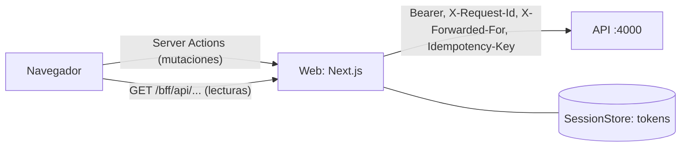

# TreoWallet · web

Panel web de TreoWallet: Next.js (App Router) como BFF (_Backend for Frontend_) de la API. El navegador nunca recibe los tokens: la sesión vive en el servidor de la web y el navegador solo tiene una cookie con un id opaco.

- Especificación: `openspec/changes/web-app/` (capability `web-app`, requisitos WEB-01 a WEB-23), `openspec/changes/account-statements/` (WEB-32, descarga del estado de cuenta), `openspec/changes/scheduled-transfers/` (WEB-33 y WEB-34, transferencias programadas; decisión D11) y `openspec/changes/redesign/` (rediseño: layout responsivo, navegación, Inicio, Movimientos, flujo por pasos y pantallas de marca, WEB-24 a WEB-31). Decisiones y alternativas en su `design.md`.
- Consume `@devchrisvaz/wallet-contract` (cliente tipado, validadores Zod, `formatMXN`) y `@devchrisvaz/wallet-design-tokens` (tokens para Tailwind v4, iconos por concepto, destinos de la navegación, agrupación por día, estados, movimientos y textos de error).

## Cómo funciona



- **Mutaciones** con Server Actions (`app/actions/`): validan con los esquemas del contrato, exigen la sesión y devuelven `{ ok, data }` o `{ ok: false, problem }`. Next.js rechaza las que llegan de otro `Origin`.
- **Lecturas** por el proxy `GET /bff/api/[...path]`, con lista blanca de rutas y destino fijo en `API_BASE_URL`. `GET /bff/api/session` responde con el usuario de la sesión sin llamar a la API.
- **Estado de cuenta** (WEB-32): en la pantalla de movimientos, un selector con el mes en curso ("(en curso)") y los 12 anteriores, con el mes anterior por defecto, y el botón "Descargar PDF". La descarga pasa por el mismo proxy (`accounts/<id>/statements/<AAAA-MM>`, solo GET): para esa ruta el proxy pide `application/pdf`, entrega el cuerpo de la API sin tocar sus bytes y copia `Content-Type`, `Content-Disposition`, `Content-Length` y `Retry-After`. El navegador guarda el archivo con el nombre que propone la API (`estado-de-cuenta-2026-09-0015.pdf`). Mientras descarga, el botón queda ocupado y no acepta otro clic; un error muestra el mensaje de su `code` sin salir de la pantalla (en `RATE_LIMITED`, con la espera). El control es un componente aparte (`components/accounts/StatementDownload.tsx`); el rediseño lo pone en su propia tarjeta, "Estado de cuenta", después del historial.
- **Sesión** en un `Map` en memoria (en AWS, Redis): expira tras `SESSION_IDLE_MINUTES` sin actividad o al vencer el refresh token; el access token se renueva una sola vez por sesión aunque lleguen peticiones simultáneas.
- **Transferencias**: la llave de idempotencia se genera en el navegador al pasar a la confirmación y se reutiliza solo al reintentar tras un fallo de red o un `5xx`; el botón se bloquea desde el primer clic.
- **Transferencias programadas** (WEB-33): el paso de monto del flujo tiene "Cuándo", con "Ahora" (por defecto) o "Programar". "Programar" muestra una fecha limitada al rango de `schedulableRange` del contrato: de mañana a 90 días, en días de la Ciudad de México. El formulario valida con `transferFormAt(ahora)`, así que hoy y las fechas fuera de rango se marcan junto al campo.
  - **Revisión:** la fila "Cuándo" dice "Se enviará el 20 de octubre de 2026"; en el dashboard, también el resumen lateral.
  - **Envío:** la petición lleva `scheduledFor` con la misma llave por intento.
  - **Resultado:** si queda `SCHEDULED` (directo o después del código, arriba de $10,000.00), el título del paso (y el del detalle) es "Transferencia programada", con la fecha y un enlace a "Programadas". El comprobante muestra "Programada para" con la fecha.
  - **Errores:** `SCHEDULED_LIMIT_REACHED` muestra el texto del paquete de diseño. Un `VALIDATION_FAILED` de la API en un campo (`DATE_OUT_OF_RANGE` en `/scheduledFor`, `TOO_LARGE` en `/amount`) regresa al paso de monto con el mensaje junto al campo y el foco en él; el siguiente envío usa una llave nueva.
  - **Fechas en palabras:** se escriben con `Intl.DateTimeFormat('es-MX', { dateStyle: 'long', timeZone: 'UTC' })` sobre la fecha calendario (`lib/scheduled-date.ts`), para que el huso del navegador no las recorra un día.
  - **Rango en la Server Action:** `createTransfer` valida el formato y el calendario de la fecha, no el rango. El rango lo decide la API después de reclamar la llave, para que un reintento después de medianoche reciba la transferencia que ya existe en lugar de `DATE_OUT_OF_RANGE`.
- **Página "Programadas"** (WEB-34): `/transfers/scheduled` lista `listScheduledTransfers` por el proxy (`transfers/scheduled`, solo GET), en el orden de la API.
  - **Cómo se llega:** en el dashboard, "Programadas" está en la navegación lateral, después de "Transferir", con su propio icono: el concepto `scheduled` (CalendarClock) del paquete de diseño 1.3.0. Entra por `DEFAULT_NAV_ITEMS` con `sideOnly`. En teléfono la barra de pestañas sigue con sus cuatro destinos: se llega con "Transferencias programadas", al pie del primer paso del flujo de transferencia. El h1 "Transferencias programadas" y, en el dashboard, la acción "Nueva transferencia" son de AppShell (`appSection`).
  - **Contenido:** cada programada muestra su fecha, el destino con los últimos 4 dígitos de la CLABE, el monto y el concepto. Sin programadas, la página dice "No tienes transferencias programadas".
  - **Cancelar:** abre un diálogo modal con el monto, el destino y la fecha. El foco empieza en "Volver" y Tab no sale del diálogo. Escape o "Volver" lo cierran sin llamar a la API y devuelven el foco al botón "Cancelar".
  - **Confirmar:** llama una sola vez a la Server Action `cancelTransfer` (`app/actions/scheduled-transfers.ts`). Si funciona, la transferencia sale de la lista, se anuncia "Transferencia cancelada" en una región `aria-live` y el foco pasa al h1 visible de la página (el de AppShell: AppHeader en teléfono, TopBar en el dashboard).
  - **Ya no se puede cancelar:** un `409 TRANSFER_NOT_CANCELLABLE` (por ejemplo, porque el ejecutor ya la tomó) muestra "Esta transferencia ya no se puede cancelar." y vuelve a cargar la lista. Otros errores se muestran en el diálogo, donde confirmar otra vez es un reintento seguro, porque cancelar es idempotente.
- **Piezas aparte:** como el control del estado de cuenta, lo programado vive en componentes propios: `components/transfers/ScheduleField.tsx` (el control "Cuándo", la línea de la revisión y la nota del resultado) y `components/transfers/ScheduledTransfersScreen.tsx` (lista y diálogo, con la forma de la hoja inferior del kit). Los pasos del flujo rediseñado solo los conectan.
- **Interfaz**: componentes cliente con TanStack Query; formularios con react-hook-form y los validadores del contrato; estilos solo con las utilidades de los tokens (la paleta por defecto de Tailwind no existe); mensajes de error de `problemMessage` del paquete de diseño.
  - **Dos formas** (WEB-24): por debajo de 1024 px, la **forma de app**, igual que la app móvil: barra de pestañas abajo (Inicio, Movimientos, Transferir y Beneficiarios) y, en Inicio, el saludo "Hola, Ana" con el avatar que abre el menú de la cuenta con "Cerrar sesión". Entre 480 y 1023 px se centra en una columna de 480 px. Desde 1024 px, el **dashboard**: navegación lateral (con "Programadas" y, abajo, la persona con "Cerrar sesión"), barra superior con el título de la página y la acción principal ("Nueva transferencia" o, en Beneficiarios, "Agregar beneficiario"), y contenido de hasta 1200 px.
  - **Estructura:** `components/layout/AppFrame.tsx` monta `AppShell` en las rutas con sesión y le da el destino, el título y la forma de cada ruta (`appSection` en `lib/navigation.ts`). Las páginas públicas (login, registro y verificación) van sobre `BrandShell`, la superficie verde de la marca. Cada página expone un solo `h1`: el del encabezado de la app en teléfono, el de la barra superior en el dashboard o el del paso en el flujo.
  - **Enlaces internos:** los del kit (pestañas, navegación lateral, acciones rápidas) pasan por `next/link` con `components/ui/RouterLink.tsx`, que AppFrame conecta; así se navega sin recargar y sin perder la caché. Sin ese proveedor (lienzos y pruebas del kit) son `<a>` normales.
  - **Inicio y Movimientos:** Inicio muestra el saldo total en el _hero_ con lo que queda del límite del día, las tarjetas de cuenta como selector y los últimos 5 movimientos de la elegida, con "Ver todos". La cuenta elegida se comparte con Movimientos (`lib/client/account-selection.tsx`): la pestaña `/movements` abre esa cuenta. Movimientos agrupa por día de la Ciudad de México y abre los filtros en una hoja inferior (en el dashboard, un panel centrado).
  - **Work Sans:** `next/font/local` con `app/fonts/WorkSans-latin.woff2` (la variable de pesos de Google Fonts, subconjunto latino; licencia OFL en `app/fonts/OFL.txt`). Es el mismo archivo que carga el lienzo de design-sync, porque Google Fonts entrega otra compilación de la fuente a cada navegador, con otros anchos de letra; `app/fonts.test.ts` lo comprueba.
  - **Transferencia por pasos** (WEB-30): Destinatario (cuentas propias y beneficiarios) → Monto → Revisión → Código (si aplica) → Comprobante, con "Paso n de m" y las acciones fijas abajo en teléfono. En el dashboard el paso va en un panel con el resumen al lado, que sigue lo que se escribe. El flujo oculta la barra de pestañas.

| Carpeta              | Contenido                                                                                                                         |
| -------------------- | --------------------------------------------------------------------------------------------------------------------------------- |
| `app/`               | Rutas: `(public)` (login, registro, verificación), `(app)` (protegidas en el layout), `bff/` y `actions/`                         |
| `components/`        | `ui/` (inventario del sistema de diseño), pantallas por dominio, estados de carga y error                                         |
| `components/layout/` | `AppFrame` y `AppShell` (las dos formas, con navegación y título), `BrandShell` (páginas públicas), `SkipLink` y el foco del `h1` |
| `lib/server/`        | Solo servidor (`server-only`): entorno, sesión, cookie, contexto de petición, cliente de API, acciones y proxy                    |
| `lib/client/`        | Lecturas, TanStack Query, mensajes por `code`, `unwrap`, flujo de transferencia y llave de idempotencia                           |
| `test/`              | Datos de ejemplo del contrato, API simulada con `fetch`, sustitutos de `next/headers` y `next/navigation`                         |

## Requisitos

- Node 24 para las herramientas (el servidor funciona desde Node 20.9).
- `/contract` y `/design-tokens` compilados (la web los instala como copia).
- Para usar la web: la API en `http://localhost:4000`, con PostgreSQL y Mailpit de su `docker compose` (ver el README de `/api`).

## Instalación

```bash
(cd ../contract && npm ci && npm run build)
(cd ../design-tokens && npm ci && npm run build)
npm ci
```

**`install-links`.** `.npmrc` tiene `install-links=true`: npm instala `file:../contract` y `file:../design-tokens` como copia de lo que cada paquete publica (su `dist`), con sus dependencias, igual que si vinieran de un registro. Por eso hay que compilarlos antes, y **un cambio en `/contract` o en `/design-tokens` no llega solo**: vuelve a compilar el paquete y corre `npm install` aquí. Sin `install-links`, npm crearía un enlace simbólico y no instalaría las dependencias del paquete.

## Variables de entorno

Todas son del servidor (ninguna lleva `NEXT_PUBLIC_`) y se validan con Zod al arrancar: una inválida detiene `next dev` o `next start` con un error que la nombra. Copia `.env.example` a `.env.local`.

| Variable                | Por defecto                                                            | Uso                                                                                                                                                                     |
| ----------------------- | ---------------------------------------------------------------------- | ----------------------------------------------------------------------------------------------------------------------------------------------------------------------- |
| `API_BASE_URL`          | `http://localhost:4000` en desarrollo; **obligatoria** en `next start` | Origen de la API, sin ruta. El destino de todas las llamadas; nunca se toma de la petición                                                                              |
| `ALLOWED_ORIGINS`       | vacío (solo el propio origen)                                          | Orígenes adicionales, separados por comas, desde los que se aceptan Server Actions (la web detrás de un proxy con otro dominio). Se aplica al arrancar                  |
| `SESSION_COOKIE_SECURE` | `true` en producción, `false` en desarrollo                            | `true` detrás de HTTPS: la cookie se llama `__Host-sid` y lleva `Secure`. Safari rechaza cookies `Secure` en `http://localhost`, por eso en local es `sid` sin `Secure` |
| `SESSION_IDLE_MINUTES`  | `15`                                                                   | Minutos de inactividad tras los que expira la sesión                                                                                                                    |

El build (`next build`) no necesita `API_BASE_URL`: el servidor la lee en cada petición.

## Correr en local

1. Levanta la API en el puerto 4000 con su base de datos y Mailpit.
2. `npm run dev` y abre `http://localhost:3000`. Si el puerto 3000 está ocupado: `npm run dev -- -p 3100`.
3. Regístrate en `/register`; el código de verificación llega a Mailpit (`http://localhost:8025`). Al verificar el correo se abren las cuentas Principal y Ahorro en $0.00; para tener saldo, usa el fondeo de la API (`db:fund`).
4. Las transferencias de más de $10,000.00 piden un código que también llega a Mailpit.
5. Para programar una transferencia, elige "Programar" en "Cuándo" y una fecha. Aparece en "Programadas" hasta que se ejecuta o la cancelas. Para verla ejecutarse sin esperar a la medianoche, sigue "Verlas ejecutarse en local" del README de `/api`, que adelanta su fecha en la base. Al ejecutarse, sale de "Programadas" y aparece en el historial; si falla, el aviso llega a Mailpit.

Para probar el build de producción por `http` en local: `npm run build` y luego `API_BASE_URL=http://localhost:4000 SESSION_COOKIE_SECURE=false npm start`.

La sesión vive en la memoria del proceso: reiniciar el servidor cierra todas las sesiones.

## Scripts

| Script                            | Qué hace                                                                                       |
| --------------------------------- | ---------------------------------------------------------------------------------------------- |
| `npm run dev`                     | Servidor de desarrollo                                                                         |
| `npm run build` / `npm start`     | Build de producción y servidor                                                                 |
| `npm test`                        | Pruebas con Vitest (`npm run test:watch` en modo observación)                                  |
| `npm run test:e2e`                | Pruebas en navegador con Playwright, contra una API simulada (ver "Pruebas en navegador")      |
| `npm run typecheck`               | `next typegen` y `tsc --noEmit`                                                                |
| `npm run lint`                    | ESLint, sin advertencias permitidas; incluye la regla que prohíbe `parseFloat` y `Number(...)` |
| `npm run format` / `format:check` | Prettier                                                                                       |

## Pruebas

```bash
npm test
```

Ninguna prueba necesita la API: el BFF se prueba con `fetch` simulado (`test/support/fake-api.ts`) y sustitutos de `next/headers`, y las pantallas con el módulo de acciones y las lecturas simulados. Hay dos proyectos de Vitest: `*.test.ts` corre en Node (BFF, configuración y lógica) y `*.test.tsx` en jsdom con Testing Library y `vitest-axe`. El título de cada prueba empieza con el ID del requisito que verifica (`WEB-17 …`, `DSG-09 …`).

El contraste no se puede medir en jsdom; se verificó con Lighthouse (ver abajo) y, desde el rediseño, lo mide axe en las pruebas en navegador.

Las pruebas de transferencias programadas usan un reloj fijo, el 14 de octubre de 2026 a mediodía de la Ciudad de México, con `vi.useFakeTimers({ toFake: ['Date'] })`. Solo se falsea `Date`, así que user-event sigue funcionando. La fecha en palabras se prueba además con `TZ` en husos al oeste y al este de UTC.

Un doble clic con `user.dblClick` no basta para probar el candado del envío. user-event envuelve cada evento en `act`, así que React deshabilita el botón entre los dos clics. Por eso las pruebas del candado ("Enviar" al programar y "Cancelar transferencia") hacen los dos clics dentro de un mismo `act`.

La pantalla de programadas no usa `<dialog>` nativo porque jsdom no implementa `showModal()`. En su lugar, el diálogo sigue el patrón modal de WAI-ARIA, con `role="dialog"`, `aria-modal`, foco atrapado y Escape, y así se puede probar con el teclado en jsdom.

### Pruebas en navegador

```bash
npm run test:e2e
```

Lo que jsdom no puede medir (layout, `display: none`, el CSS real) se prueba en Chromium con Playwright 1.61.1 (`e2e/`, `playwright.config.ts`). La configuración levanta dos servidores y los detiene al terminar: `e2e/fake-api.mjs` en `127.0.0.1:4999`, una API simulada con los datos canónicos de las historias del rediseño y las formas del contrato, y `next dev` en `127.0.0.1:3101` apuntando a ella. No usa la API real, PostgreSQL ni los puertos 3000 y 4000. Si falta el navegador, la primera vez corre `npx playwright install chromium`. `next dev` usa Turbopack, que necesita observadores de archivos (inotify): si se detiene con "OS file watch limit reached", libera observadores (otros editores o servidores que vigilan carpetas) o sube `fs.inotify.max_user_watches`.

- **Layout** (`layout.spec.ts`, `scrollbars.spec.ts`): sin desplazamiento horizontal de 320 a 1920 px, también con barras de desplazamiento clásicas; un solo `h1` visible, un solo `main` y un solo "Saltar al contenido" por pantalla; las dos formas; el texto al 200 %; el pie fijo de los pasos y la barra de pestañas a 20 px de lo último, como en la app móvil.
- **Teclado** (`keyboard.spec.ts`): la transferencia hasta el comprobante solo con el teclado, a 390 y a 1280 px.
- **Hojas y diálogos** (`overlays.spec.ts`): foco atrapado, Escape, foco de regreso y la página de fondo sin desplazarse.
- **Accesibilidad** (`a11y.spec.ts`): axe con el CSS real (incluido el contraste) en cada pantalla, en los pasos del flujo y con las hojas abiertas.
- **Programadas** (`scheduled.spec.ts`): programar, cancelar y el `409` de una que ya no se puede cancelar.

## Avisos conocidos

- `npm audit` reporta vulnerabilidades altas de `braces` que llegan por `eslint-config-next` (`fast-glob` → `micromatch`). Solo afectan a herramientas de desarrollo: `npm audit --omit=dev` está limpio. La corrección que propone npm baja `eslint-config-next` a la versión 14.
- ESLint queda en la versión 9 porque los plugins de `eslint-config-next` 16.4 (react, import, jsx-a11y) declaran ESLint ≤ 9.
- `vitest-axe` está en `1.0.0-pre.5`, la versión con tipos para Vitest ≥ 1; la estable (0.1.0) es de 2022.
- En desarrollo, Next.js registra los argumentos de las Server Actions; está desactivado (`logging.serverFunctions: false`) para que contraseñas y códigos no lleguen a los logs.

## Verificaciones manuales

Lo que las pruebas automáticas no pueden comprobar en jsdom se verificó en un navegador real (Chrome, con el MCP de Chrome DevTools) el 13 de octubre de 2026.

**Entorno.** Build de producción (`npm run build` y `next start -p 3100`, sin el overlay de desarrollo de Next.js, que captura el foco en `next dev`) con `SESSION_COOKIE_SECURE=false`. La primera vez la API real no estaba disponible: se usó una API simulada en el puerto 4100 con las rutas, los cuerpos y los códigos de `contract/openapi.yaml` (no se versiona). Las dos verificaciones de accesibilidad se repitieron después con la API real (ver "Repetición con la API real"); la de origen no depende de la API.

### Transferencia solo con teclado (WEB-23)

Desde el rediseño, este recorrido está automatizado en `e2e/keyboard.spec.ts` (`npm run test:e2e`), a 390 y a 1280 px, sobre el flujo por pasos. El guion manual de abajo es el de la primera verificación, con el formulario anterior al rediseño, y sirve para repetirlo con la API real.

Con Tab, Shift+Tab, Enter, Espacio y las flechas, sin ratón:

| Paso                                                                                                                                               | Resultado                                                                                                                        |
| -------------------------------------------------------------------------------------------------------------------------------------------------- | -------------------------------------------------------------------------------------------------------------------------------- |
| Abrir `/transfers/new` sin sesión                                                                                                                  | Redirige a `/login?next=%2Ftransfers%2Fnew`                                                                                      |
| Tab desde el inicio de la página                                                                                                                   | El primer foco es "Saltar al contenido", visible, con el anillo de 2 px `#1C4B42` y 2 px de separación; Enter lleva al contenido |
| Correo, Tab, contraseña, Enter                                                                                                                     | Inicia sesión y vuelve a `/transfers/new`                                                                                        |
| Cuenta de origen (flecha abajo), Tab al destino "Un beneficiario", Tab al beneficiario (flecha abajo), monto `15,000`, concepto, referencia, Enter | Pasa a la confirmación; el foco queda en "Confirma la transferencia" y el resumen muestra $15,000.00                             |
| Tab a "Enviar", Espacio                                                                                                                            | Pasa al código; el foco queda en "Ingresa el código", con el destino enmascarado y la hora de expiración                         |
| Código incorrecto, Enter                                                                                                                           | La alerta "El código no es correcto. Te quedan 2 intentos." recibe el foco                                                       |
| Tab al código, código correcto, Enter                                                                                                              | Comprobante "Completada"; el foco queda en "Transferencia enviada"                                                               |
| Volver al resumen                                                                                                                                  | Saldo de Principal en $10,000.00 y "Te quedan $23,000.00 hoy": las cuentas se volvieron a consultar                              |

En todos los pasos el foco fue visible. Observaciones:

- Tras una navegación del lado del cliente el foco queda en el documento: el siguiente Tab va al primer enlace de la navegación y Shift+Tab llega a "Saltar al contenido".
- Durante la verificación la sesión superó los 15 minutos de inactividad: al pulsar "Enviar", la web llevó a `/login?next=%2Ftransfers%2Fnew&reason=expired` con "Tu sesión expiró" y la API no recibió la creación (WEB-03). Con la cookie de una sesión que ya no existía, el layout pasó por `/bff/session/expired`, que borró la cookie.
- La cookie `sid` no es visible para JavaScript (`document.cookie` vacío) y ni el HTML ni el almacenamiento del navegador contienen tokens (WEB-01).

### Contraste y accesibilidad con Lighthouse (WEB-23)

Categoría de accesibilidad de Lighthouse, que incluye `color-contrast`. En modo _snapshot_ la auditoría se hizo después de cargar los datos o de enviar el formulario vacío, con los errores a la vista.

| Pantalla                                            | Modo                            | Dispositivo | Accesibilidad |
| --------------------------------------------------- | ------------------------------- | ----------- | ------------- |
| `/login?reason=expired`                             | navegación                      | móvil       | 100           |
| `/register` con errores en los seis campos          | snapshot                        | móvil       | 100           |
| `/` (resumen)                                       | navegación y snapshot con datos | escritorio  | 100           |
| `/transfers/new` con errores en cinco campos        | snapshot                        | escritorio  | 100           |
| `/beneficiaries/new` con errores en los tres campos | snapshot                        | escritorio  | 100           |
| `/accounts/{id}/movements` con 20 movimientos       | snapshot                        | móvil       | 100           |

`color-contrast` pasó en todas, sin auditorías fallidas.

### Repetición con la API real

El mismo día, con la API real (puerto 4000, PostgreSQL y Mailpit) y el build de producción de la web en `127.0.0.1:3100`:

- **Solo con teclado:** inicio de sesión y transferencia de $5.00 de Principal a Ahorro hasta el comprobante, sin ratón. Con Tab real, "Continuar" muestra el anillo de 2 px `#1C4B42` con 2 px de separación. El anillo aparece con una transición de 150 ms (`transition-colors` también anima `outline-color`), así que una captura tomada justo al enfocar puede no mostrarlo.
- **Lighthouse (accesibilidad):** 100, sin auditorías fallidas, en `/login`, `/`, `/accounts/{id}/movements`, `/beneficiaries` y `/transfers/new`.

### Prueba de extremo a extremo contra la API real

Se recorrieron en el navegador todas las funciones con los usuarios del seed:

- inicio y cierre de sesión, y rutas protegidas;
- historial con filtros y paginación;
- beneficiarios con sus cuatro rechazos;
- transferencias propias y a terceros, con el doble clic y el reintento tras perder la respuesta (una sola transferencia, misma llave);
- OTP: umbral, código incorrecto, reenvíos con su tope, vencimiento y agotamiento de intentos;
- límite diario;
- registro con verificación por correo, y registro con un correo existente (mismo mensaje, aviso al dueño);
- acceso a datos ajenos por URL;
- límite de intentos de inicio de sesión.

Las cifras se verificaron contra la base de datos. Encontró un error: con "Desde" posterior a "Hasta", el historial mostraba "Revisa los campos marcados." sin marcar ningún campo. Se corrigió (tarea 6.3 de `web-app`) y se comprobó en el navegador.

### Mutación con un `Origin` ajeno (WEB-06)

La protección de origen de las Server Actions es del framework (compara `Origin` con `Host` y acepta los hosts de `serverActions.allowedOrigins`); las pruebas solo cubren la configuración. Se verificó a mano con `curl` contra `next start`, invocando la acción `createBeneficiary` con el header `Next-Action` y la cookie de una sesión válida, y contando en el registro de la API simulada las llamadas a `POST /beneficiaries`:

```sh
curl -X POST http://localhost:3100/beneficiaries/new \
  -H 'Origin: https://evil.example.com' -H 'Next-Action: <id de createBeneficiary>' \
  -H 'Content-Type: text/plain;charset=UTF-8' -H 'Cookie: sid=<id de sesión>' \
  --data '[{"name":"Mario Soto","alias":"Mario","clabe":"032180000118359780"}]'
```

El id de la acción está en `.next/server/server-reference-manifest.json` tras el build.

| `Origin`                            | `ALLOWED_ORIGINS`            | Respuesta                                                                                                                           | Llamadas a la API |
| ----------------------------------- | ---------------------------- | ----------------------------------------------------------------------------------------------------------------------------------- | ----------------- |
| `https://evil.example.com`          | vacío                        | `500`; el servidor registra "`x-forwarded-host` … does not match `origin` … Aborting the action" e "Invalid Server Actions request" | 0                 |
| `http://localhost:3100` (el propio) | vacío                        | `200` con el beneficiario                                                                                                           | 1                 |
| `https://wallet.example.com`        | `https://wallet.example.com` | `200` con el beneficiario                                                                                                           | 1                 |
| `https://evil.example.com`          | `https://wallet.example.com` | `500`, acción abortada                                                                                                              | 0                 |

`ALLOWED_ORIGINS` se aplica al arrancar `next start`, sin volver a compilar. La respuesta del rechazo no incluye detalles, solo un `digest`.
